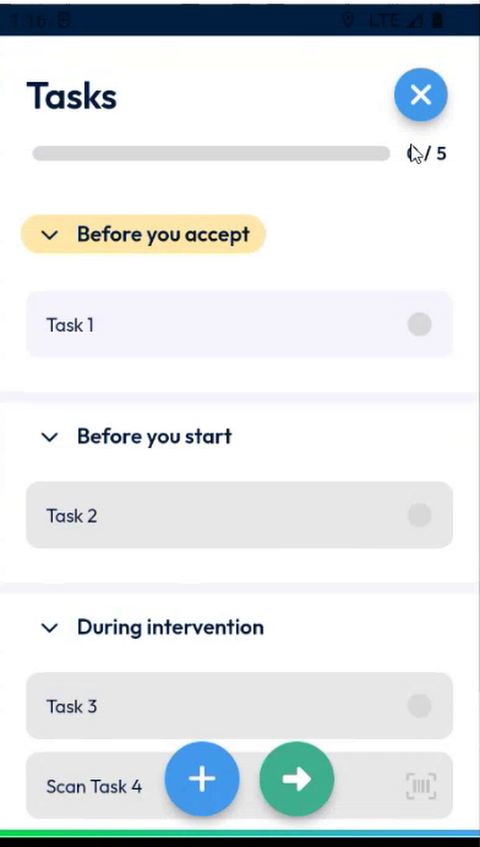
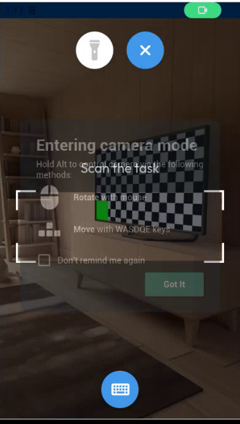
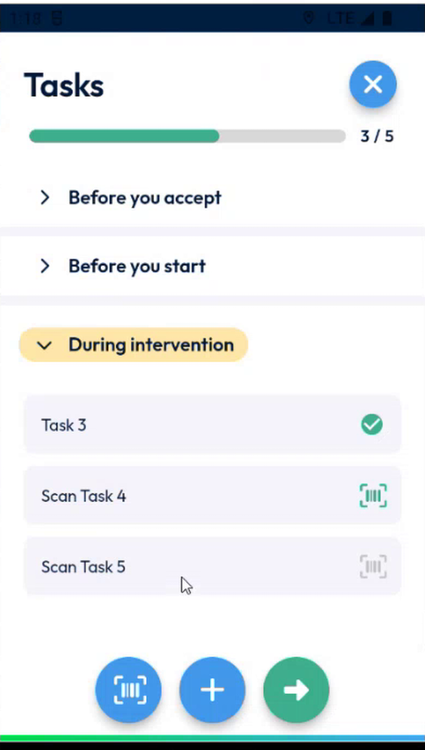

# Scan a Task Code

## Overview

An intervention can have a list of tasks to complete at certain stages: before you accept, before you start, and during the intervention. You complete a task in one of three ways: you tap it, you read its NFC tag, or you scan its barcode or QR code.

A scan task normally has its code defined in the back office. A task can now have **no code yet**: the first scan records the code, and sends it to the back office.

## Before you begin

* You have opened the intervention. See [Start an Intervention](start-an-intervention.md).
* The app is allowed to use the camera of your device.
* The tasks are set up in the back office. See [Scan Task Setup](../configuration/scan-task-setup.md).

## Open the tasks

1. On the **Intervention** page, tap **Tasks**.
2. The **Tasks** page lists the tasks in three groups: **Before you accept**, **Before you start** and **During intervention**. A bar shows how many tasks are done, for example **3 / 5**.

<figure><figcaption>
Tasks page
</figcaption></figure>

A task with a scan icon at the right is a scan task.

## Complete a normal task

1. Open the group that contains the task, for example **During intervention**.
2. Tap the task. A green check mark appears.

## Complete a scan task

1. Tap the scan task, for example **Scan Task 4**.
2. The camera opens with the message **Scan the code**.
3. Point the camera at the barcode or QR code, inside the corners of the frame.

<figure><figcaption>
Scan the code
</figcaption></figure>

4. When the code matches the code of the task, the task is done and the counter goes up.

<figure><figcaption>
Tasks done
</figcaption></figure>

## Record the code of a task by scanning it

When the code of a task is not known, the task has no code yet.

1. Tap the task, for example **Scan Task 5**.
2. Scan any barcode or QR code.
3. The task is done, and the code that you scanned is saved with the task.

In NFS, the code appears in the field of the task, with the date and time when you completed it. Refresh the appointment to see it.


The app does not check the content of the code. It records exactly what it reads. The team is looking at basic checks, such as a maximum length, but the right rule depends on your company.


<!-- REVIEW: confirm how the camera message and the complete step behave when the scanned code does not match the code of a task that already has one. The demo shows only matching codes and the empty task. Confirm whether the checks on the scanned value will be added. -->

## Related topics

* [Edit, Reset or Delete a Task](edit-reset-or-delete-a-task.md)
* [Keep the Task Comment When You Scan by Hand](task-comment-and-manual-scan.md)
* [Start an Intervention](start-an-intervention.md)
* [Scan or Enter a Serial Number](scan-a-serial-number.md)
* [Scan Task Setup](../configuration/scan-task-setup.md)
