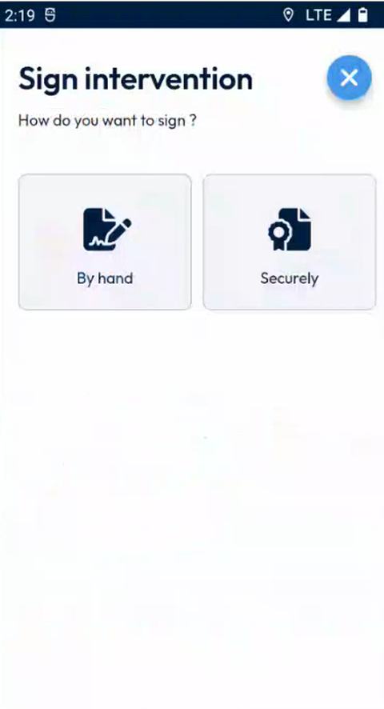
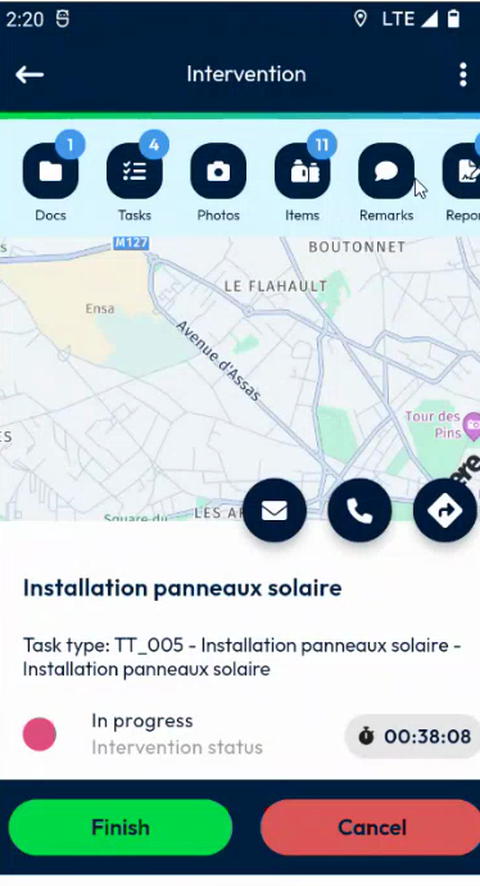

# Sign an Intervention

Have the intervention signed when you finish it.

## Overview

When an intervention requires a signature, the **Sign intervention** page opens when you finish the intervention. It asks **How do you want to sign?** and offers two ways: **By hand** and **Securely**.

<figure><figcaption>
Sign intervention page
</figcaption></figure>

| Way to sign | Description |
| ----------- | ----------- |
| **By hand** | The customer and the technician sign by hand on the screen. See [Sign by Hand](sign-by-hand.md). |
| **Securely** | The signatory signs the document electronically after a check of identity by SMS. See [Sign Securely](sign-securely.md). |

This section covers:

| Topic | Description |
| ----- | ----------- |
| [Sign by Hand](sign-by-hand.md) | Select the report and sign on the screen. |
| [Sign Securely](sign-securely.md) | Sign the document electronically, with a code received by SMS. |
| [Decline to Sign](decline-to-sign.md) | Refuse to sign and explain why. |

## Start the signature

1. Open the intervention in progress. The icons at the top of the page give access to **Docs**, **Tasks**, **Photos**, **Items**, **Remarks** and **Reports**. A number on an icon shows how many items it contains.

<figure><figcaption>
Intervention in progress
</figcaption></figure>

2. Tap **Finish**. See [Finish an Intervention](../finish-an-intervention.md).
3. On the **Sign intervention** page, tap **By hand** or **Securely**.

<!-- REVIEW: confirm which way is offered to your users. The configuration decides whether the electronic signature is available and whether it is mandatory. -->

## Related topics

* [Finish an Intervention](../finish-an-intervention.md)
* [Fill in the Report](../report.md)
