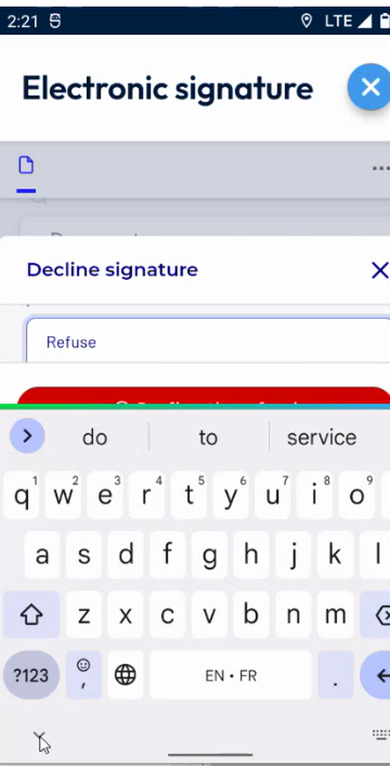

# Decline to Sign

## Overview

A signatory can refuse to sign the document. The refusal is recorded with an explanation, so that your company knows why the intervention was not signed.

## Before you begin

* You have started the secure signature. See [Sign Securely](sign-securely.md).
* The document is displayed on the **Electronic signature** page.

## Decline the signature

1. Under the document, tap **Refuse to sign**.
2. In the **Decline signature** page, read the name of the signatory, for example **O test 2**.
3. In **Explanation**, enter the reason for the refusal. The page asks **Please fill in the field below to explain the reason for your refusal.**

<figure><figcaption>
Decline signature page
</figcaption></figure>

4. Tap **Confirm the refusal**.
5. The app records the refusal and the status of the intervention is updated.

<!-- REVIEW: the video enters an explanation and ends at the Confirm the refusal button. Confirm the message displayed after the refusal, the status of the intervention, and whether the intervention can be signed again. -->

## Related topics

* [Sign Securely](sign-securely.md)
* [Sign an Intervention](README.md)
