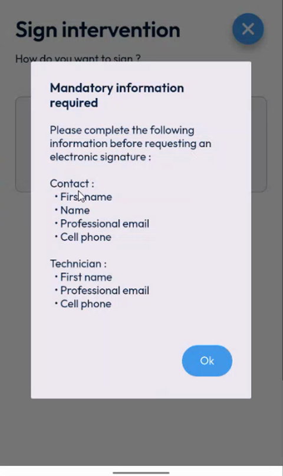
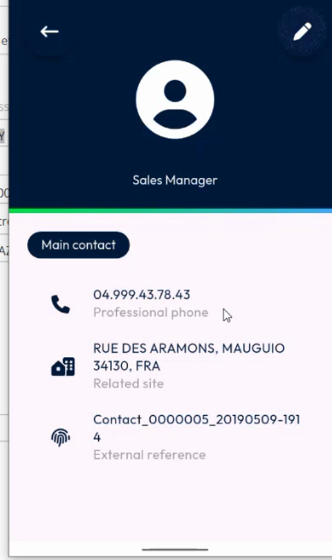
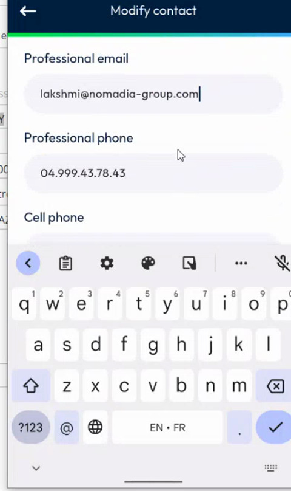
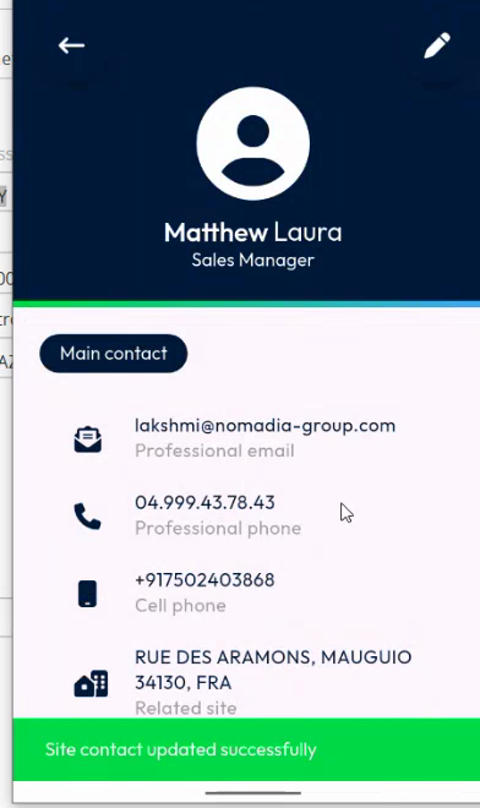
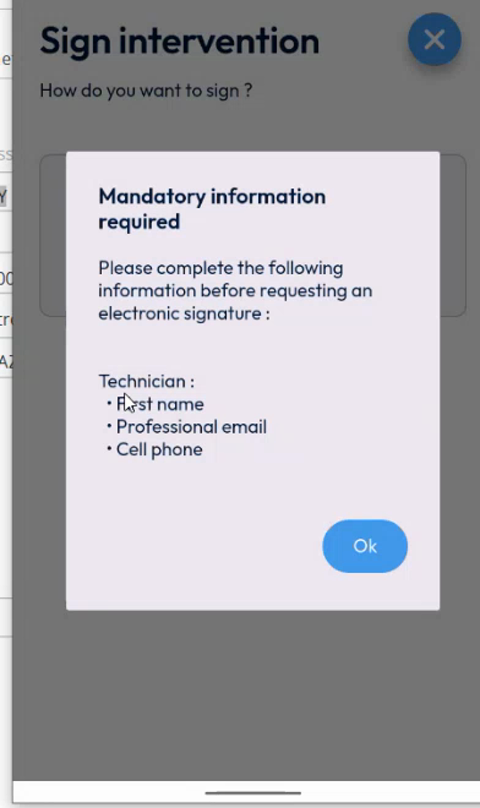
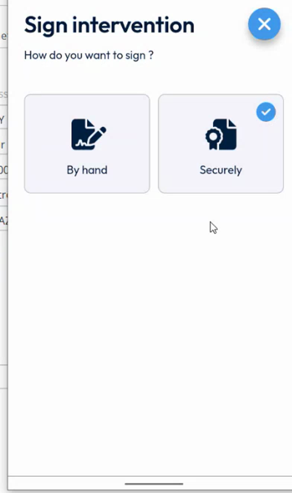
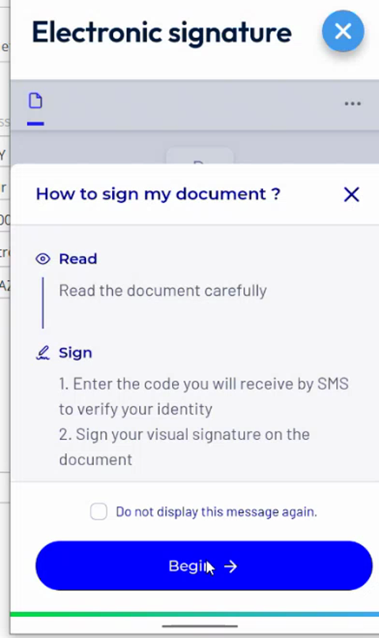

# Fill In the Required Fields for Electronic Signature

## Overview

The back office can create the electronic signature only when some fields are filled in, for the main contact of the customer and for the technician. NFS Mobile now checks these fields for you. Before, the app could only display the error **Unable to retrieve the electronic signature**. Now it tells you which fields are missing, and it opens the contact sheet so that you can fill them in.

## Before you begin

* The intervention is in progress. The signature is available only after you start it. See [Start an Intervention](../start-an-intervention.md).
* Your company uses the secure signature. See [Sign Securely](sign-securely.md).

## Required fields

| Person | Required fields |
| ------ | --------------- |
| **Contact** (main contact of the customer) | **First name**, **Name**, **Professional email**, **Cell phone** |
| **Technician** (you) | **First name**, **Last name**, **Professional email**, **Cell phone** |

## Find the missing fields

1. On the **Intervention** page, tap **Finish**.
2. On the **Sign intervention** page, tap **Securely**.
3. If a required field is empty, the message **Mandatory information required** is displayed. It lists the fields that are missing for the **Contact** and for the **Technician**.

<figure><figcaption>
Mandatory information required
</figcaption></figure>

4. Tap **Ok**.

## Update the contact

When the contact is missing information, the app opens the **Main contact** sheet.

1. Check the details of the contact. The empty fields, such as the email and the cell phone, are not displayed.

<figure><figcaption>
Main contact sheet
</figcaption></figure>

2. Tap the pencil icon at the top right. The **Modify contact** page opens.
3. Fill in **Name**, **First name**, **Professional email**, **Professional phone** if needed, and **Cell phone**.

<figure><figcaption>
Modify contact page
</figcaption></figure>

4. Tap the save button. The message **Updating site contact details** is displayed, then **Site contact updated successfully**.

<figure><figcaption>
Site contact updated
</figcaption></figure>

5. Go back to the **Sign intervention** page and tap **Securely** again.

## Update the technician details

If the details of the technician are missing, the message lists only the **Technician** fields.

<figure><figcaption>
Technician fields missing
</figcaption></figure>

The app has no screen to edit your own details. Ask your administrator to fill them in, in the back office. Then refresh your data. See [Refresh Your Data](../../main-actions/refresh-your-data.md).


Your last name is already filled in, because it is mandatory when the resource is created in the back office. The fields that can still be missing are the first name, the professional email and the cell phone.


## Continue with the signature

1. When all the fields are filled in, tap **Securely**. It is now selected.
2. The message **A request for electronic signature will be sent as soon as the intervention is completed** is displayed.

<figure><figcaption>
Securely selected
</figcaption></figure>

3. Finish the intervention. If your company requires photos, take them first. See [Take the Required Photos](../required-photos.md).
4. In **Complete the intervention**, tap **Confirm**.
5. Wait for **Sending data in progress**. The **Electronic signature** page opens and loads the document. It can take time.
6. Read the message **How to sign my document?**, then continue as in [Sign Securely](sign-securely.md).

<figure><figcaption>
How to sign my document
</figcaption></figure>


You can still switch between the secure signature and the signature by hand. The new check applies only to the secure signature. See [Sign by Hand](sign-by-hand.md).


<!-- REVIEW: confirm the exact list of required fields (the message in the video shows First name, Name, Professional email and Cell phone for the contact, and First name, Professional email and Cell phone for the technician) and whether the check applies when a user blocked by a missing field chooses to sign by hand. -->

## Related topics

* [Sign Securely](sign-securely.md)
* [Sign by Hand](sign-by-hand.md)
* [Signature Settings](../../configuration/signature-settings.md)
* [Refresh Your Data](../../main-actions/refresh-your-data.md)
