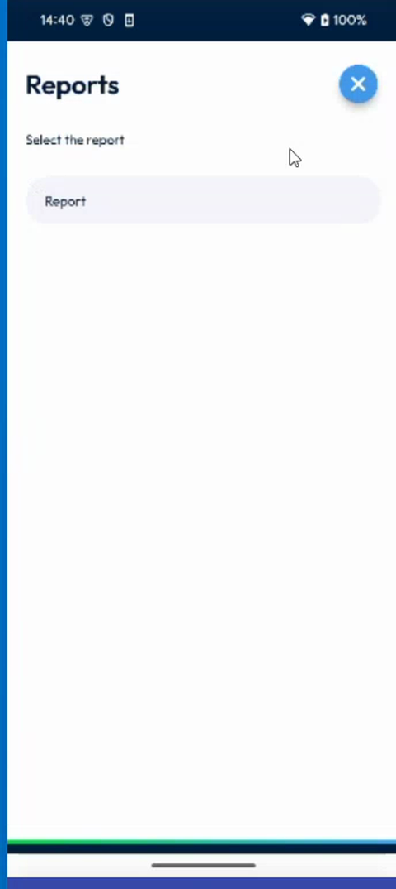
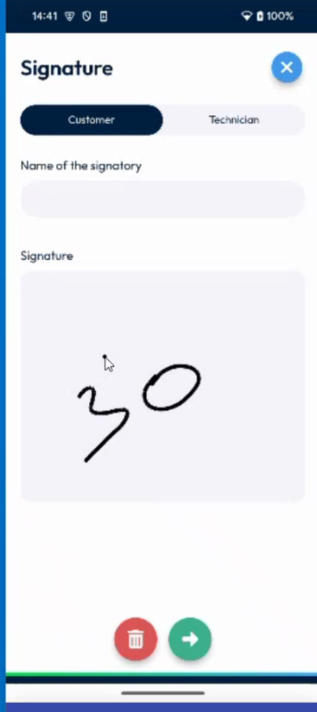

# Sign by Hand

## Overview

With **By hand**, the customer and the technician sign on the screen of the device. You first select the report to sign, then each person draws a signature.

## Before you begin

* You have tapped **By hand** on the **Sign intervention** page. See [Sign an Intervention](README.md).

## Select the report

1. On the **Reports** page, read **Select the report**.
2. Tap the report in the list, for example **Report**. A check mark shows the selected report.

<figure><figcaption>
Select the report
</figcaption></figure>

<!-- REVIEW: the video shows the Reports page at the start of the signature, but not the button that goes to the Signature page. Confirm how you move to the next step. -->

## Sign

1. On the **Signature** page, tap the tab of the signatory: **Customer** or **Technician**.
2. In **Name of the signatory**, enter the name of the person who signs.
3. In **Signature**, draw the signature in the frame with your finger.

<figure><figcaption>
Signature page
</figcaption></figure>

4. To erase the signature and start again, tap the red bin button.
5. To validate the signature, tap the green arrow button.
6. Repeat steps 1 to 5 for the other signatory.

When both signatures are done, the intervention is completed. The message **Intervention completed successfully** is displayed, and the status of the intervention is **Completed**. The **Calendar** and **Next inter.** buttons are displayed at the bottom of the screen.

<!-- REVIEW: confirm whether both signatures are mandatory, whether the technician can sign first, and which settings make them mandatory: see Signature Settings. -->

## After the signature

The signed report is added to the documents of the intervention. See [View the Documents of an Intervention](../documents.md).

## Related topics

* [Sign an Intervention](README.md)
* [Sign Securely](sign-securely.md)
* [Signature Settings](../../configuration/signature-settings.md)
