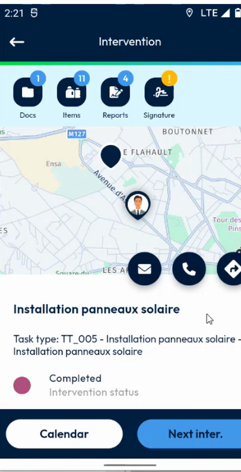
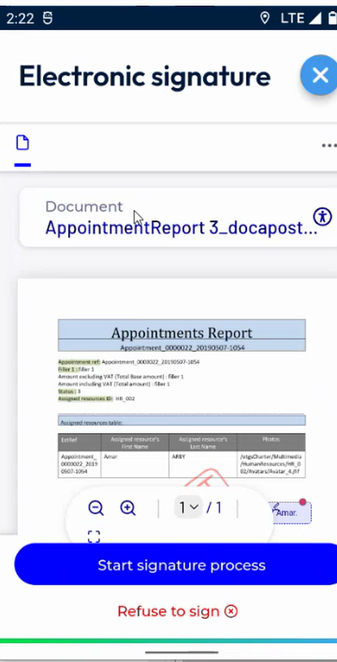
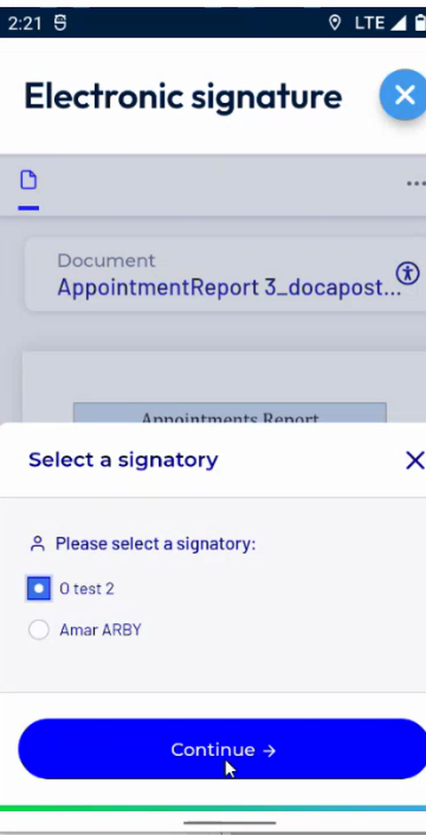
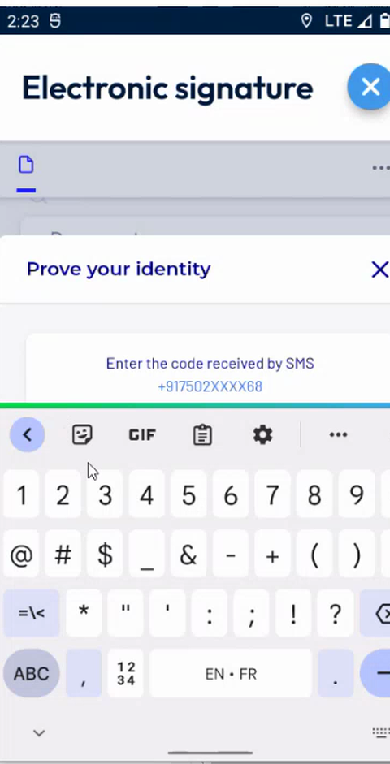
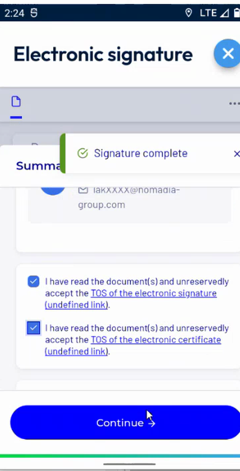
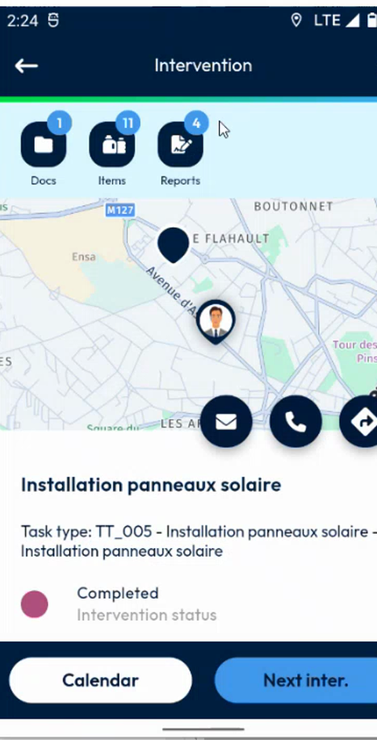

# Sign Securely

## Overview

The secure signature produces a signed report of the intervention. The signatory reads the document, then proves their identity with a code received by SMS and signs.

## Before you begin

* You have tapped **Securely** on the **Sign intervention** page. See [Sign an Intervention](README.md).
* The contact and the technician details that the signature needs are filled in. If the app displays **Mandatory information required**, see [Fill In the Required Fields for Electronic Signature](required-fields-for-electronic-signature.md).

## Sign the document

1. On the **Electronic signature** page, in the message **How to sign my document?**, read the two steps:
   * **Read** – read the document carefully.
   * **Sign** – enter the code that you receive by SMS to verify your identity, then sign the document with a visual signature.

<figure><figcaption>
How to sign my document
</figcaption></figure>

2. Tap **Begin**. To hide this message next time, turn on **Do not display this message again** first.
3. Read the document, for example **AppointmentReport**. Use the zoom buttons and the page selector under the document to read it.
4. Tap **Start signature process**.

<figure><figcaption>
Document to sign
</figcaption></figure>

5. In **Select a signatory**, select the person who signs, for example **O test 2** or **Amar ARBY**, then tap **Continue**.

<figure><figcaption>
Select a signatory
</figcaption></figure>

6. In **Prove your identity**, wait for the message **SMS sent**. The code is sent to the phone number of the signatory.
7. Enter the code that you received by SMS in **Enter the code received by SMS**. To change the number, tap **Edit phone number**.

<figure><figcaption>
Prove your identity
</figcaption></figure>

8. The message **OTP code verified** is displayed. The page **Signature for** followed by the name of the signatory opens, with two ways to sign: **Draw** and **Text**.
9. Draw the signature in the frame, or tap **Import an image** to use an image. Then tap **Sign**.
10. The message **Signature complete** is displayed. A summary asks you to confirm that you have read the documents and that you accept the terms of the electronic signature and of the electronic certificate. Turn on both check boxes, then tap **Continue**.

<figure><figcaption>
Signature complete and summary
</figcaption></figure>

11. Wait while the message **Redirection – Warning: please do not close this window – Processing** is displayed.

If the intervention has several signatories, repeat steps 5 to 10 for each of them.

## Check the result

The **Intervention** page shows the status **Completed**. The buttons **Calendar** and **Next inter.** are displayed at the bottom of the screen.

<figure><figcaption>
Intervention completed
</figcaption></figure>

* To open your calendar, tap **Calendar**.
* To go to the next intervention, tap **Next inter.**

<!-- REVIEW: confirm the number of signatories required, whether the Text way types the name of the signatory, and where the signed document is stored. It is probably listed in the documents of the intervention. -->

## Related topics

* [Sign an Intervention](README.md)
* [Fill In the Required Fields for Electronic Signature](required-fields-for-electronic-signature.md)
* [Decline to Sign](decline-to-sign.md)
* [View the Documents of an Intervention](../documents.md)
