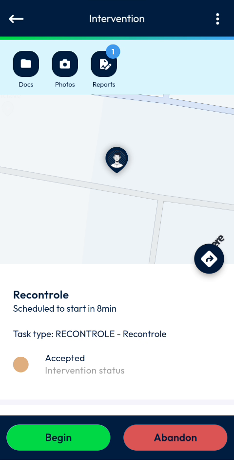
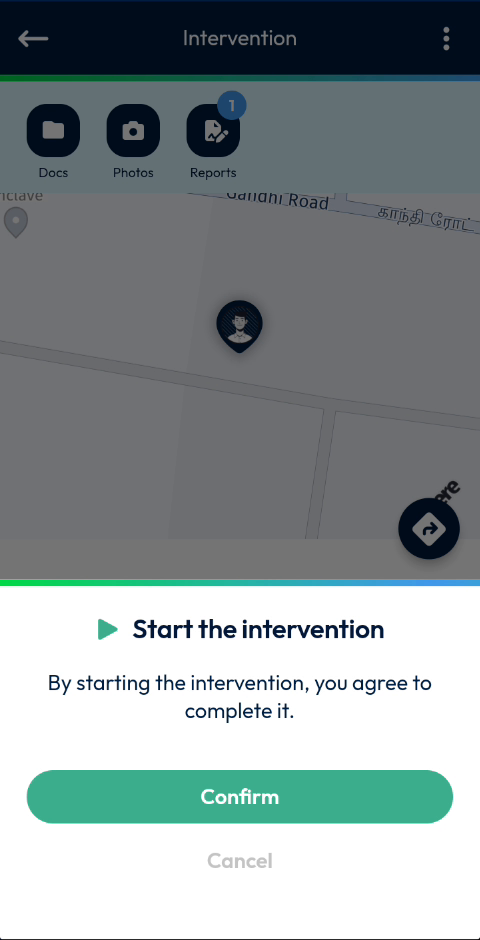
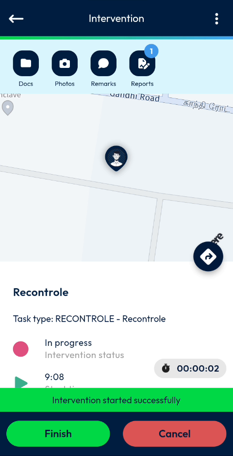
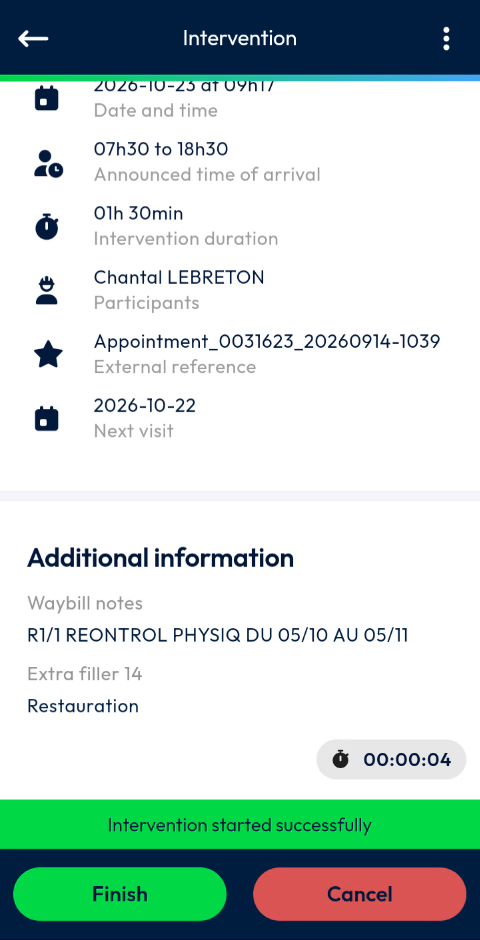

# Start an Intervention

Open an accepted intervention, check its details and start it.

## Overview

When you start an intervention, its status changes to **In progress** and a timer starts. You can start an intervention that you have accepted.

## Before you begin

* You have accepted the intervention. Its status is **Accepted**.

## Open the intervention

1. Open the intervention from the **Interventions** list of the [dashboard](../main-actions/main-actions.md) or from the [calendar](../main-actions/calendar.md).
2. Wait while the **Loading Data – Please wait** message is displayed.
3. The **Intervention** page opens.

<figure><figcaption>
Intervention page of an accepted intervention
</figcaption></figure>

The page shows:

* The shortcuts **Docs**, **Photos** and **Reports** at the top. A number on a shortcut indicates how many items it contains.
* A map with the location of the intervention.
* The name of the intervention, for example **Recontrole**, and the time left before it starts, for example **Scheduled to start in 8min**.
* The **Task type**, for example **RECONTROLE - Recontrole**.
* The **Intervention status**, for example **Accepted**.
* The **Begin** and **Abandon** buttons at the bottom of the screen.

## Start the intervention

1. On the **Intervention** page, tap **Begin**.
2. In the **Start the intervention** message, read the text **By starting the intervention, you agree to complete it.**
3. Tap **Confirm**. To close the message without starting, tap **Cancel**.

<figure><figcaption>
Start the intervention message
</figcaption></figure>

The message **Intervention started successfully** is displayed. The status changes to **In progress** and a timer shows how long the intervention has lasted.

<figure><figcaption>
Intervention in progress
</figcaption></figure>

The **Remarks** shortcut now appears next to **Docs**, **Photos** and **Reports**. The **Finish** and **Cancel** buttons replace **Begin** and **Abandon**.

<!-- REVIEW: confirm what Abandon does, and the difference between Abandon and Cancel. The video does not tap them. -->

## Check the details of the intervention

1. On the **Intervention** page, scroll down.
2. Check the details of the intervention.

| Detail | Description |
| ------ | ----------- |
| **Date and time** | The date and time of the intervention, for example **2026-10-23 at 09h17**. |
| **Announced time of arrival** | The time range in which you are expected, for example **07h30 to 18h30**. |
| **Intervention duration** | The planned duration, for example **01h 30min**. |
| **Participants** | The people who take part in the intervention. |
| **External reference** | The reference of the appointment in the customer's system. |
| **Next visit** | The date of the next visit, for example **2026-10-22**. |

The **Additional information** section shows information such as the **Waybill notes** and **Extra filler 14**.

<figure><figcaption>
Details of the intervention
</figcaption></figure>

## Next steps

* [Fill in the Report](report.md)
* [Add Photos and Remarks](photos-and-remarks.md)
* [Finish an Intervention](finish-an-intervention.md)

## Related topics

* [Calendar](../main-actions/calendar.md)
