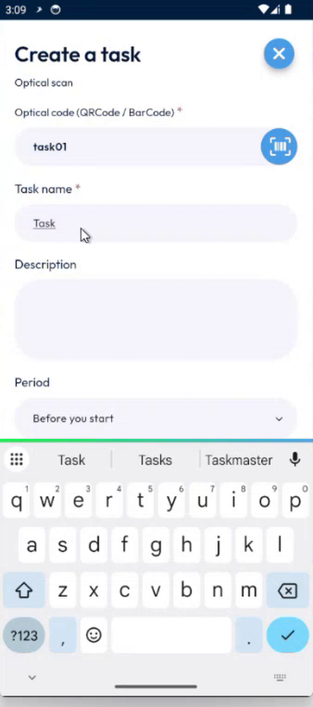
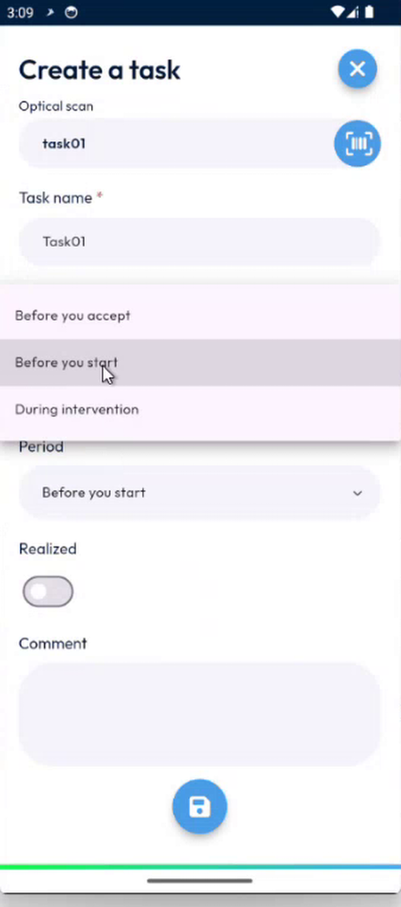
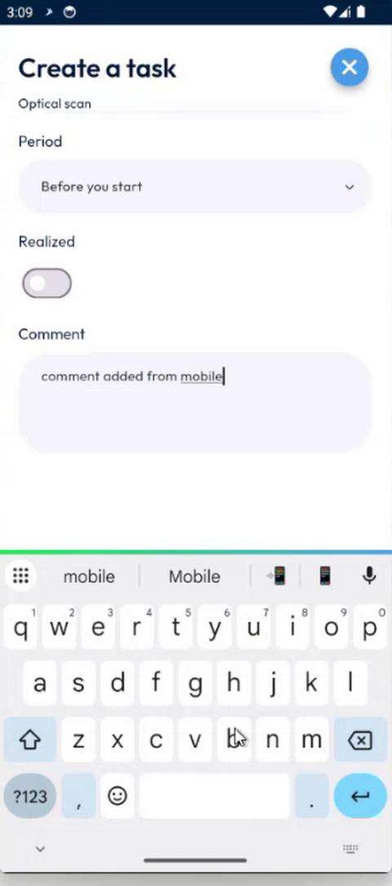
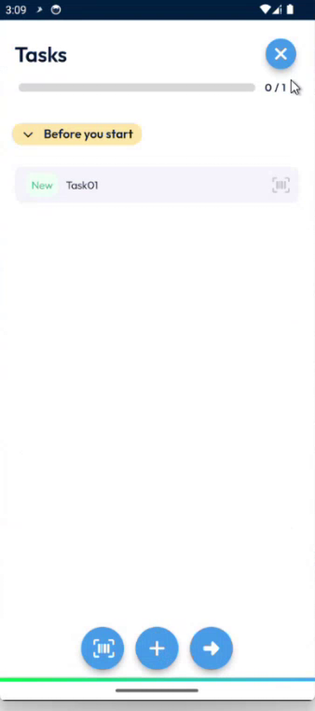
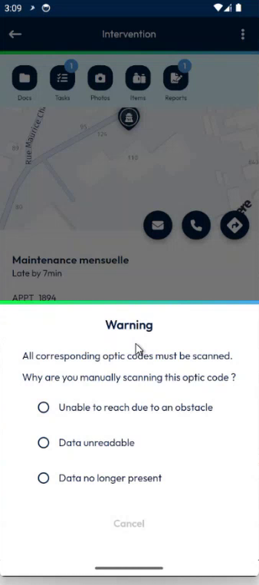
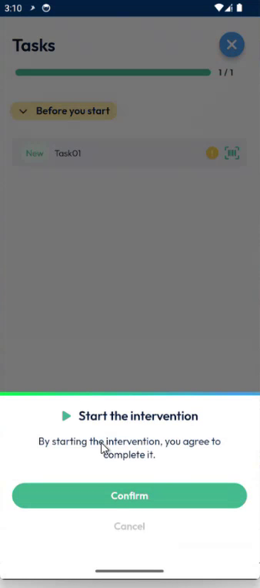
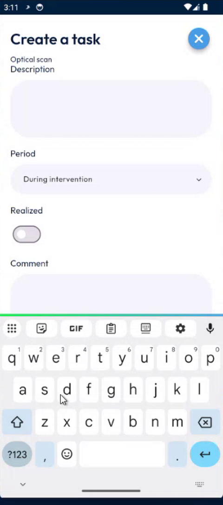
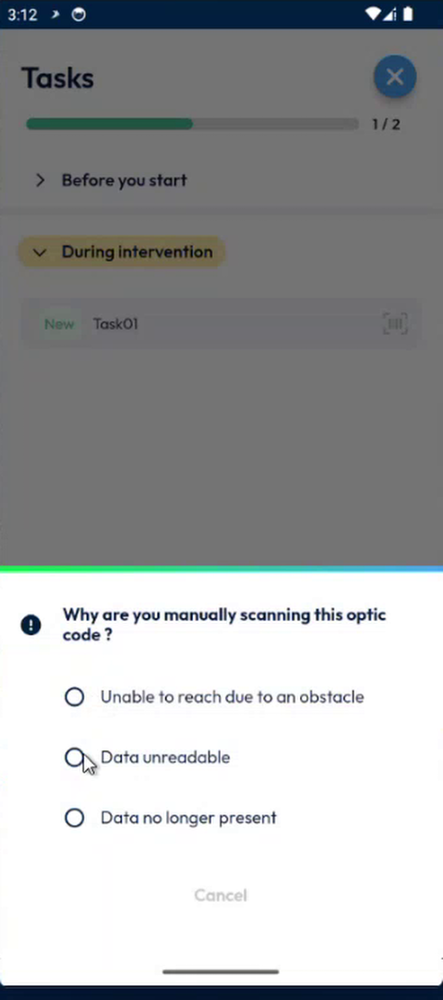

# Keep the Task Comment When You Scan by Hand

Create a task in the app, and give the reason when you complete a scan task by hand, without losing the comment of the task.

## Overview

A scan task is a task that you complete by scanning its code. If you cannot scan it, you can complete it by hand. The app then asks **Why are you manually scanning this optic code ?**, and you choose a reason.

The reason used to replace the comment of the task. Now your administrator can keep the comment, and save the reason in a separate field.

## Before you begin

* You are on the **Tasks** page of an intervention. See [Scan a Task Code](scan-a-task-code.md).
* Your administrator has chosen where the reason is saved. See [Task Comment Setup](../configuration/task-comment-setup.md).

## Create a task in the app

1. On the **Tasks** page, tap the plus button at the bottom of the screen.
2. In **Create a task**, enter the **Optical code (QRCode / BarCode)**. Tap the scan button to scan it instead.

<figure><figcaption>
Create a task
</figcaption></figure>

3. Enter the **Task name**, and a **Description** if you need one.
4. In **Period**, choose when the task must be done: **Before you accept**, **Before you start** or **During intervention**.

<figure><figcaption>
Period of the task
</figcaption></figure>

5. Optional: turn on **Realized** if the task is already done.
6. Enter the **Comment**.

<figure><figcaption>
Comment of the task
</figcaption></figure>

7. Tap the save button at the bottom of the screen. The task is in the list, in its period.

<figure><figcaption>
Tasks page with the new task
</figcaption></figure>

## Complete a task by hand

1. Tap **Begin** to start the intervention. If a task is not complete, the app asks you to scan it.
2. In the warning **All corresponding optic codes must be scanned**, read the question **Why are you manually scanning this optic code ?**.

<figure><figcaption>
Reason for the manual scan
</figcaption></figure>

3. Select one reason:
   * **Unable to reach due to an obstacle**
   * **Data unreachable**
   * **Data no longer present**
4. The task is completed, and the app goes on. A confirmation **Start the intervention** is displayed.

<figure><figcaption>
Start the intervention
</figcaption></figure>

The same question is asked when a task of the **During intervention** period is completed by hand.

<figure><figcaption>
A task of the period <strong>During intervention</strong>
</figcaption></figure>

<figure><figcaption>
The reason is asked again
</figcaption></figure>

## What happens to the comment

In NFS, the comment of the task and the reason that you chose are two different values.

| Setting of your administrator | Comment of the task | Reason that you chose |
| ----------------------------- | ------------------- | --------------------- |
| **Do not overwrite the comment** is on | Kept | Saved in a separate filler of the task |
| **Do not overwrite the comment** is off | Replaced by the reason | Written in the comment field |

You do not choose this. It depends on the setting. If you need to keep the comment, ask your administrator.

<!-- REVIEW: in the demo, the reason is saved in the filler 5 or the filler 6 when the comment is kept, and in the filler 3 (the comment) when the setting is off. The audio is unclear on the number of the separate filler. Confirm it, and the name of the setting. -->

## Related topics

* [Scan a Task Code](scan-a-task-code.md)
* [Start an Intervention](start-an-intervention.md)
* [Task Comment Setup](../configuration/task-comment-setup.md)
