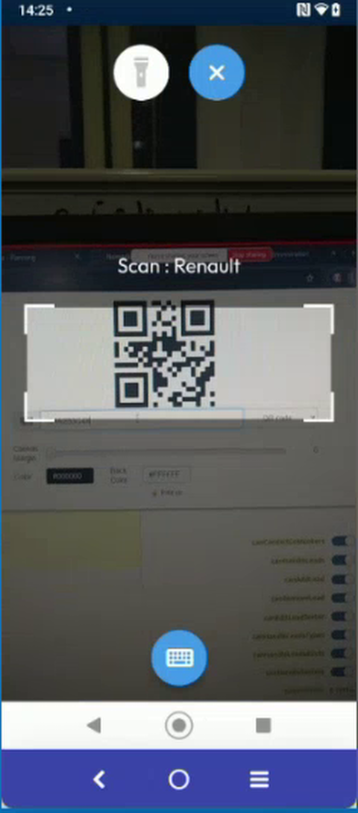
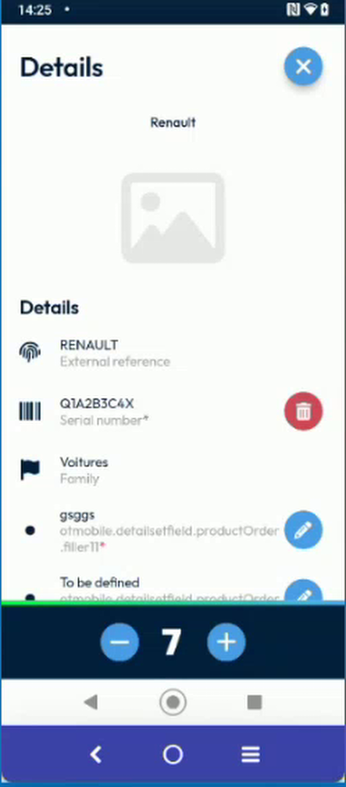
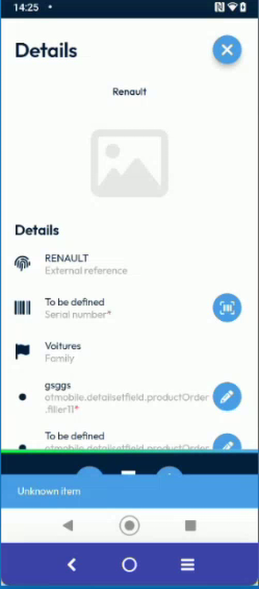

# Accept Only Valid Scan Codes

## Overview

When you scan the serial number of an item, your company can limit the codes that the app accepts. The limit is a pattern that the code must match. A code that matches is recorded. A code that does not match is rejected, and the app displays **Unknown item**.

This check applies only to the serial number of an item. Other scans in the app, such as the code of a task or the code of an intervention, do not use it.

## Before you begin

* You are on the **Details** page of an item, and the intervention is started. See [Scan or Enter a Serial Number](scan-a-serial-number.md).
* Your administrator has set the pattern. See [Scan Code Rules Setup](../configuration/scan-code-rules-setup.md). Without a pattern, the app accepts every code.

## Scan a valid code

1. Tap the scan button at the right of the **Serial number** field.
2. Point the camera at the code.

<figure><figcaption>
Scan a code that follows the pattern
</figcaption></figure>

3. The app accepts the code, and the **Details** page shows it in the **Serial number** field.

<figure><figcaption>
Code accepted
</figcaption></figure>

## If the code is rejected

1. Scan a code that does not match the pattern of your company.
2. A blue message at the bottom of the screen says **Unknown item**.

<figure><figcaption>
Unknown item: the code is rejected
</figcaption></figure>

3. The code is not recorded. Scan the right code, or ask your administrator which codes your company accepts.


The pattern is checked on the content of the code, not on its type. A QR code and a barcode are accepted if their content matches.


<!-- REVIEW: in the demo, the reject message is a blue bar that says "Unknown item". The team suggested showing it in red, which is not done yet. Confirm the final color and wording. Confirm also whether a code that is typed with the keyboard is checked in the same way. -->

## Related topics

* [Scan or Enter a Serial Number](scan-a-serial-number.md)
* [Scan the Mandatory Serial Numbers](mandatory-serial-number.md)
* [Scan Code Rules Setup](../configuration/scan-code-rules-setup.md)
