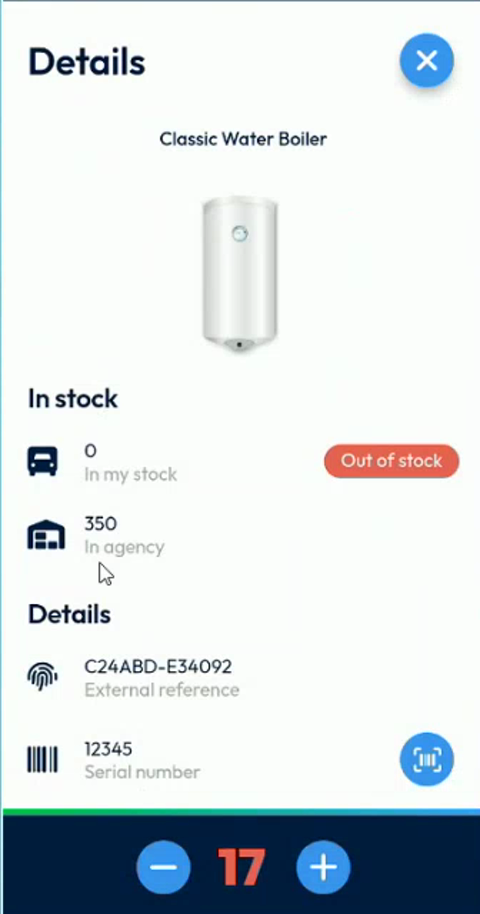
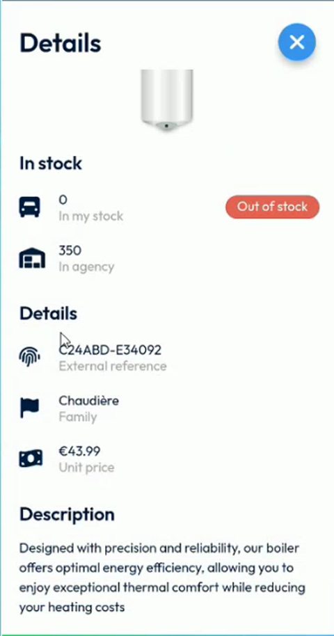

# View the Details of an Item

## Overview

The **Details** page, also called the product sheet, shows the information of an item of the intervention: its photo, its stock, its references, its unit price and its description. The page was redesigned: the stock and the details are now displayed one under the other, and the quantity is chosen in a bar at the bottom of the screen.

## Before you begin

* You have opened the **Items** page of the intervention. See [Add Items to an Intervention](add-items-to-an-intervention.md#open-the-items-page).

## Open the details of an item

1. On the **Items** page, tap the name of an item, or its photo, for example **Classic Water Boiler**.
2. The **Details** page opens.


Tap the name or the photo of the item to open its details. Tapping the plus or minus buttons, or the quantity next to them, does not open the details. See [Change the quantities](add-items-to-an-intervention.md#change-the-quantities).


<figure><figcaption>
Details page of an item
</figcaption></figure>

## Read the details of an item

The page shows, from top to bottom:

| Section | Information | Description |
| ------- | ----------- | ----------- |
| Name and photo | Name of the item | The name of the item and its photo, or a placeholder if it has no photo. |
| **In stock** | **In my stock** | The quantity available in your own stock, for example **0**. The label **Out of stock** is displayed when your stock is empty. |
| **In stock** | **In agency** | The quantity available in the agency, for example **350**. |
| **Details** | **External reference** | The reference of the item, for example **C24ABD-E34092**. |
| **Details** | **Serial number** | The serial number of the item for this intervention. See [Scan or Enter a Serial Number](scan-a-serial-number.md). |
| **Details** | **Family** | The family of the item, for example **Chaudière**. |
| **Details** | **Unit price** | The price of one unit, for example **€43.99**. |
| **Description** | | The description of the item. Scroll down to read it. |

At the bottom of the screen, the quantity bar shows the quantity of the item for the intervention, for example **17**. Tap the minus or the plus button to change it.

## When the intervention is not started

Until you start the intervention, the **Details** page shows the stock and the references, but not the **Serial number** field and not the quantity bar.

<figure><figcaption>
Details page before the intervention is started
</figcaption></figure>

Start the intervention to scan or enter a serial number. See [Start an Intervention](start-an-intervention.md).

## Close the details

To return to the **Items** page, tap the blue cross at the top right.

<!-- REVIEW: confirm that the quantity bar can be used to change the quantity of the item and that the number shown is the quantity used. Confirm also how the stock In my stock and In agency are updated, and why an item with 16 in stock is still labelled Out of stock in the video. -->

Your company can add **extra fields** below the **Unit price**. See [View and Edit the Extra Fields of an Item](edit-extra-item-fields.md).

## Related topics

* [View and Edit the Extra Fields of an Item](edit-extra-item-fields.md)
* [Add Items to an Intervention](add-items-to-an-intervention.md)
* [Scan or Enter a Serial Number](scan-a-serial-number.md)
