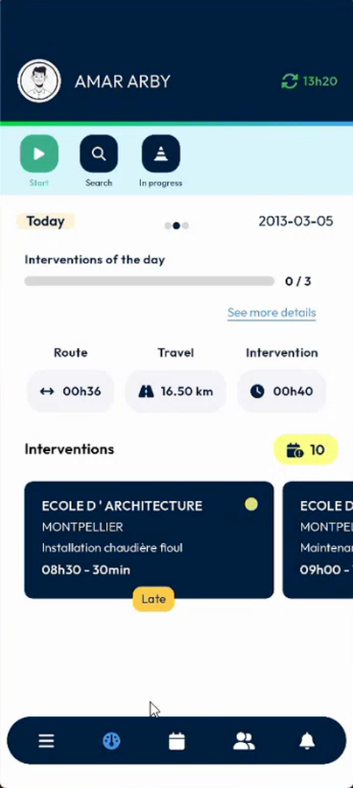
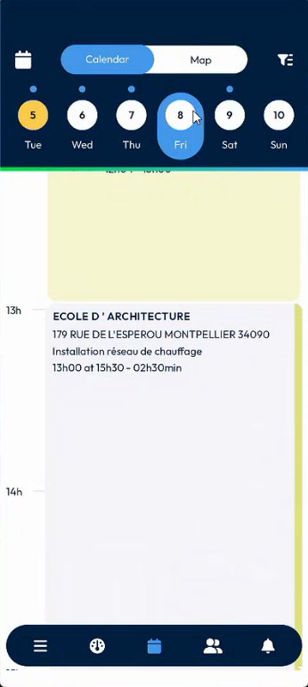
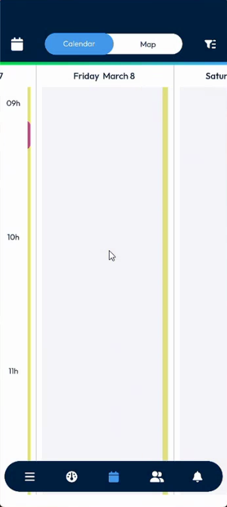

# Agenda Position and Saved Day

## Overview

The agenda now remembers where you were. When you open the **Calendar** page, the current time is centered in the screen. When you open an intervention of another day and come back, the app returns to that day, and it centers the current time again.

## Before you begin

* You are logged in. See [Login](../app-launch/app-launch.md).
* You use the **Week** or the **Day** display of the agenda. See [Calendar options](calendar.md#calendar-options).

## See the current time

1. In the navigation bar, tap the **Calendar** icon.
2. The agenda of the current day opens. The current time is centered in the screen, shown by a red line.

<figure><figcaption>
Agenda centered on the current time
</figcaption></figure>

The agenda is centered on the current time each time that you open it, including after you log out and log in again.

## Return to the day you were viewing

1. On the **Calendar** page, select another day, for example **Friday March 8**. See [Select a day](calendar.md#select-a-day).

<figure><figcaption>
Another day selected
</figcaption></figure>

2. Tap an intervention of that day to open it.
3. Tap the back arrow at the top left.
4. The **Calendar** page shows the same day again, not today. The agenda scrolls to the current time.

<figure><figcaption>
Agenda back on the day you were viewing
</figcaption></figure>


The app remembers the day only in the **Week** and **Day** displays. In the **List** display, the agenda does not keep your position.


## Reset to today

When you log out and log in again, the agenda opens on the current day and centers the current time.

<!-- REVIEW: confirm that after a new login the agenda returns to today (the video shows the current time centered after logging in), and confirm the behavior in the List display, which the presenter says does not keep the day. -->

## Related topics

* [Calendar](calendar.md)
* [Calendar Map Marker Colors](calendar-map-marker-colors.md)
