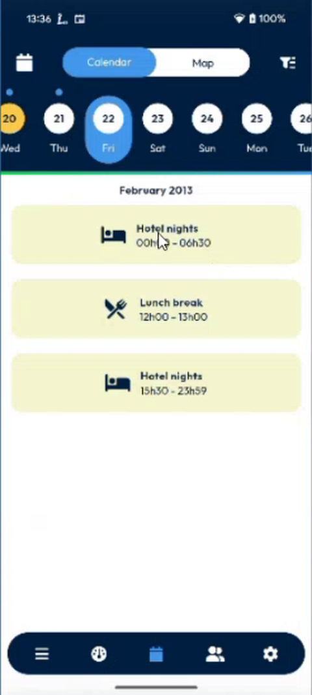

# Hotel Nights in the Calendar

See the nights that you spend away from home, separately from your rest periods.

## Overview

When you work away from home, your planner can assign a hotel to you for some nights. The calendar shows these **Hotel nights**, like the rest and the lunch break. Before, a night away was displayed as a **Rest** period, so you could not tell the two apart.

## Before you begin

* Your planner has assigned a hotel to you for a period. See [Hotel Nights Setup](../configuration/hotel-nights-setup.md).
* Your administrator has turned on the display of the rest periods.

## See the hotel nights

1. In the navigation bar, tap the **Calendar** icon.
2. Select the day, for example **22 February**.
3. The agenda shows the **Hotel nights** with their time range, for example **00h00 - 06h30** and **15h30 - 23h59**.

<figure><figcaption>
Hotel nights in the agenda
</figcaption></figure>

## Open a hotel night

1. Tap a **Hotel nights** card.
2. The details open: the type **Hotel nights**, the start and the end, the address of the hotel and the description, for example **Night away**.

<figure><figcaption>
Details of a hotel night
</figcaption></figure>

3. To go back to the agenda, tap the back arrow.

## When the hotel nights are hidden

The hotel nights follow the setting that shows the rest periods. When your administrator turns it off, the agenda shows neither the rest nor the hotel nights. Log out and log in again to see the change.

<figure><figcaption>
Agenda without hotel nights
</figcaption></figure>

<!-- REVIEW: confirm that the hotel nights are tied to the displayRests setting (the presenter says that the same custom setting is used), and what the other cards of the agenda show on a day with a hotel night. -->

## Related topics

* [Calendar](calendar.md)
* [Hotel Nights Setup](../configuration/hotel-nights-setup.md)
