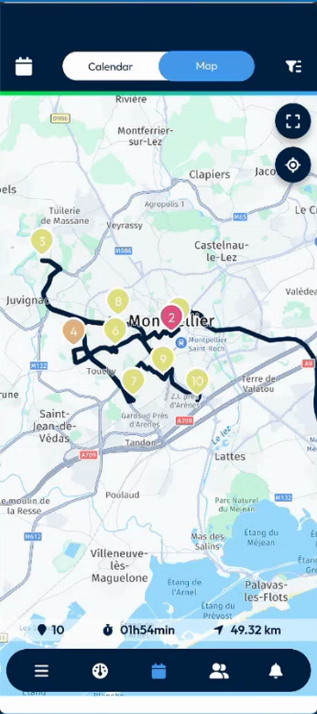
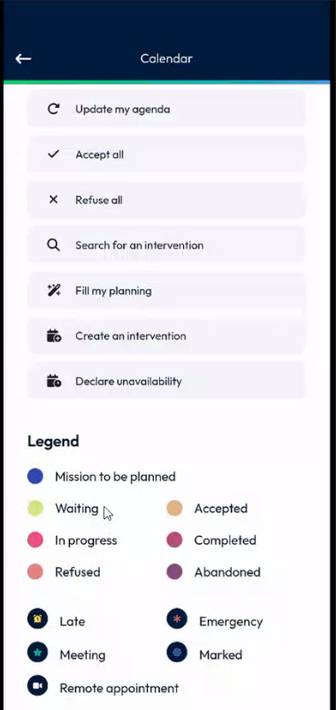
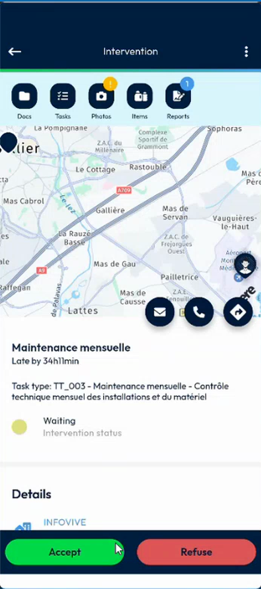
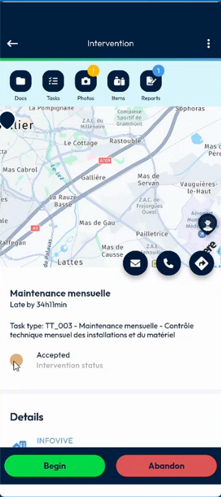
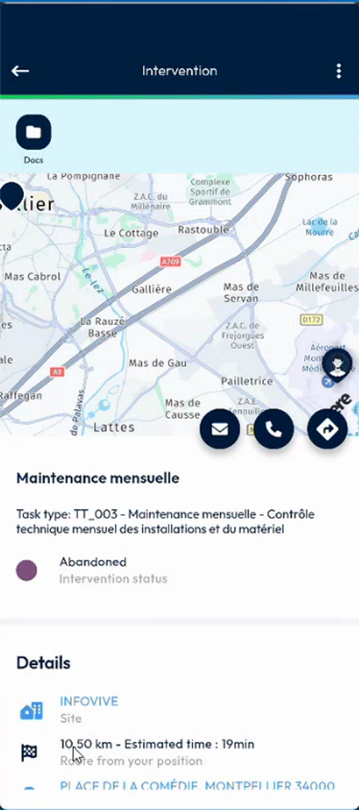

# Calendar Map Marker Colors

## Overview

On the **Map** view of the calendar, each intervention is a numbered marker. Before, all the markers were blue. Now the color of a marker shows the status of the intervention, and it changes when the status changes.

## Before you begin

* You are logged in, and your agenda has interventions. See [Calendar](calendar.md).

## Read the colors on the map

1. In the navigation bar, tap the **Calendar** icon.
2. In the top bar, tap **Map**.
3. Look at the markers. Each marker has the number of the intervention and a color.

<figure><figcaption>
Map with the markers of ten interventions
</figcaption></figure>

## Find the meaning of a color

1. In the top bar, tap the options icon at the right.
2. On the **Calendar** page, scroll down to **Legend**.
3. Find the status that matches the color of the marker.

<figure><figcaption>
Legend
</figcaption></figure>

| Color | Status |
| ----- | ------ |
| Blue | Mission to be planned |
| Light yellow-green | Waiting |
| Orange-brown | Accepted |
| Pink | In progress |
| Dark pink | Completed |
| Salmon | Refused |
| Purple | Abandoned |

## Follow the status of an intervention

The color of the marker follows the status of the intervention.

1. On the map, tap a marker, then open the intervention. A waiting intervention has the status **Waiting** and a light yellow-green marker.

<figure><figcaption>
Intervention waiting
</figcaption></figure>

2. Tap **Accept**, then **Confirm**. The message **Intervention accepted successfully** is displayed and the status changes to **Accepted**.

<figure><figcaption>
Intervention accepted
</figcaption></figure>

3. Go back to the map. The marker is now orange-brown.
4. Abandon the intervention. The status changes to **Abandoned**.

<figure><figcaption>
Intervention abandoned
</figcaption></figure>

5. Go back to the map. The marker is now purple.

<figure><figcaption>
Purple marker for the abandoned intervention
</figcaption></figure>

The same happens for a refused intervention: its marker takes the color of the status **Refused**.

## Related topics

* [Calendar](calendar.md#view-your-interventions-on-the-map)
* [Accept an intervention](calendar.md#accept-an-intervention)
* [Abandon an Intervention](../intervention/abandon-an-intervention.md)
