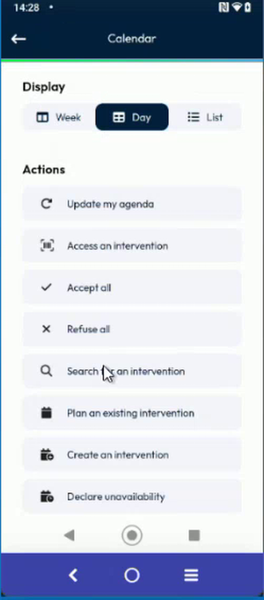
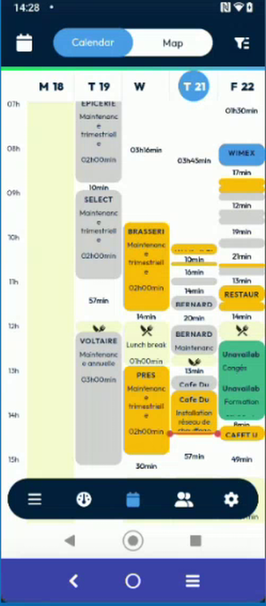
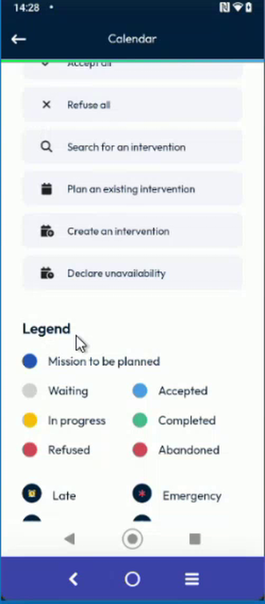
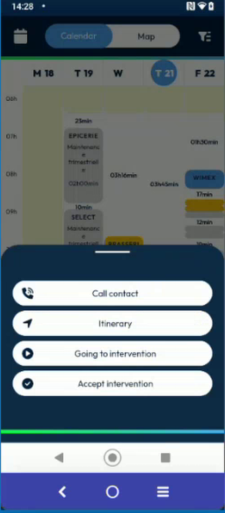
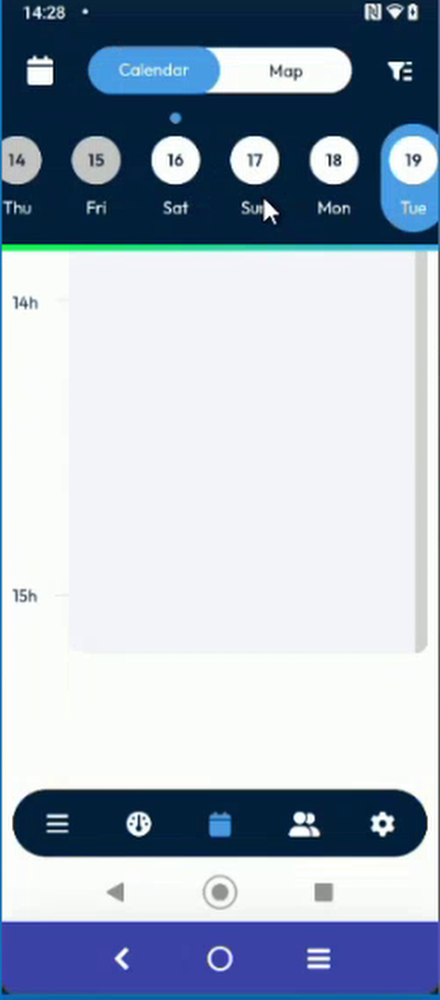

# Week View of the Calendar

Read five consecutive days at once in the week display of the calendar, and jump to a day.

## Overview

The **Week** display of the calendar was redesigned. Before, you saw one or two days at a time. Now you see at least five consecutive days side by side, so that you can compare your days at a glance.

## Before you begin

* You are logged in, and your agenda has interventions. See [Calendar](calendar.md).

## Open the week display

1. In the navigation bar, tap the **Calendar** icon.
2. Tap the options icon at the right of the top bar.
3. In **Display**, tap **Week**. The selected option is highlighted in dark blue.

<figure><figcaption>
Display: Week, Day or List
</figcaption></figure>

4. Tap the back arrow at the top left. The agenda shows five days.

<figure><figcaption>
Week view of five days
</figcaption></figure>

## Read the week

* The day letters and numbers are at the top of the columns, for example **M 18**, **T 19**, **W**, **T 21** and **F 22**. Today is highlighted in blue.
* The hours of the day are at the left.
* Each intervention is a card in the column of its day.
* The **color** of a card is the status of the intervention. It fills the whole card. Before, only its right border was colored. See [Calendar Map Marker Colors](calendar-map-marker-colors.md) and the **Legend** of the calendar options.
* The small time between two cards, for example **10min** or **57min**, is the free time between the two interventions.

<figure><figcaption>
Legend: the colors of the statuses
</figcaption></figure>

## Open the quick actions of an intervention

A tap on a card no longer opens the intervention. Press the card for a long time instead.

1. Press an intervention for a long time.
2. The panel of quick actions opens at the bottom of the screen: **Call contact**, **Itinerary**, **Going to intervention** and **Accept intervention**. See [Quick Actions on an Intervention](long-press-an-intervention.md).

<figure><figcaption>
Quick actions of an intervention
</figcaption></figure>

## Go to a day

1. Tap a day at the top of a column, for example **T 19**.
2. The calendar switches to the **Day** display of this day. The days of the week stay at the top, so you can tap another day.

<figure><figcaption>
Day view of the selected day
</figcaption></figure>

To open an intervention, switch to the **Day** display and tap its card. See [Open an intervention](calendar.md#open-an-intervention).


The agenda remembers the week and the day that you were viewing. See [Agenda Position and Saved Day](calendar-agenda-position.md).


<!-- REVIEW: in the demo, the presenter noted that one day (Wednesday) did not show its number in the header, and planned to fix it. Confirm that all the days show their number. Confirm also the number of days displayed on a phone with a narrow screen, and whether a tap on an empty area of a day does anything. -->

## Related topics

* [Calendar](calendar.md#calendar-options)
* [Quick Actions on an Intervention](long-press-an-intervention.md)
* [Agenda Position and Saved Day](calendar-agenda-position.md)
* [Calendar Map Marker Colors](calendar-map-marker-colors.md)
