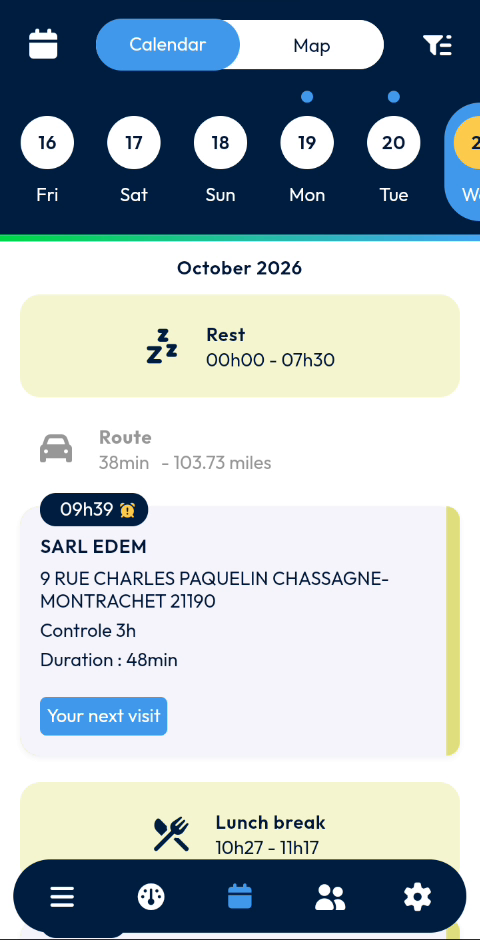
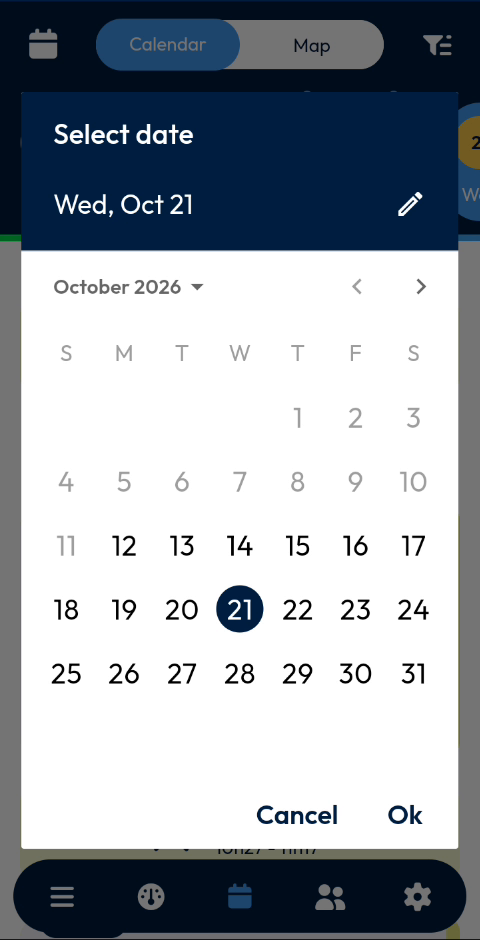
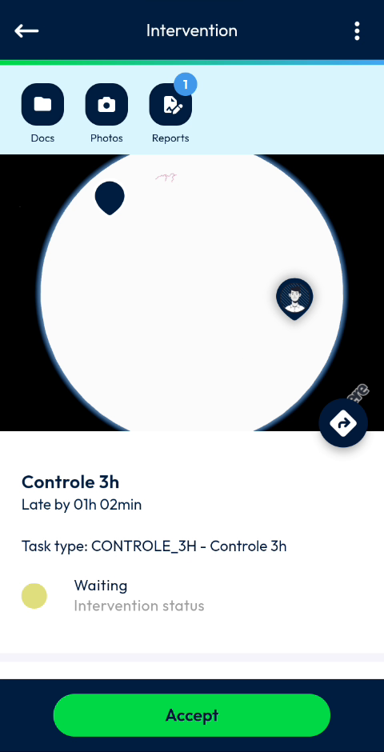
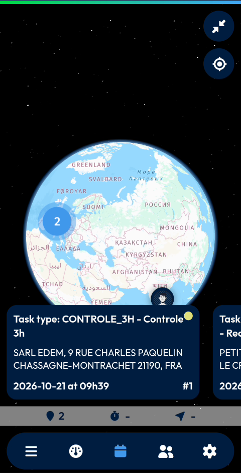
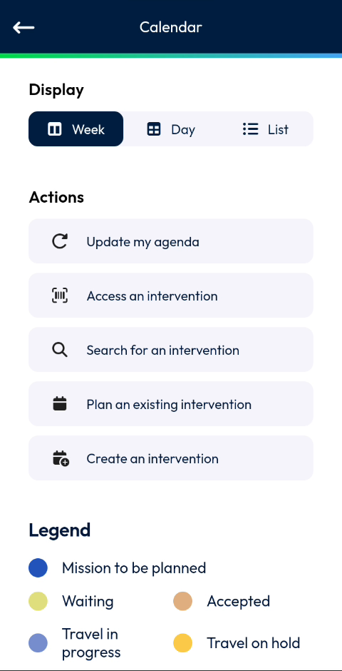
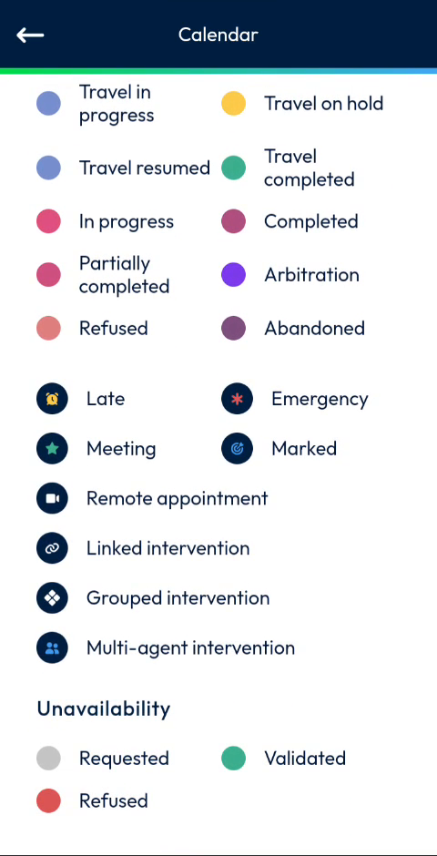

# Calendar

See your interventions by day, pick a date, open an intervention and view your visits on a map.

## Overview

The **Calendar** page shows your agenda. It displays your interventions for the selected day, with your rest and lunch break times and the route between visits. You can switch between a calendar view and a map view.

<figure><figcaption>
Calendar page
</figcaption></figure>

The page contains the following areas:

| Area | Description |
| ---- | ----------- |
| Top bar | The date picker icon, the **Calendar** and **Map** switch, and the options icon. |
| Week strip | The days of the week. Select a day to display its agenda. |
| Day agenda | The rest period, the route, the interventions and the lunch break of the selected day. |

## Open the Calendar page

1. In the navigation bar at the bottom of the screen, tap the **Calendar** icon.
2. The **Calendar** page opens, with the agenda of the current day. The calendar icon is highlighted in blue.

## Select a day

### Use the week strip

1. In the week strip, tap a day. The selected day is highlighted in yellow.
2. Swipe the week strip left or right to display another week.

A dot above a day indicates that the day has interventions.

### Use the date picker

1. In the top bar, tap the calendar icon at the left.
2. In the **Select date** window, tap a day in the calendar. To change month, tap the arrows next to the month name.
3. Tap **Ok**. To close the window without changing the date, tap **Cancel**.

<figure><figcaption>
Select date window
</figcaption></figure>


To type the date instead, tap the pencil icon in the **Select date** window, then enter the date in the **Enter Date** field, for example **10/21/2026**.


## Day agenda

The agenda of the selected day lists, in time order:

* The month and year, for example **October 2026**.
* **Rest** – the rest period, with its time range, for example **00h00 - 07h30**.
* **Route** – the travel time and the distance to the next intervention, for example **38min - 103.73 miles**.
* The interventions of the day. Each intervention card shows the start time, the customer name, the address, the type of intervention, for example **Controle 3h**, and the **Duration**.
* **Your next visit** – a button on the card of your next intervention.
* **Lunch break** – the time range of the break, for example **10h27 - 11h17**.

## Open an intervention

1. On the **Calendar** page, tap an intervention card.
2. Wait while the **Loading Data – Please wait** message is displayed.
3. The **Intervention** page opens.

<figure><figcaption>
Intervention page
</figcaption></figure>

The **Intervention** page shows:

* **Docs**, **Photos** and **Reports** shortcuts at the top. A number on a shortcut indicates how many items it contains.
* A map with the location of the intervention.
* The type of intervention, for example **Controle 3h**, and the delay, for example **Late by 01h 02min**.
* The **Task type**, for example **CONTROLE_3H - Controle 3h**.
* The **Intervention status**, for example **Waiting**.
* The **Accept** button.

To accept the intervention, tap **Accept**. To return to the **Calendar** page, tap the back arrow at the top left.

<!-- REVIEW: the video does not show what happens after Accept, nor the Docs, Photos and Reports pages or the three-dot menu at the top right. Confirm their behavior. -->

## View your interventions on the map

1. On the **Calendar** page, tap **Map** in the top bar.
2. The map displays the location of your interventions and your position.
3. At the bottom of the screen, swipe the intervention cards left or right to display each intervention. A card shows the task type, the customer name and address, and the date and time of the intervention.
4. To return to the agenda, tap **Calendar** in the top bar.

<figure><figcaption>
Map view
</figcaption></figure>

On the map, you can also:

* Tap the expand icon at the top right to display the map in full screen.
* Tap the target icon to center the map on your position.

<!-- REVIEW: confirm the meaning of the three counters at the bottom of the map (pin with 2, clock and arrow) and of the number on the map marker. -->

## Calendar options

1. On the **Calendar** page, tap the options icon at the right of the top bar.
2. The **Calendar** options page opens.
3. To return to the agenda, tap the back arrow at the top left.

<figure><figcaption>
Calendar options page
</figcaption></figure>

### Display

In **Display**, choose how the agenda is shown. The selected option is highlighted in dark blue.

| Option | Description |
| ------ | ----------- |
| **Week** | Display the agenda by week. |
| **Day** | Display the agenda by day. |
| **List** | Display the agenda as a list. |

<!-- REVIEW: confirm the exact effect of each display option. The video shows the options being selected but not the resulting agenda. -->

### Actions

| Action | Description |
| ------ | ----------- |
| **Update my agenda** | Refresh your agenda. |
| **Access an intervention** | Open an intervention directly. |
| **Search for an intervention** | Find an intervention. |
| **Plan an existing intervention** | Add an existing intervention to your agenda. |
| **Create an intervention** | Create a new intervention. |

<!-- REVIEW: the video does not run these actions. Confirm what each one does and how Access an intervention works (for example by scanning a code). -->

### Legend

The **Legend** explains the colors and icons used in the agenda and on the map.

<figure><figcaption>
Legend
</figcaption></figure>

**Intervention statuses**

* Mission to be planned
* Waiting
* Accepted
* Travel in progress
* Travel on hold
* Travel resumed
* Travel completed
* In progress
* Completed
* Partially completed
* Arbitration
* Refused
* Abandoned

**Intervention icons**

| Icon | Meaning |
| ---- | ------- |
| Late | The intervention is late. |
| Emergency | The intervention is an emergency. |
| Meeting | The intervention is a meeting. |
| Marked | The intervention is marked. |
| Remote appointment | The appointment is remote. |
| Linked intervention | The intervention is linked to another one. |
| Grouped intervention | The intervention is grouped with others. |
| Multi-agent intervention | Several agents work on the intervention. |

**Unavailability**

* Requested
* Validated
* Refused

## Related topics

* [Dashboard](main-actions.md)
* [Settings](settings.md)
