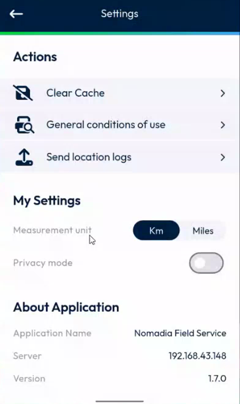
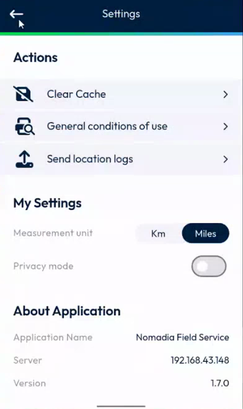
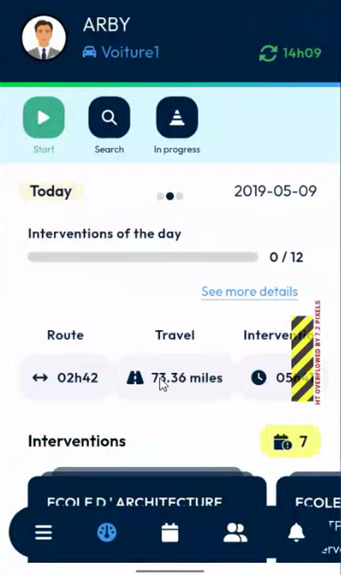
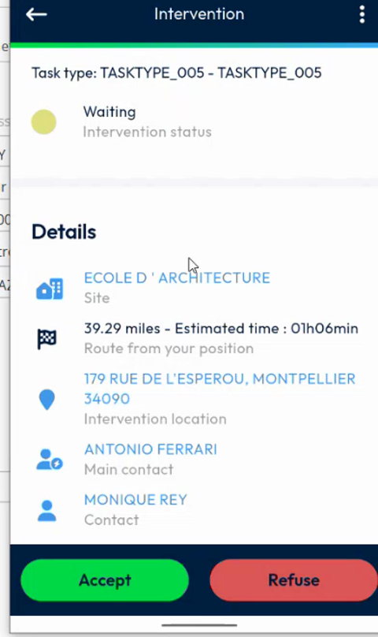
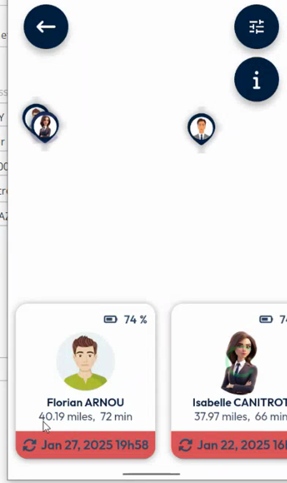

# Change the Measurement Unit

Display distances in kilometers or in miles across the app.

## Overview

The **Measurement unit** setting lets you choose the unit of the distances that NFS Mobile displays. The default is **Km**. When you select **Miles**, every distance of the app is converted. This matches the same choice that exists in the back office.

## Before you begin

* You are logged in. See [Login](../app-launch/app-launch.md).

## Change the unit

1. In the navigation bar, tap the menu icon, then tap **Settings**. See [Settings](settings.md#open-the-settings-page).
2. In **My Settings**, find **Measurement unit**. **Km** is selected by default.

<figure><figcaption>
Measurement unit: Km
</figcaption></figure>

3. Tap **Miles**. The selected value is highlighted in dark blue.

<figure><figcaption>
Measurement unit: Miles
</figcaption></figure>

4. Tap the back arrow at the top left to leave the page.

To go back to kilometers, tap **Km**.

## Check the distances

The unit applies wherever the app displays a distance.

### Sites list

In **Contacts**, the distance of each site is displayed in the unit that you selected. In the example, the first site is at **35.65 km** with **Km**, and at **22.15 miles** with **Miles**.

<figure><figcaption>
Sites list in kilometers
</figcaption></figure>

<figure><figcaption>
Sites list in miles
</figcaption></figure>

### Dashboard

On the dashboard, the **Travel** figure of the day is displayed in miles, for example **73.36 miles**.

<figure><figcaption>
Dashboard in miles
</figcaption></figure>

### Intervention details

In the **Details** of an intervention, the estimated travel distance from your position is displayed with the estimated time, for example **39.29 miles – Estimated time: 01h06min**.

<figure><figcaption>
Intervention details in miles
</figcaption></figure>

### Coworkers

On the coworkers map, the distance and the travel time of each coworker are displayed in the unit that you selected, for example **40.19 miles, 72 min**. See [View Your Coworkers](../menu/coworkers/view-your-coworkers.md).

<figure><figcaption>
Coworkers in miles
</figcaption></figure>


The change applies across the whole app. You do not need to change it page by page.


<!-- REVIEW: the setting is shown in the Settings page of version 1.7.0. Confirm whether it is saved per user or per device, whether it is kept after you log out, and whether speeds are also converted. -->

## Related topics

* [Settings](settings.md)
* [Dashboard](main-actions.md)
* [Measurement Unit Setup](../configuration/measurement-unit-setup.md)
