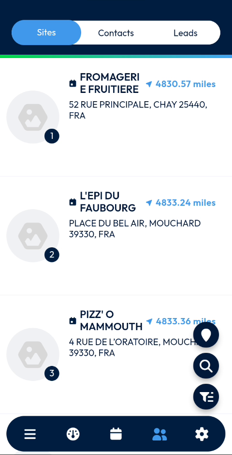

# Browse the Sites List

Read the list of sites and open the site you need.

## Overview

The **Sites** tab lists the sites around you. Each site shows how far it is from your position, so you can find the nearest customers quickly.

## Before you begin

* You have opened the **Customer Directory**. See [Customer Directory](README.md#open-the-customer-directory).

## Read the list

1. In the **Customer Directory**, make sure that the **Sites** tab is selected. It is highlighted in blue.
2. Scroll down to see all the sites.

<figure><figcaption>
List of sites
</figcaption></figure>

For each site, the list shows:

* The rank of the site in the list.
* The name of the site.
* The distance from your position, in miles, for example **4830.57 miles**.
* The address of the site.

## Use the buttons of the list

Three buttons are displayed at the right of the screen:

* The map pin button.
* The magnifying glass button, to search.
* The filter button.

<!-- REVIEW: the video does not use these buttons. Confirm what each one does: map display, search criteria and filters. -->

## Open a site

1. In the list, tap the site.
2. The page of the site opens. See [View a Site](view-a-site.md).

To return to the list, tap the back arrow at the top left of the site page.

## Related topics

* [Customer Directory](README.md)
* [View a Site](view-a-site.md)
