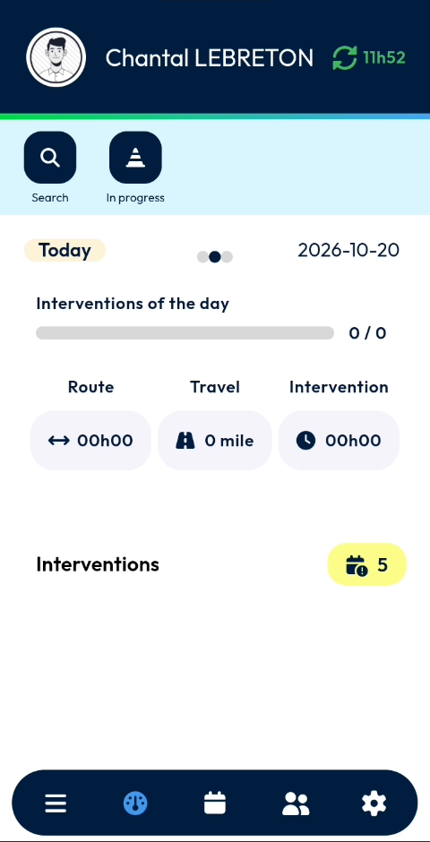
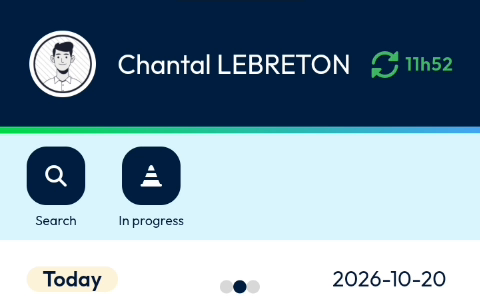
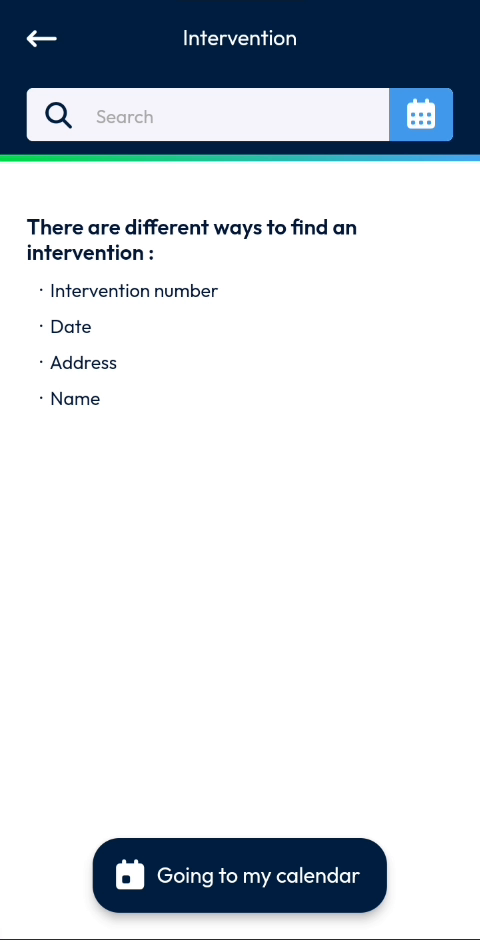
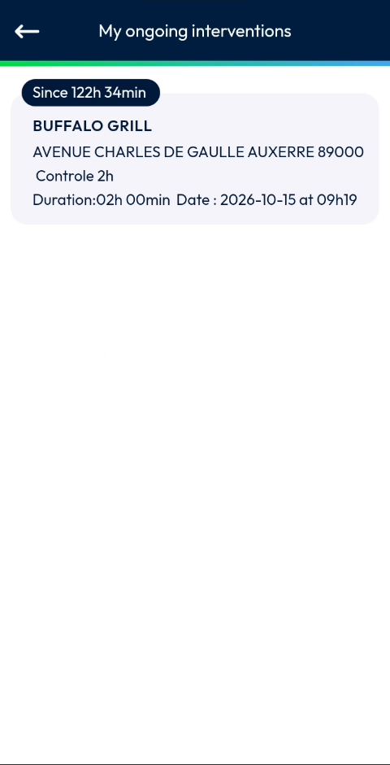
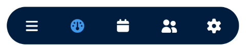

# Dashboard

See your day at a glance and reach your interventions quickly.

## Overview

The dashboard is the home page of NFS Mobile. It opens after you log in. It shows your planned interventions and the progress of the day, and gives you shortcuts to search for an intervention or to list the interventions in progress.

<figure><figcaption>
Dashboard
</figcaption></figure>

## Screen layout

The dashboard contains the following areas, from top to bottom:

| Area | Description |
| ---- | ----------- |
| [Header](dashboard.md#header) | Your photo and name, and the synchronization indicator. |
| [Shortcuts](dashboard.md#shortcuts) | **Search** and **In progress**. |
| [Day summary](dashboard.md#day-summary) | The date, the progress of the day and the route, travel and intervention figures. |
| [Interventions](dashboard.md#interventions) | The number of interventions in your list. |
| [Navigation bar](dashboard.md#navigation-bar) | The icons to move between the main pages. |

## Header

The header at the top of the screen shows:

* Your photo and name.
* A green synchronization icon, followed by a time.

<figure><figcaption>
Header and shortcuts
</figcaption></figure>

<!-- REVIEW: confirm what the green synchronization icon and the time (11h52 in the video) mean, and whether tapping the icon starts a synchronization. -->

## Shortcuts

Two shortcuts are displayed under the header.

| Shortcut | Description |
| -------- | ----------- |
| **Search** | Find an intervention. |
| **In progress** | List the interventions that are in progress. |

### Search for an intervention

1. On the dashboard, tap **Search**.
2. In the **Intervention** page, tap the search field.
3. Enter your search.

You can find an intervention by:

* Intervention number
* Date
* Address
* Name


To search by date, tap the calendar icon at the right of the search field.


<figure><figcaption>
Intervention search page
</figcaption></figure>

* To go to your schedule, tap **Going to my calendar** at the bottom of the screen.
* To return to the dashboard, tap the back arrow at the top left.

### List the interventions in progress

1. On the dashboard, tap **In progress**.
2. The **My ongoing interventions** page lists each intervention that is in progress.

Each intervention is displayed in a card that shows:

* How long ago the intervention started, for example **Since 122h 34min**.
* The customer name, for example **BUFFALO GRILL**.
* The address.
* The type of intervention, for example **Controle 2h**.
* The planned duration, and the date and time.

<figure><figcaption>
My ongoing interventions page
</figcaption></figure>

To return to the dashboard, tap the back arrow at the top left.

## Day summary

The day summary shows the state of the selected day.

| Item | Description |
| ---- | ----------- |
| **Today** and the date | The selected day, for example **2026-10-20**. The dots next to it indicate that other days are available. |
| **Interventions of the day** | A progress bar and the number of interventions completed out of those planned, for example **0 / 0**. |
| **Route** | The route time for the day. |
| **Travel** | The distance to travel, in miles. |
| **Intervention** | The time planned for the interventions. |

<!-- REVIEW: confirm how to change the day (swipe left or right?), what the dots represent, and the exact definition of Route, Travel and Intervention. -->

## Interventions

The **Interventions** line shows the number of interventions in your list, in a yellow badge. In the video, the badge shows **5**.

<!-- REVIEW: confirm whether tapping this line or badge opens the list of interventions. It is not shown in the video. -->

## Navigation bar

The navigation bar at the bottom of the screen lets you move between the main pages of the app.

| Icon | Name | Description |
| ---- | ---- | ----------- |
| Three horizontal lines | Menu | - |
| Gauge | Dashboard | The current page, highlighted in blue. |
| Calendar | Calendar | - |
| Two people | Contacts | - |
| Gear | Settings | - |

<figure><figcaption>
Navigation bar
</figcaption></figure>

<!-- REVIEW: the video does not open the Menu, Calendar, Contacts or Settings pages. Confirm the names and purpose of each icon. -->

## Related topics

* [Login](../app-launch/app-launch.md)
