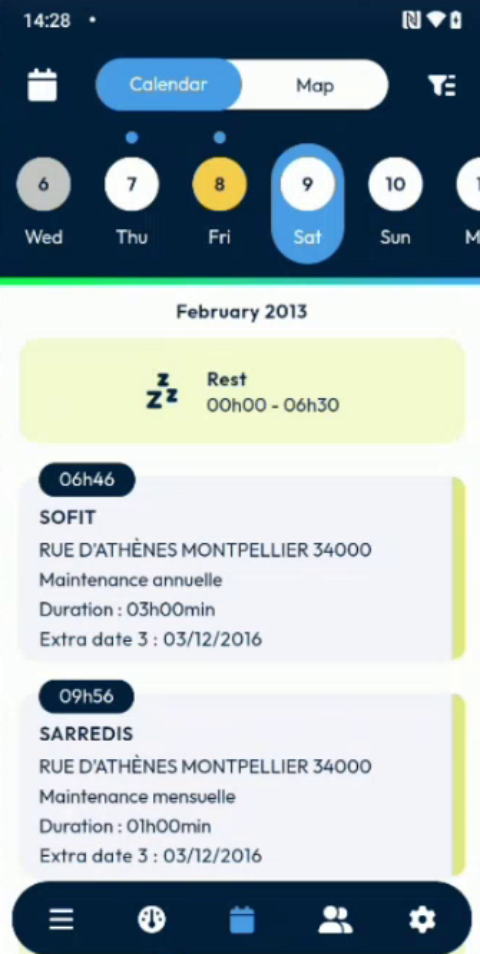
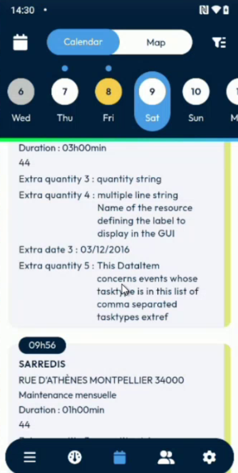

# See Extra Fields in the Agenda

## Overview

The appointment sheet can show additional information, such as extra dates, quantities and logical fields. Your administrator can also show some of these fields on the interventions of the agenda, so that you read them without opening the intervention.

## Before you begin

* Your administrator has chosen which fields appear in the agenda. See [Agenda Handling Setup](../configuration/agenda-handling-setup.md).
* Refresh your data after a change. See [Refresh Your Data](refresh-your-data.md).

## See the fields in the agenda

1. On the dashboard, tap the calendar icon to open the **Calendar**. See [Calendar](calendar.md).
2. Look at an intervention. Under its type and duration, the card shows the extra fields that your administrator chose. For example, **Extra date 3**.

<figure><figcaption>
Intervention with one extra field
</figcaption></figure>

3. When your administrator shows more fields, they all appear on the card, for example **Extra quantity 3**, **Extra quantity 4**, **Extra date 3** and **Extra quantity 5**.

<figure><figcaption>
Intervention with several extra fields
</figcaption></figure>

The fields appear in the day view and in the week view too. A field of another type, such as a check box, is displayed as in the appointment sheet. Scroll the agenda to read all the cards.

<!-- REVIEW: confirm how the fields look in the week view and in the list, and how a logical field is displayed on a card. -->

## Related topics

* [Calendar](calendar.md)
* [Week View of the Calendar](calendar-week-view.md)
* [Agenda Handling Setup](../configuration/agenda-handling-setup.md)