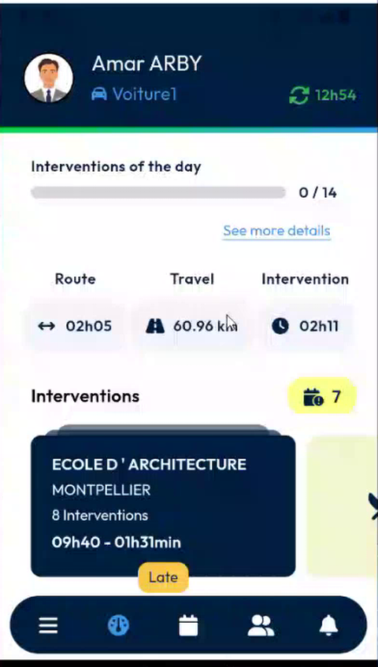
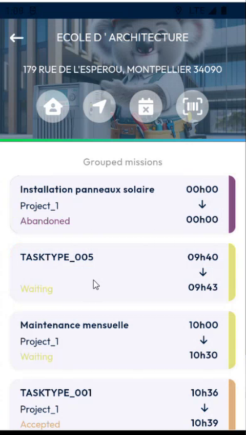
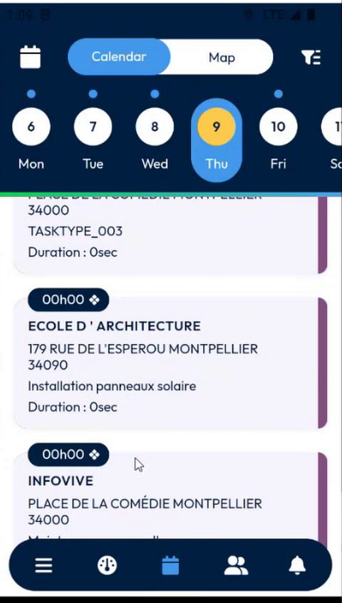
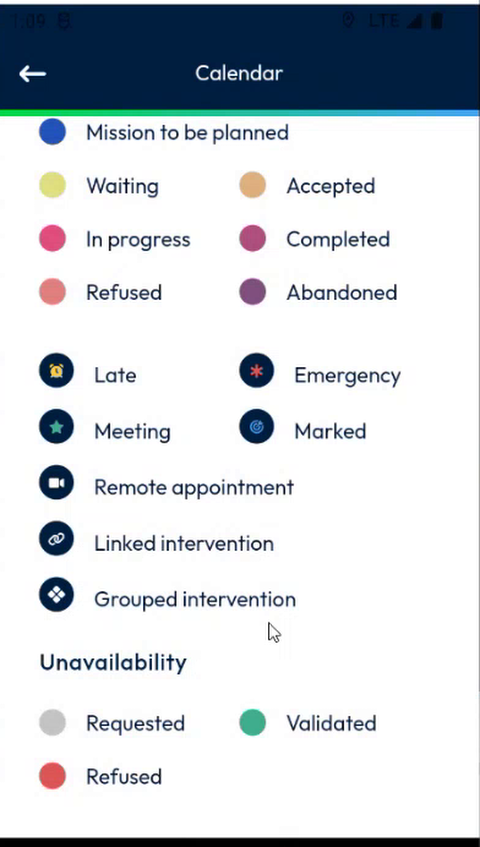
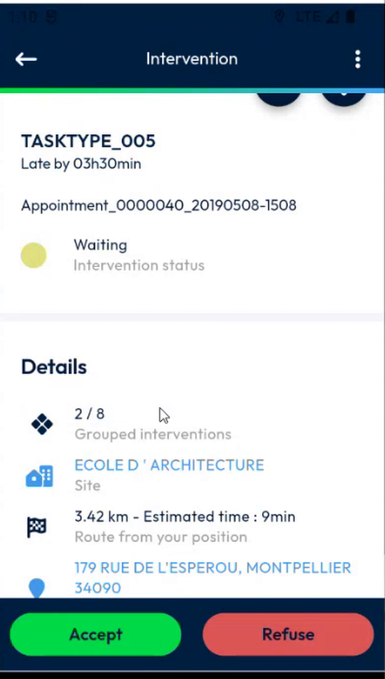
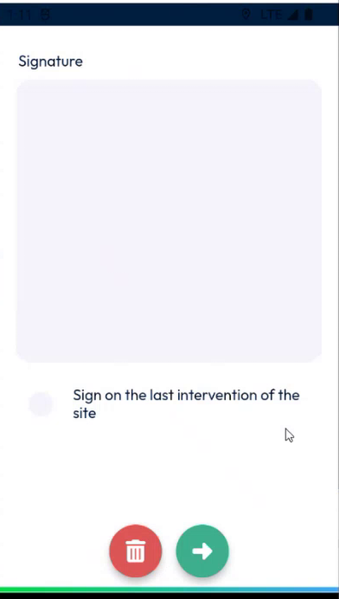
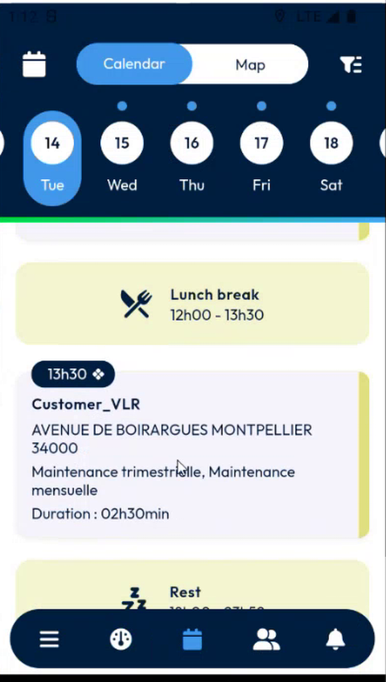

# Grouped Interventions

Recognize the interventions that belong to the same group, and sign once for the whole group.

## Overview

Several interventions at the same customer on the same day are grouped. The rule is now simple: **same day, same customer**. Before, the interventions also had to follow each other without a break, so a lunch break or a visit to another customer split the group.

The grouping now works in the dashboard and in the calendar, and the group behaviors are available wherever you open an intervention.

## Before you begin

* You are logged in, and your agenda has interventions. See [Calendar](calendar.md).

## Find a group on the dashboard

On the dashboard, a card in the **Interventions** area shows the customer and the number of interventions of the group, for example **8 Interventions**.

<figure><figcaption>
Group of 8 interventions on the dashboard
</figcaption></figure>

1. Tap the card.
2. The **Grouped missions** page lists the interventions of the group with their time and status. In the example, one is **Abandoned** and the others are **Waiting** or **Accepted**.

<figure><figcaption>
Grouped missions
</figcaption></figure>

3. Tap an intervention to open it.

## Find a group in the calendar

In the calendar, each intervention of a group has a small group icon next to its start time. A single intervention has no icon.

<figure><figcaption>
Group icon in the calendar
</figcaption></figure>

The icon is displayed in the **Day**, **Week** and **List** displays.

To check what the icon means, open the options of the calendar and read the **Legend**. The icon is **Grouped intervention**.

<figure><figcaption>
Legend
</figcaption></figure>

## See the position of an intervention in its group

1. In the calendar, tap an intervention that has the group icon.
2. On the **Intervention** page, scroll to **Details**.
3. Read **Grouped interventions**, for example **2 / 8**. It is the position of this intervention in the group, and the total.

<figure><figcaption>
2 / 8: second intervention of a group of eight
</figcaption></figure>

## Sign on the last intervention

For a group, you can ask the customer to sign once, at the last intervention of the group, instead of once per intervention.

1. Open an intervention of the group and finish it. See [Finish an Intervention](../intervention/finish-an-intervention.md).
2. On the signature page, select **Sign on the last intervention of the site**.

<figure><figcaption>
Sign on the last intervention of the site
</figcaption></figure>

3. Continue. The signature is requested when you finish the last intervention of the group.

This option was available only from the dashboard. It is now available wherever you open the intervention, including from the calendar.

## An intervention with several time slots

An intervention that is split into several slots, for example by a lunch break, is also a group. Each slot is a position of the group, for example **1 / 2** and **2 / 2**.

<figure><figcaption>
One intervention split into two slots by the lunch break
</figcaption></figure>


A cancelled intervention counts in the total of the group. In the example, seven interventions are confirmed and one is cancelled, so the group shows eight.


<!-- REVIEW: the team asked whether there is a time saving for grouped interventions. Today the only group behavior is Sign on the last intervention. Confirm the wording of this option, and whether a cancelled or abandoned intervention counts in the total of the group. -->

## Related topics

* [Calendar](calendar.md)
* [Dashboard](main-actions.md)
* [Sign an Intervention](../intervention/sign-an-intervention/README.md)
