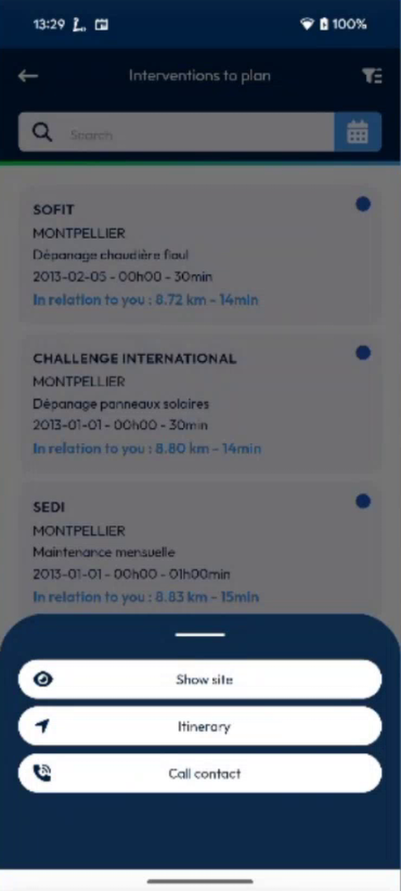
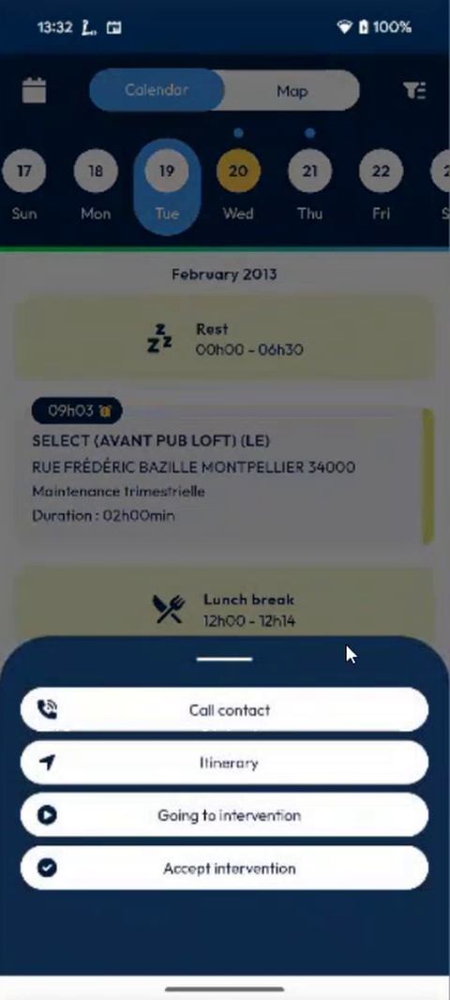
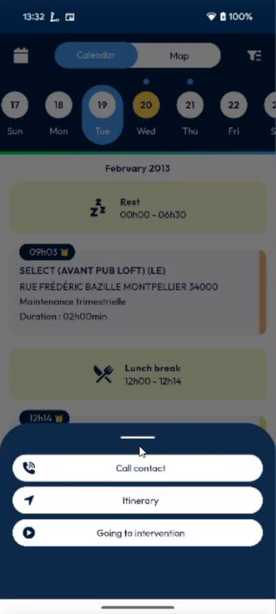
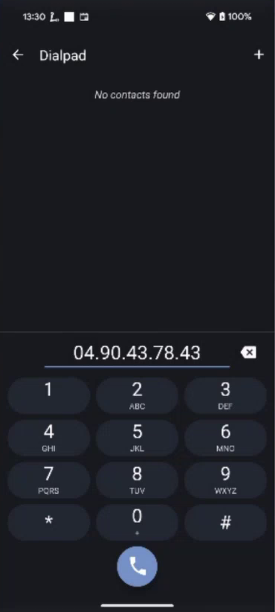
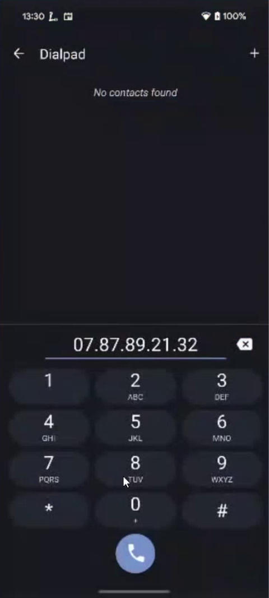

# Quick Actions on an Intervention

## Overview

A long press on an intervention opens a panel of quick actions at the bottom of the screen. You can use it in the list of interventions to plan and in the calendar.

## Before you begin

* You are logged in. See [Login](../app-launch/app-launch.md).
* For **Itinerary**, a navigation app is installed and the location of your device is turned on.

## In the list of interventions to plan

1. Open the list of **Interventions to plan**.
2. Press an intervention for a long time. The panel opens at the bottom of the screen.

<figure><figcaption>
Quick actions in the list of interventions to plan
</figcaption></figure>

| Action | What it does |
| ------ | ------------ |
| **Show site** | Opens the page of the site. |
| **Itinerary** | Opens the route to the site in your navigation app. |
| **Call contact** | Opens the dial pad with the number of the contact. |

## In the calendar

Press an intervention in the calendar for a long time. The same panel is displayed at the bottom of the same page. Before, a long press opened another page.

<figure><figcaption>
Quick actions in the calendar
</figcaption></figure>

| Action | What it does |
| ------ | ------------ |
| **Call contact** | Opens the dial pad with the number of the contact. |
| **Itinerary** | Opens the route to the intervention. |
| **Going to intervention** | Starts the journey to the intervention. |
| **Accept intervention** | Accepts the intervention. |
| **Select for swap** | Starts a swap with another intervention. See [Swap Two Interventions](swap-interventions.md). |

**Accept intervention** is displayed only when the intervention is not accepted yet. Once accepted, the button disappears.

<figure><figcaption>
Quick actions of an accepted intervention
</figcaption></figure>

## Which number is called

The app uses the main contact of the customer.

1. If the main contact has a **work phone**, the app uses it.
2. If not, the app uses the **cell phone** of the main contact.
3. If the main contact has neither, the app looks at the other contacts and uses the first work phone or cell phone that it finds.
4. If no contact has a phone, **Call contact** is hidden.

<figure><figcaption>
Dial pad with the work phone
</figcaption></figure>

<figure><figcaption>
Dial pad with the cell phone
</figcaption></figure>

Tap the green call button to call.

<!-- REVIEW: confirm the order of the numbers (work phone, then cell phone, then another contact), and whether the home phone is ever used. Confirm whether Going to intervention is displayed only for accepted interventions. -->

## Related topics

* [Calendar](calendar.md)
* [Get Directions to a Site](../customer-directory/get-directions-to-a-site.md)
* [Create an Intervention for a Site](../customer-directory/create-an-intervention-for-a-site.md)
