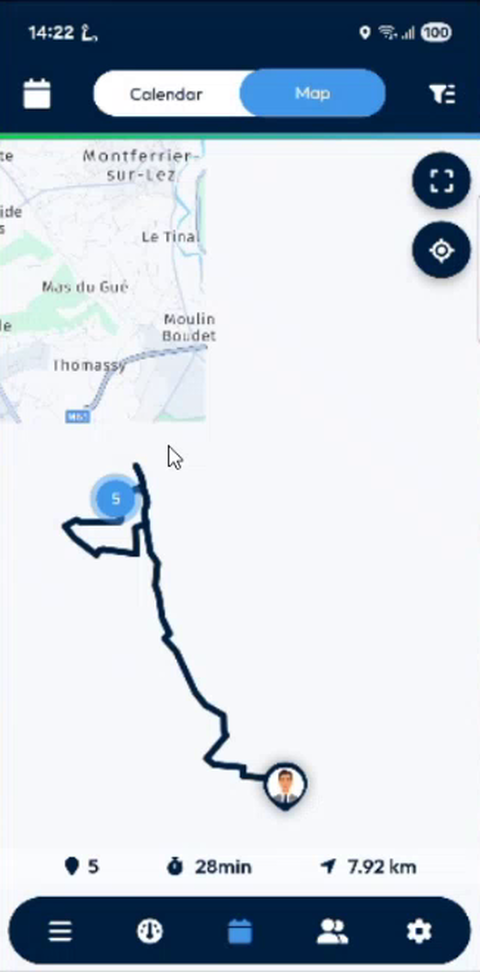
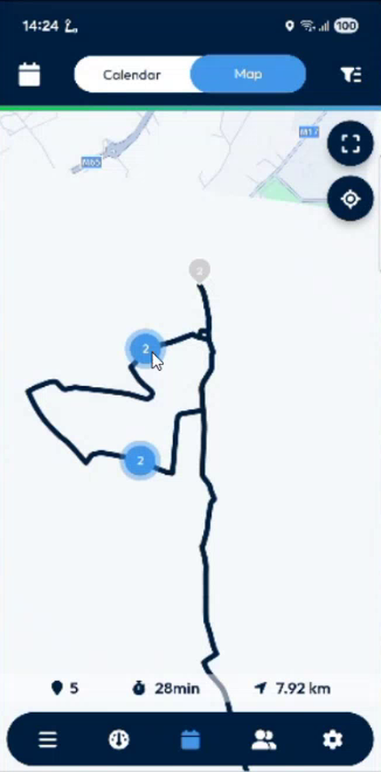
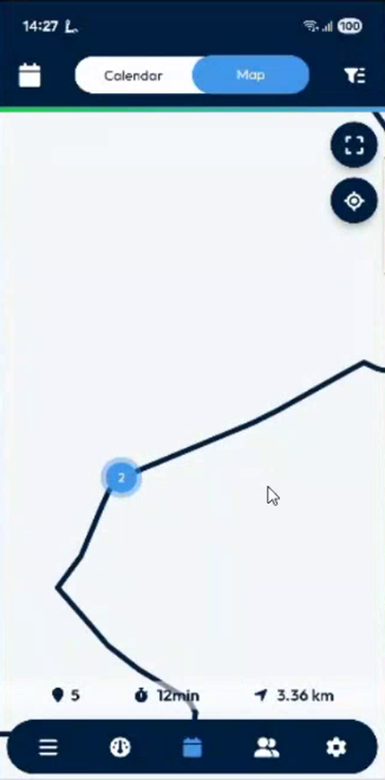
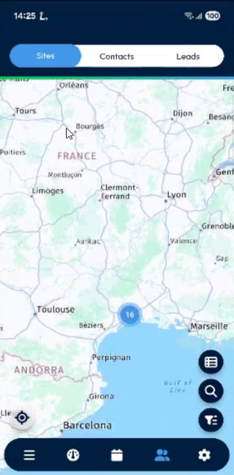
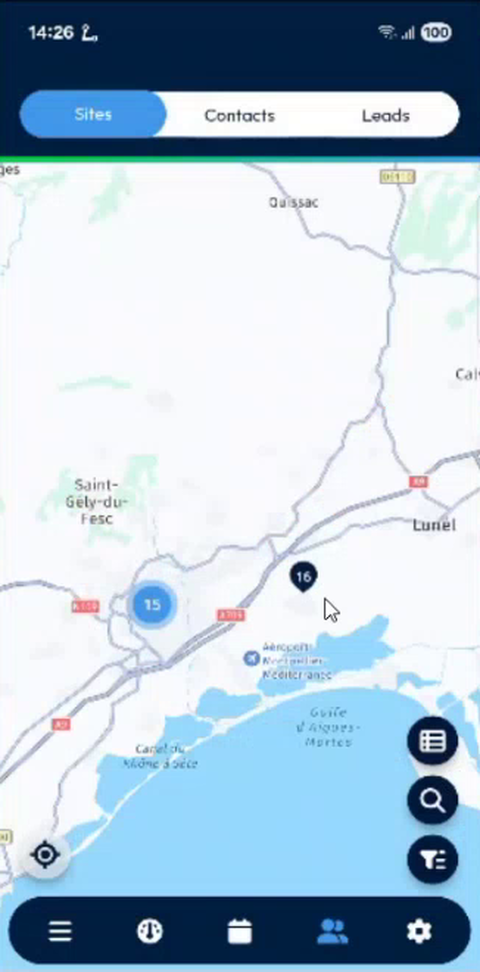
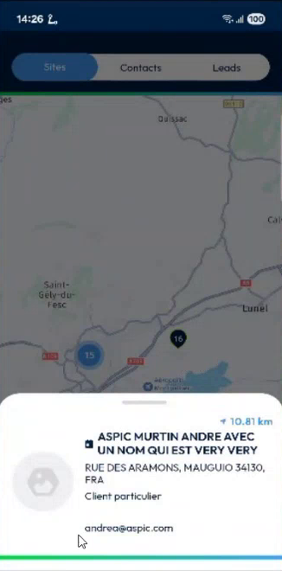
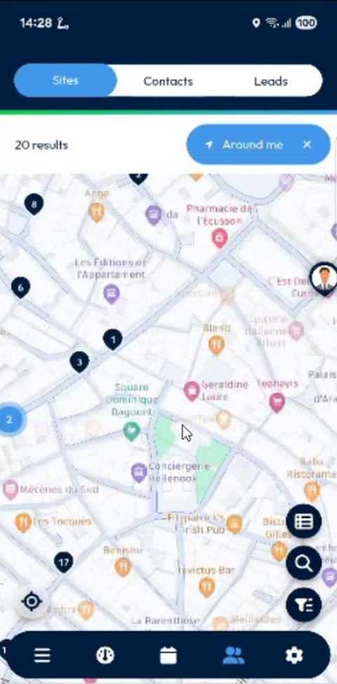

# Clustered Markers on the Maps

Read a crowded map: nearby markers are grouped into one numbered circle that opens as you zoom in.

## Overview

The two main maps of the app now group markers that are close to each other:

* The **Map** of the **Calendar**, which shows your interventions.
* The **Map** of the **Contacts**, which shows the sites around you.

Before, each intervention or site was a separate marker, so the map was hard to read when there were many. Now a numbered blue circle represents a group, and the number is how many markers it contains.

## Before you begin

* You are logged in, and your agenda or your list of sites has results. See [Calendar](calendar.md) and [Browse the Sites List](../customer-directory/browse-the-sites-list.md).

## Read the clusters on the calendar map

1. In the navigation bar, tap the **Calendar** icon.
2. Select a day, then tap **Map** in the top bar.
3. Look at the blue circles. A circle with a number groups that many interventions that are close together. In the example, a circle with **5** groups the five interventions of the day.

<figure><figcaption>
A cluster groups five interventions
</figcaption></figure>

### Zoom in to split a cluster

1. Zoom in on the map. Pinch with two fingers, or double-tap the map.
2. The cluster splits into smaller clusters, then into single markers.

<figure><figcaption>
The cluster splits into two clusters when you zoom in
</figcaption></figure>

<figure><figcaption>
Zoomed in further
</figcaption></figure>

3. Zoom out. The markers group again.


Two interventions at the same address, for example two interventions for the same customer on the same day, share one position. They stay in one cluster of **2**, even at the highest zoom, because their markers overlap.


### Open an intervention

1. Zoom in until the intervention is a single marker.
2. Tap the marker. The intervention card opens at the bottom of the screen, then the **Intervention** page when you tap it.

Tapping a cluster does nothing. Zoom in to reach the markers.

## Read the clusters on the sites map

1. In the navigation bar, tap the **Contacts** icon, then the **Sites** tab.
2. Tap the map button at the bottom right of the list. The map opens with the sites.

<figure><figcaption>
List of sites
</figcaption></figure>

<figure><figcaption>
Sites map with one cluster
</figcaption></figure>

3. A circle with a number groups that many sites. In the example, **16** sites are grouped near Montpellier, and one site is displayed in Paris.
4. Zoom in. The clusters split into smaller clusters and single markers.

<figure><figcaption>
Sites map zoomed in
</figcaption></figure>

5. Tap a single marker. The card of the site opens at the bottom, with its name, address, contact and distance. See [View a Site](../customer-directory/view-a-site.md).

<figure><figcaption>
Card of the selected site
</figcaption></figure>

### Search around you

When you use **Around me**, the map shows more sites, for example **20 results**. The clusters keep the map readable and fast, even with 30 markers or more.

<figure><figcaption>
20 results around me
</figcaption></figure>

<!-- REVIEW: the team asked whether a tap on a cluster could zoom in on it. Today only the pinch and the double-tap zoom. Confirm whether a tap on a cluster will be added, and whether the lists of Contacts and Leads both use the clusters. -->

## Related topics

* [Calendar](calendar.md#view-your-interventions-on-the-map)
* [Browse the Sites List](../customer-directory/browse-the-sites-list.md)
* [Calendar Map Marker Colors](calendar-map-marker-colors.md)
