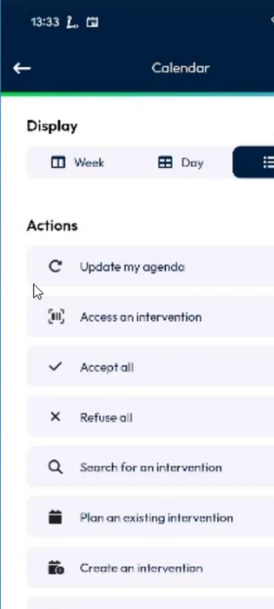
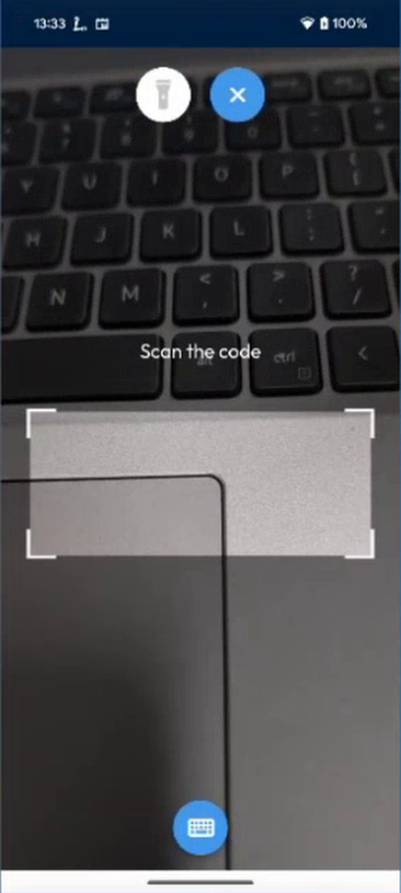
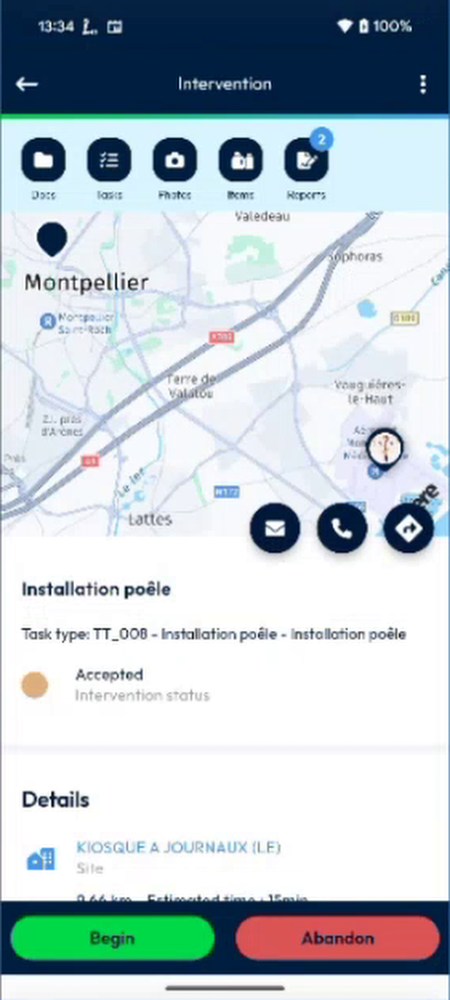
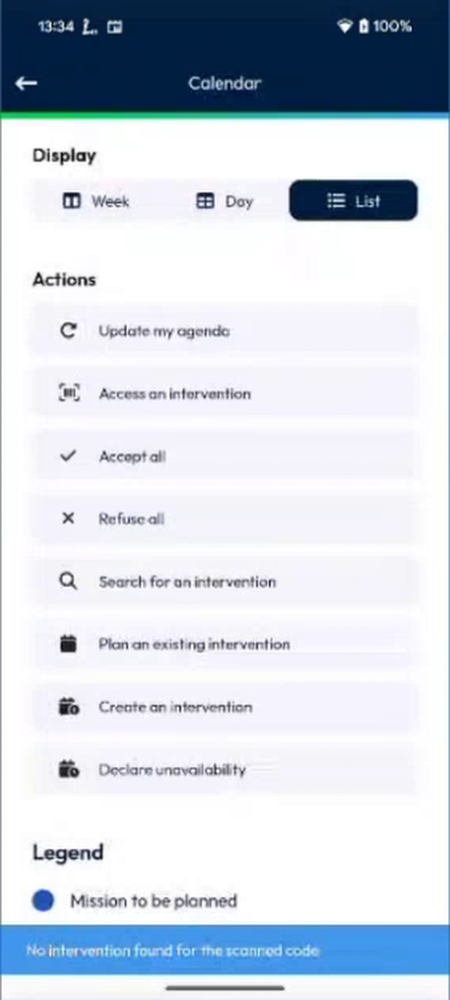

# Open an Intervention with a Scan

Scan a barcode or a QR code to open the intervention that it identifies.

## Overview

The **Access an intervention** action opens the camera. When you scan the code of an intervention, the app opens that intervention at once. You do not have to look for it in your agenda.

## Before you begin

* The appointment has a code. See [Intervention Scan Code Setup](../configuration/intervention-scan-code-setup.md).
* The app is allowed to use the camera of your device.

## Open an intervention

1. In the **Calendar** page, tap the options icon at the right of the top bar.
2. In **Actions**, tap **Access an intervention**.

<figure><figcaption>
Calendar options
</figcaption></figure>

3. The camera opens with the message **Scan the code**.

<figure><figcaption>
Scan the code
</figcaption></figure>

4. Point the camera at the code. The **Intervention** page opens.

<figure><figcaption>
Intervention opened by the scan
</figcaption></figure>

To type the code instead, tap the keyboard button at the bottom of the screen. To leave without a code, tap the cross.

## If the code is not recognized

| Message | Meaning |
| ------- | ------- |
| **No intervention found for the scanned code** | No intervention of your agenda has this code. |
| **Scan code is empty or contains only spaces** | The code that you typed or scanned is empty. |

<figure><figcaption>
No intervention found for the scanned code
</figcaption></figure>

<!-- REVIEW: confirm the exact wording of the second message, and whether the scan can open an intervention of another day or of another technician. -->

## Related topics

* [Calendar](calendar.md#calendar-options)
* [Intervention Scan Code Setup](../configuration/intervention-scan-code-setup.md)
* [Scan a Task Code](../intervention/scan-a-task-code.md)
