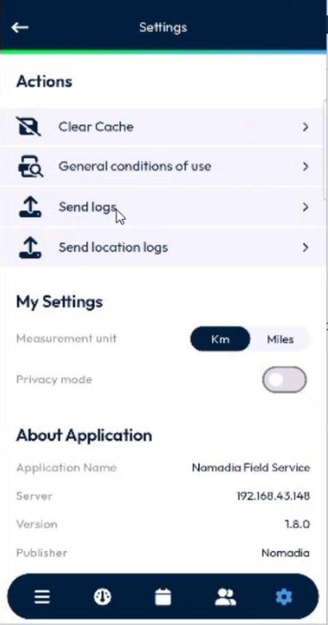

# Send the App Logs

## Overview

NFS Mobile keeps a log file of what the app does and of the errors that it meets. When you have a problem, you send this file to the back office, and your support team reads what happened before the error. It is a tool for diagnostics, not a feature for your daily work.

The app has two log files, and a send button for each:

| Option in **Settings** | What it sends |
| ---------------------- | ------------- |
| **Send logs** | The app log: errors, the state of the app, the network and the scans. |
| **Send location logs** | The log of the position tracking. See [Send Your Location Logs](send-location-logs.md). |

## Before you begin

* You are logged in, and your device has a network.
* You know the version of the app. It is displayed at the bottom of **Settings**, in **About Application**.

## Send the app logs

1. In the navigation bar, tap the gear icon to open **Settings**.
2. In **Actions**, tap **Send logs**.

<figure><figcaption>
Settings with <strong>Send logs</strong>
</figcaption></figure>

3. Wait for the message **Successfully sent** at the bottom of the screen.

After a successful sending, the app starts a new log file. The next sending does not repeat the lines that you already sent.


The app does not send the logs by itself. You send them on demand, when your support team asks you. The automatic sending of the location logs every 24 hours was removed.


## What the app log contains

| Information | Example |
| ----------- | ------- |
| **A header** | The version of the app, the upload time, the device (system, model, physical device or emulator). |
| **The sessions** | The start of the application session. |
| **The network** | The device is connected to wifi, to cellular data, or to none. |
| **The life cycle** | The app is in the foreground, or moved to the background. |
| **The automatic refresh** | When the app started it, and whether the network was available. |
| **The errors of a request** | The request that the app sent and the answer of the back office, when the answer is an error. |
| **The errors of the screens and of the platform** | A layout error, or an exception that can lead to a blank page. |
| **The scans of an item** | The appointment, the item, the time, the status of the scan and the scanned code. |

The authentication data, such as the session identifier, the login and the password, is removed before it is written to the file.

The app writes the whole error, but only the first line of the stack trace.

## How the log files are kept

* Each log file has a fixed size: **2 MB** for the app log and **4 MB** for the tracking log.
* The app keeps two files for each log, the current one and the previous one. When the current file is full, it becomes the previous one and a new current file starts. You keep the history that comes before an error.
* The app does not record the requests that end without an error.

<!-- REVIEW: the 2 MB and 4 MB sizes and the two-file rolling are described by the developer. The Q&A mentions that the log levels cannot be chosen yet. Confirm that the Send logs option exists in your version (earlier versions show Send location logs only). -->

## Related topics

* [Send Your Location Logs](send-location-logs.md)
* [Settings](settings.md)
* [App Logs Setup](../configuration/app-logs-setup.md)
* [Messages and Troubleshooting](../reference/messages-and-troubleshooting.md)
