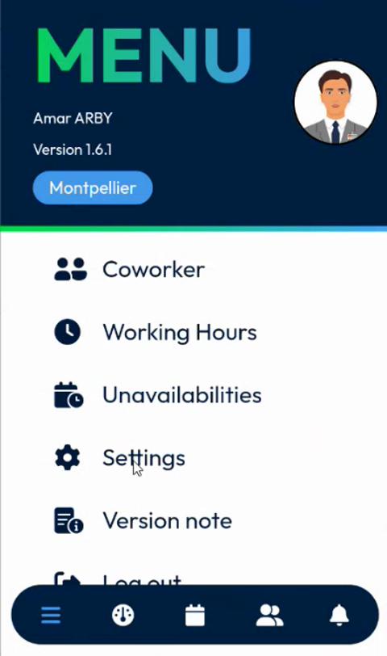
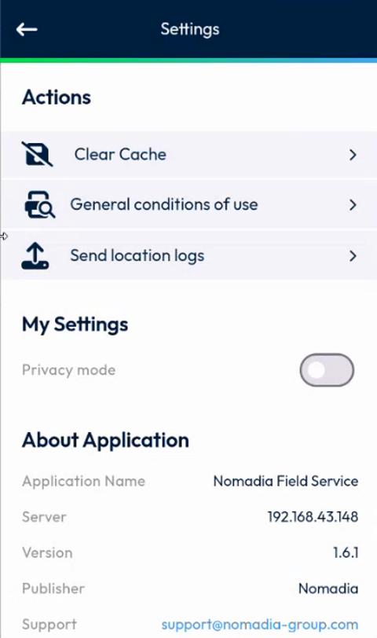
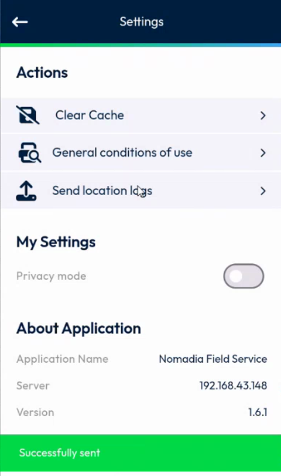
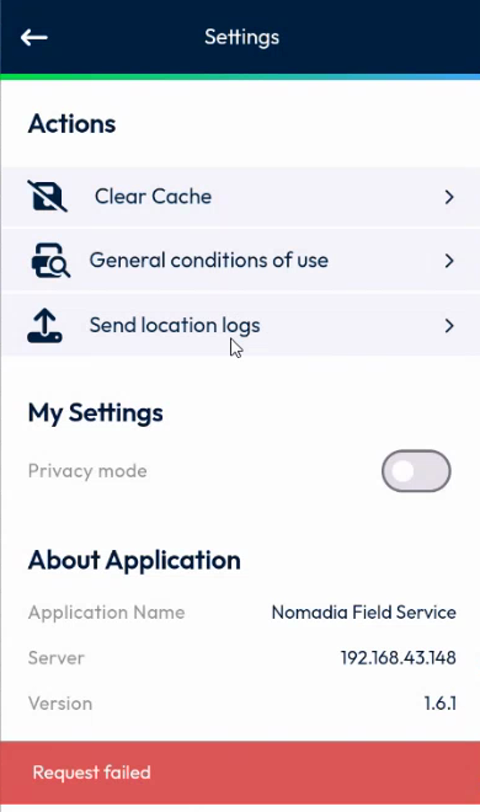

# Send Your Location Logs

## Overview

NFS Mobile keeps a log of its position tracking: when tracking started and stopped, when a position was sent, and whether the sending worked. You can send this location log file to the back office from the **Settings** page. The app also sends it by itself.

This is a diagnostic feature. Use it when your support team asks you, or when your positions do not reach your planner.

## Before you begin

* You are logged in. See [Login](../app-launch/app-launch.md).
* Your device is connected to the network.
* The tracking has recorded some positions. An empty log file is not sent.

## Send the location logs

1. In the navigation bar at the bottom of the screen, tap the menu icon, then tap **Settings**. You can also tap the gear icon, depending on your version.

<figure><figcaption>
Menu
</figcaption></figure>

2. On the **Settings** page, in the **Actions** section, tap **Send location logs**.

<figure><figcaption>
Settings page with Send location logs
</figcaption></figure>

3. Wait for the message at the bottom of the screen.

| Message | Meaning |
| ------- | ------- |
| **Successfully sent** | The file reached the back office. |
| **Request failed** | The file was not sent, for example because there is nothing to send. Try again later. |

<figure><figcaption>
Location logs sent
</figcaption></figure>

<figure><figcaption>
Request failed
</figcaption></figure>

After a successful sending, the app deletes the sent file from your device and starts a new one.

## Automatic sending

The app no longer sends the location log by itself. The sending every 24 hours was removed, because it could fill a temporary folder of the server. You send the file only on demand, from **Settings**. Your support team can also ask you for the app logs. See [Send the App Logs](send-app-logs.md).

## What the log contains

The file lists, with the time of each event:

* When the tracking started and stopped, and the scheduled start and end of the tracking.
* Whether the location permission is granted and whether the app is in the foreground.
* Each time a position was acquired, and whether it was the same as the last known position. To avoid duplicates, the app does not send the same position twice.
* Whether the position was updated on the server successfully.
* When the privacy mode was turned on or off.


The **Send location logs** option is different from the logs of the app itself. The location logs record the tracking. Your support team may also ask you for the logs of the exchanges between the app and the back office.


<!-- REVIEW: the Settings page of the app shown in the video has the option Send location logs where earlier versions show Send logs. Confirm whether both options exist in the current version. Confirm that the privacy mode is written in the log (the presenter could not show it). Confirm the access path to Settings (Menu or navigation bar) in your version. -->

## Related topics

* [Send the App Logs](send-app-logs.md)
* [Settings](settings.md)
* [Send Your Position](../menu/coworkers/send-your-position.md)
* [Privacy Mode](../menu/coworkers/privacy-mode.md)
* [Location Logs Setup](../configuration/location-logs-setup.md)
