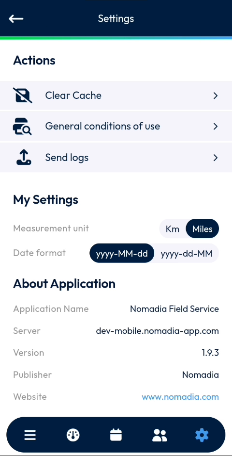
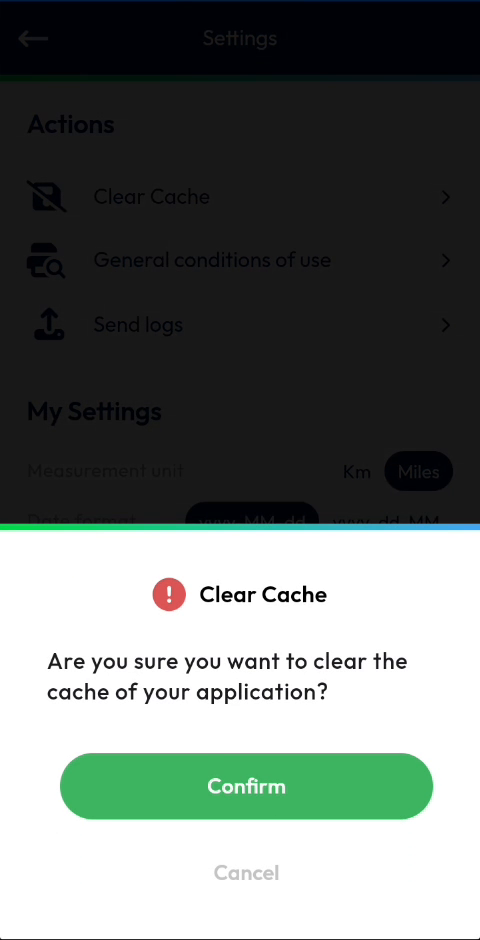
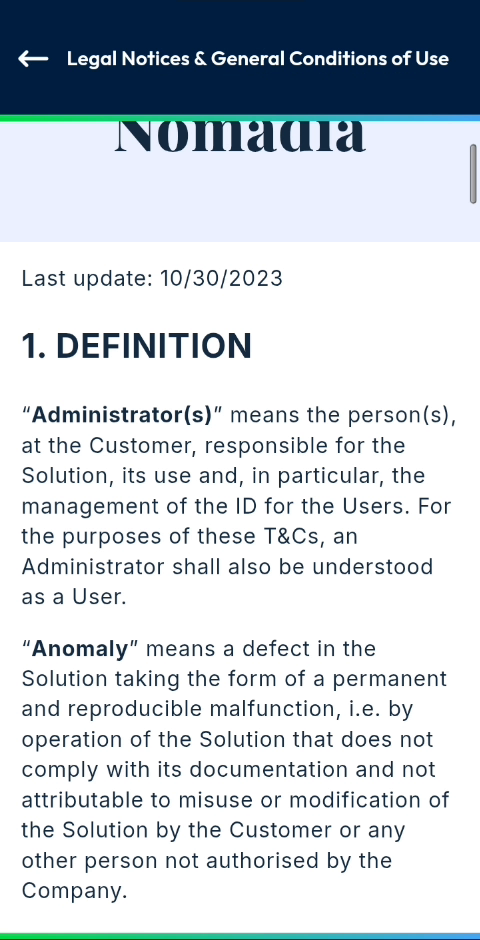
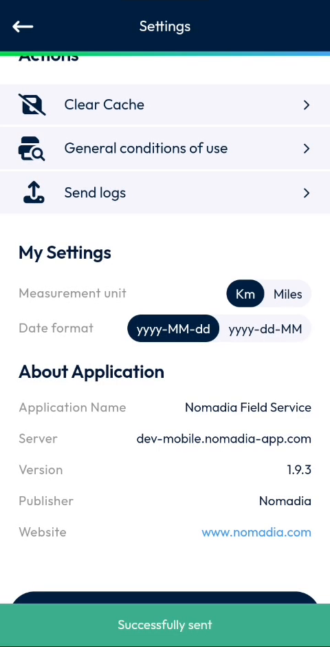

# Settings

Clear the app cache, read the conditions of use, send your logs and set your display preferences.

## Overview

The **Settings** page groups the actions and preferences of the NFS Mobile app. It is organized in three sections:

| Section | Description |
| ------- | ----------- |
| [Actions](settings.md#actions) | Clear the cache, read the general conditions of use and send your logs. |
| [My Settings](settings.md#my-settings) | Choose the measurement unit and the date format. |
| [About Application](settings.md#about-application) | See the application name, server, version and publisher. |

<figure><figcaption>
Settings page
</figcaption></figure>

## Open the Settings page

1. In the navigation bar at the bottom of the screen, tap the **Settings** icon (gear).
2. The **Settings** page opens. The gear icon is highlighted in blue.

To return to the previous page, tap the back arrow at the top left.

## Actions

The **Actions** section contains three options. Tap an option to run it.

| Option | Description |
| ------ | ----------- |
| **Clear Cache** | Clear the cache of the app. |
| **General conditions of use** | Display the legal notices and general conditions of use. |
| **Send logs** | Send the logs of the app. |

### Clear the cache

1. On the **Settings** page, tap **Clear Cache**.
2. In the **Clear Cache** message, read the question **Are you sure you want to clear the cache of your application?**
3. Tap **Confirm** to clear the cache, or tap **Cancel** to close the message without clearing it.

<figure><figcaption>
Clear Cache confirmation message
</figcaption></figure>

After you confirm, the app reloads its data.

<!-- REVIEW: confirm what the cache contains and what happens to data not yet synchronized. The video shows a blank loading screen after Confirm. -->

### Read the general conditions of use

1. On the **Settings** page, tap **General conditions of use**.
2. The **Legal Notices & General Conditions of Use** page opens. It shows the date of the last update, for example **Last update: 10/30/2023**.
3. Scroll down to read the document.
4. To return to the **Settings** page, tap the back arrow at the top left.

The document is organized in numbered sections, such as **1. DEFINITION** and **2. SCOPE**.

<figure><figcaption>
Legal Notices &amp; General Conditions of Use
</figcaption></figure>

### Send your logs

1. On the **Settings** page, tap **Send logs**.
2. Wait for the message **Successfully sent** at the bottom of the screen.

<figure><figcaption>
Message displayed after the logs are sent
</figcaption></figure>


Send your logs when your support team asks for them, for example to analyze a problem with the app.


<!-- REVIEW: confirm who receives the logs and when a user should send them. The video only shows the Successfully sent message. -->

## My Settings

The **My Settings** section lets you choose how the app displays distances and dates. Tap a value to select it. The selected value is highlighted in dark blue.

| Setting | Values | Description |
| ------- | ------ | ----------- |
| **Measurement unit** | **Km**, **Miles** | The unit used to display distances, for example the **Travel** distance on the [dashboard](main-actions.md). |
| **Date format** | **yyyy-MM-dd**, **yyyy-dd-MM** | The order in which year, month and day are displayed. |

<!-- REVIEW: confirm that the Measurement unit and Date format apply to all pages of the app. -->

## About Application

The **About Application** section shows information about the app. This information is read-only.

| Field | Description |
| ----- | ----------- |
| **Application Name** | The name of the app: **Nomadia Field Service**. |
| **Server** | The address of the NFS server the app is connected to. |
| **Version** | The version of the app, for example **1.9.3**. |
| **Publisher** | The publisher of the app: **Nomadia**. |
| **Website** | The website of the publisher. Tap the link to open it. |


Give the **Version** number to your site administrator or support team when you report a problem.


## Related topics

* [Dashboard](main-actions.md)
* [Login](../app-launch/app-launch.md)
