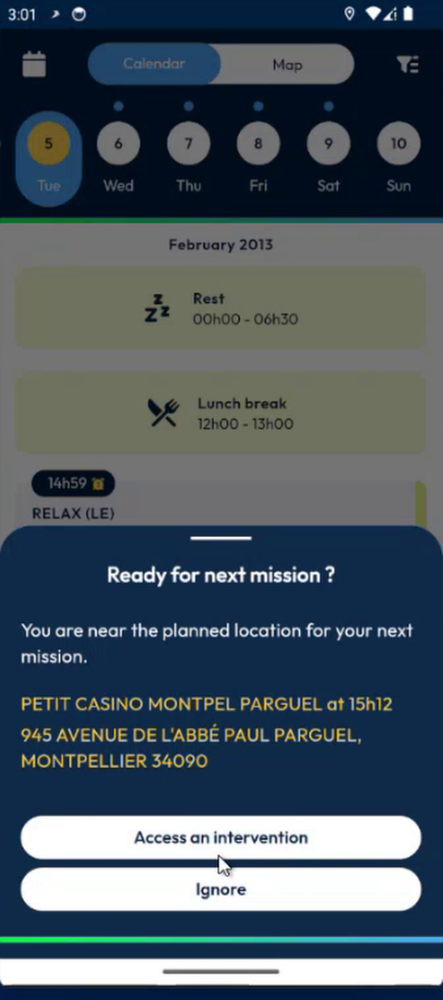
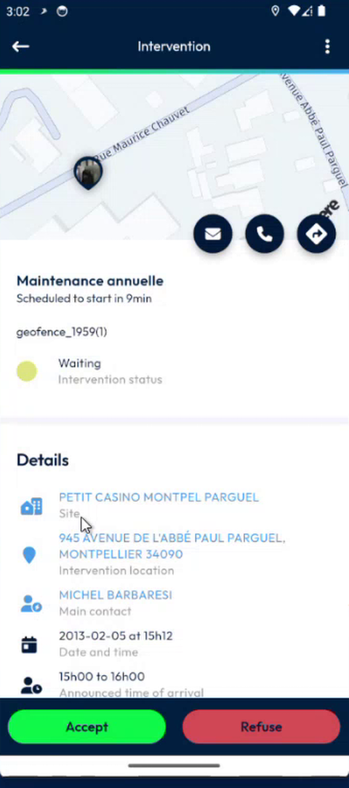
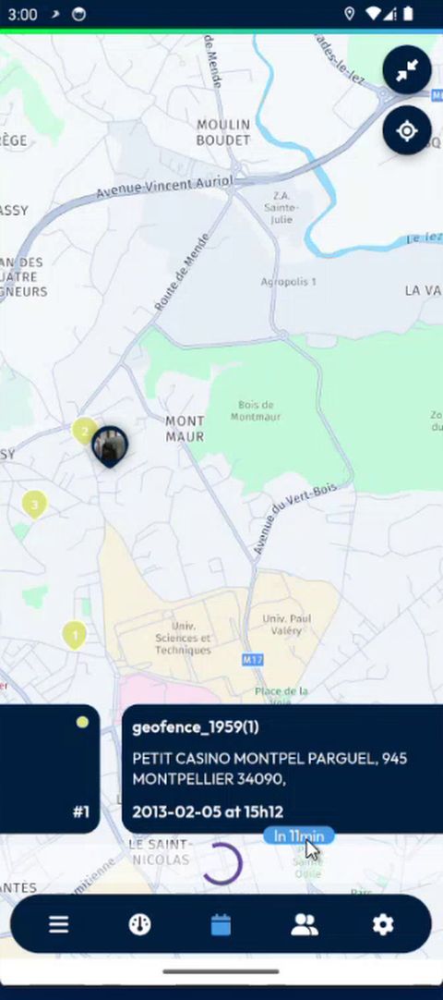
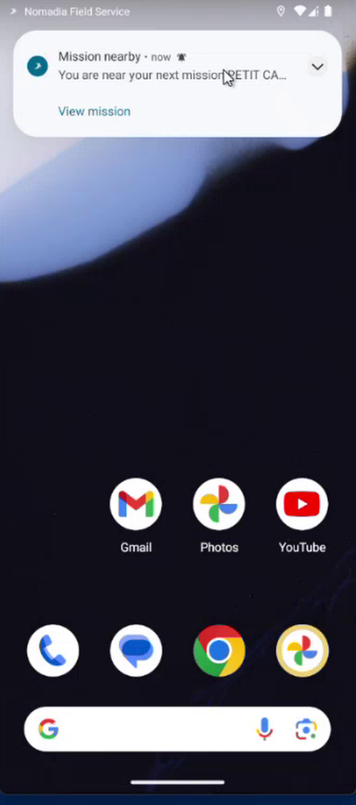
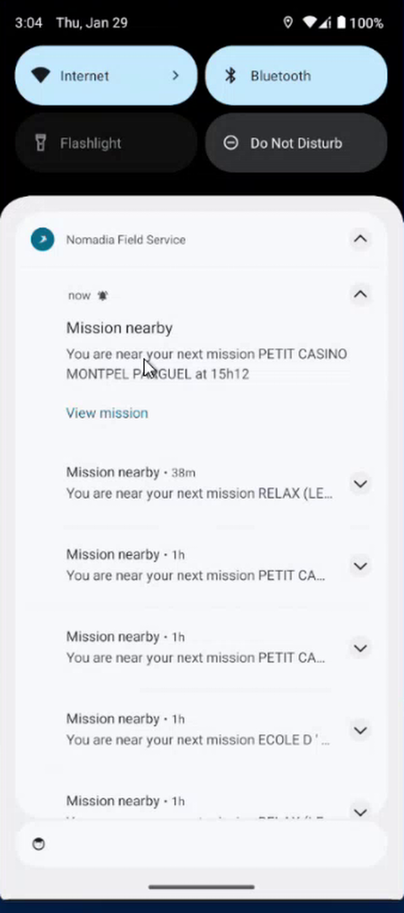

# Get Suggested Interventions Near You

Get a message that suggests the next intervention when you are close to its address and its time is near.

## Overview

When you arrive near the address of an intervention, the app suggests it to you. You can open it in one tap, without looking for it in your agenda. The app does this by itself, from your position and the time.

## Before you begin

* Your administrator has turned on the geofencing. See [Automatic Suggestion Setup](../configuration/automatic-suggestion-setup.md).
* The privacy mode is **off**. With the privacy mode on, the app does not suggest anything. See [Privacy Mode](../menu/coworkers/privacy-mode.md).
* The app is allowed to use the location of your device and to send notifications.

## When the app suggests an intervention

The app suggests an intervention when all of these are true:

| Condition | Rule |
| --------- | ---- |
| **Place** | You are within **500 meters** of the address of the intervention. |
| **Time** | The intervention starts within 30 minutes before or after the current time. |
| **Status** | The intervention is **Accepted** or you have begun it. |
| **Your action** | You have not started the intervention yet. |

The app checks again about every two minutes, while you stay in the area.


If you have already started the intervention, the app does not suggest it, even if you are in the area.


## When the app is open

The app shows the message **Ready for next mission ?** over the screen. It says that you are near the planned place of your next mission, and gives its name, its time and its address.

<figure><figcaption>
Ready for next mission ?
</figcaption></figure>

You have two choices:

* Tap **Access an intervention** to open the intervention.

<figure><figcaption>
Intervention opened from the suggestion
</figcaption></figure>

* Tap **Ignore** to close the message. The app does not suggest this intervention again for 10 minutes. After that, it can suggest it again if you are still near.

You can see the suggestion while you move on the map of the calendar.

<figure><figcaption>
Map of the calendar with the intervention near you
</figcaption></figure>

## When the app is in the background

The app sends a notification **Mission nearby**: **You are near your next mission** followed by its name and time.

<figure><figcaption>
Notification: Mission nearby
</figcaption></figure>

1. Expand the notification to read the details. Your earlier notifications are listed under it.
2. Tap **View mission**. The intervention opens.

<figure><figcaption>
Expanded notification with <strong>View mission</strong>
</figcaption></figure>

## When the app uses the camera

When you take a photo, scan a barcode, use text recognition or use speech detection, the app does not show the message over the screen, so that you are not disturbed. It sends you a notification instead, even if the app is in the foreground.

<!-- REVIEW: the presenter said that the app does not tell the server when you enter the area or start an intervention. The older OT Mobile app had a web service for it, and the team may add it. Confirm the radius (500 meters), the time window (30 minutes) and the delay of the ignore (10 minutes), which come from the demo. -->

## Related topics

* [Quick Actions on an Intervention](long-press-an-intervention.md)
* [Privacy Mode](../menu/coworkers/privacy-mode.md)
* [Calendar](calendar.md)
* [Automatic Suggestion Setup](../configuration/automatic-suggestion-setup.md)
