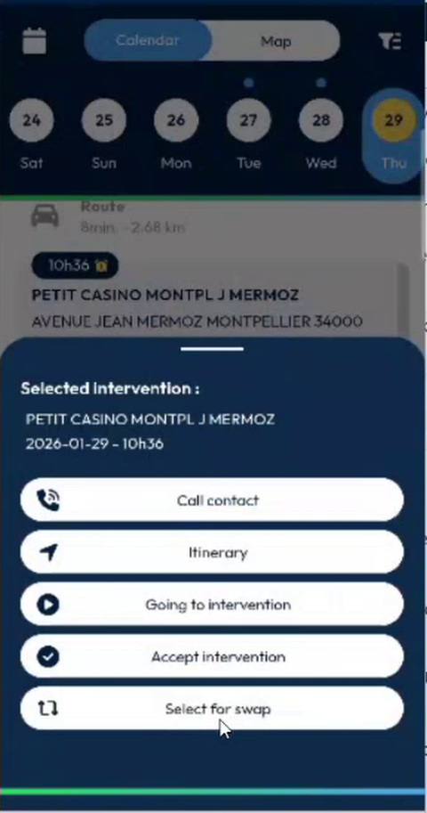
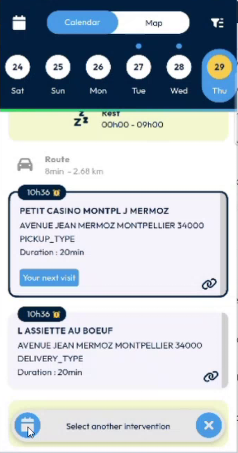
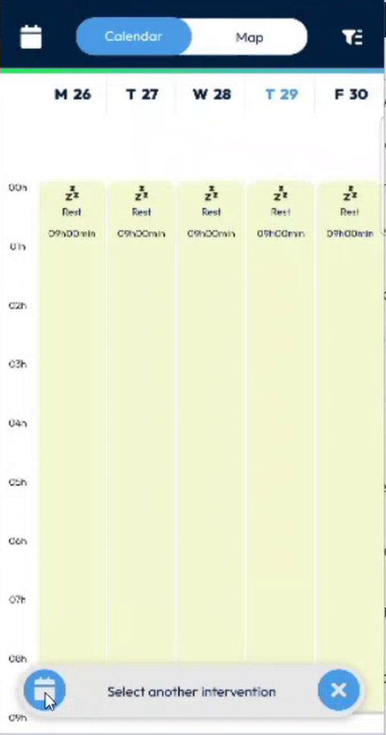
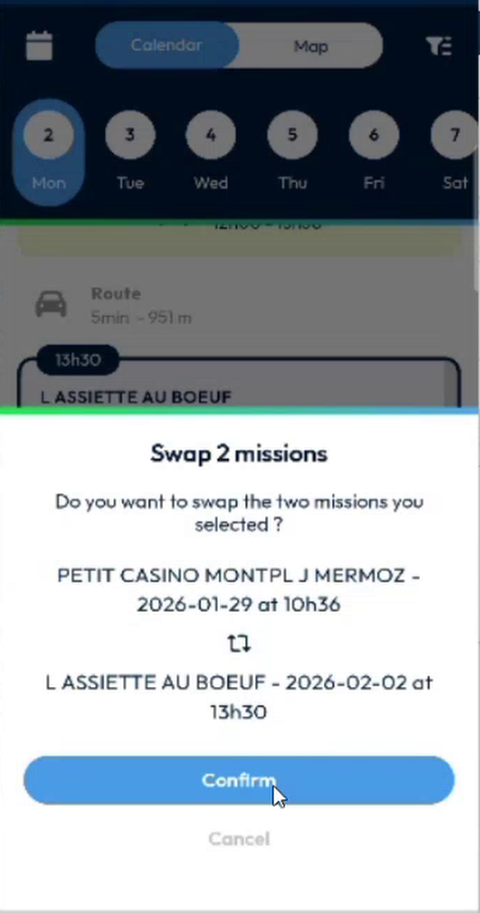
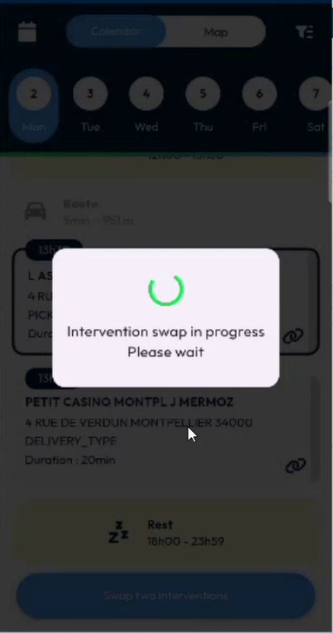
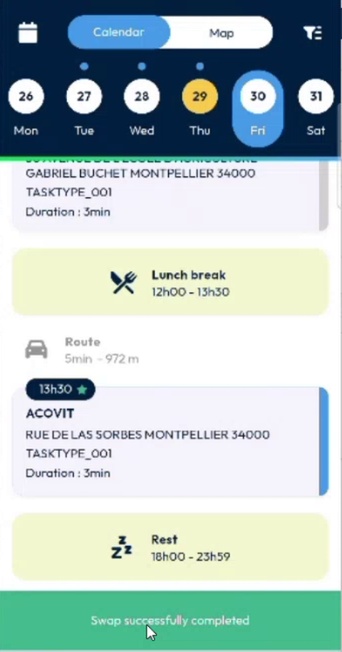
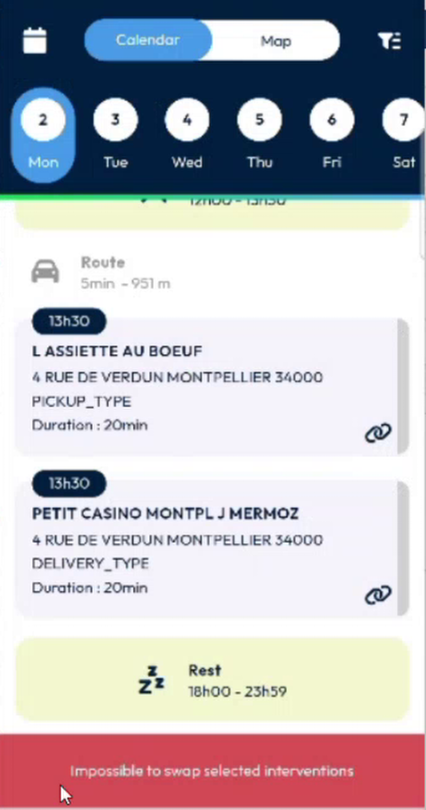
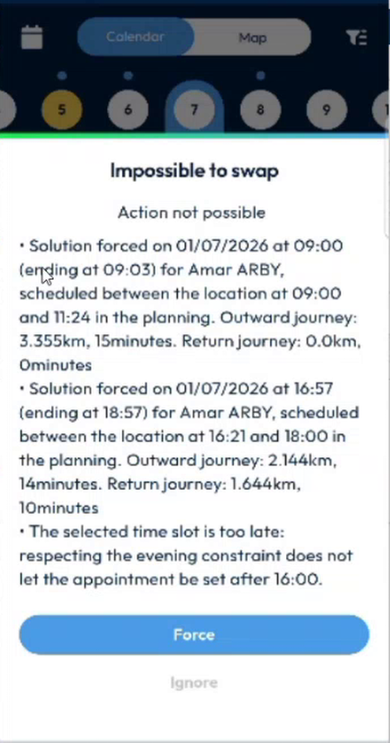
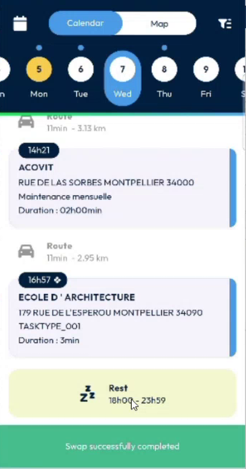

# Swap Two Interventions

## Overview

You can swap two interventions of your agenda from the **Calendar**. The app asks the back office whether the swap is possible. There are three possible answers:

| Answer | What happens |
| ------ | ------------ |
| **The swap is possible** | The back office swaps the two interventions. The app refreshes your agenda. |
| **The swap is possible only if you force it** | The app shows the reasons. You choose **Force** or **Ignore**. |
| **The swap is not possible** | A red message tells you that the swap is impossible. Nothing changes. |

## Before you begin

* Your administrator has turned on the swap. See [Swap Setup](../configuration/swap-interventions-setup.md). Without it, **Select for swap** is not offered.
* The two interventions are **Confirmed** or **Accepted**. You cannot swap an intervention in another status.
* You have refreshed your agenda. See [Refresh Your Data](refresh-your-data.md).

## Select the first intervention

1. In the **Calendar**, press an intervention for a long time. The quick actions open: **Call contact**, **Itinerary**, **Going to intervention**, **Accept intervention** and **Select for swap**.

<figure><figcaption>
Quick actions with <strong>Select for swap</strong>
</figcaption></figure>

2. Tap **Select for swap**. The card of the intervention gets a dark border, and a bar appears at the bottom: **Select another intervention**.

<figure><figcaption>
First intervention selected
</figcaption></figure>

The bar has two buttons:

* The calendar button switches the agenda between the **Week** display and the **List** display, so that you reach the second intervention more easily.
* The cross clears your selection and leaves the swap mode.

<figure><figcaption>
Week display in swap mode
</figcaption></figure>

## Select the second intervention

1. Go to the day of the other intervention. You can select any intervention that your agenda shows. The limit is the number of days that the app loads: the agenda weeks and the planning depth.
2. Press the second intervention for a long time, then tap **Select for swap**, or tap its card.
3. A button **Swap two interventions** appears at the bottom of the screen.

You can deselect an intervention by tapping it again. To change the day, go to another day and select there.

### Linked interventions

An intervention that has a link icon belongs to a pair of linked interventions, for example a pickup and its delivery. The rules are:

* You can swap a pickup only with another pickup.
* You cannot select a delivery together with a pickup, or two deliveries.

If you tap an intervention that the rules do not allow, it is not selected.

## Confirm the swap

1. Tap **Swap two interventions**.
2. In **Swap 2 missions**, check the two interventions, with their dates and times.

<figure><figcaption>
Swap 2 missions
</figcaption></figure>

3. Tap **Confirm**. To keep the interventions as they are, tap **Cancel**.
4. Wait while **Intervention swap in progress – Please wait** is displayed. The app sends the request to the back office.

<figure><figcaption>
Intervention swap in progress
</figcaption></figure>

## Read the answer

### The swap is possible

A green message **Swap successfully completed** is displayed. The app refreshes your agenda, and the two interventions have exchanged their places.

<figure><figcaption>
Swap successfully completed
</figcaption></figure>

### The swap is not possible

A red message **Impossible to swap selected interventions** is displayed. Your agenda does not change.

<figure><figcaption>
Impossible to swap selected interventions
</figcaption></figure>

### The swap is possible only if you force it

The **Impossible to swap** page explains why the swap needs a decision from you. It lists the reasons, for example a journey that is longer than planned, or a time slot that is too late for the evening constraint.

<figure><figcaption>
Impossible to swap: <strong>Force</strong> or <strong>Ignore</strong>
</figcaption></figure>

* Tap **Force** to swap anyway. The app confirms with **Swap successfully completed** and refreshes your agenda.
* Tap **Ignore** to cancel the swap. Nothing changes.

<figure><figcaption>
Swap completed after <strong>Force</strong>
</figcaption></figure>


**Force** applies the swap although the back office warns you. Read the reasons first. An intervention that breaks a constraint can make your day longer.


<!-- REVIEW: the team asked whether the app could group the interventions that cannot be swapped, so that the user does not try several swaps in vain. It needs information from the back office and is not done. Confirm what Force means for the planner in NFS (the reasons say that the solution is forced). Confirm whether a swap is limited to one day or one week. In the demo, there is no limit other than the days that the app loads. -->

## Related topics

* [Calendar](calendar.md)
* [Quick Actions on an Intervention](long-press-an-intervention.md)
* [Week View of the Calendar](calendar-week-view.md)
* [Swap Setup](../configuration/swap-interventions-setup.md)
