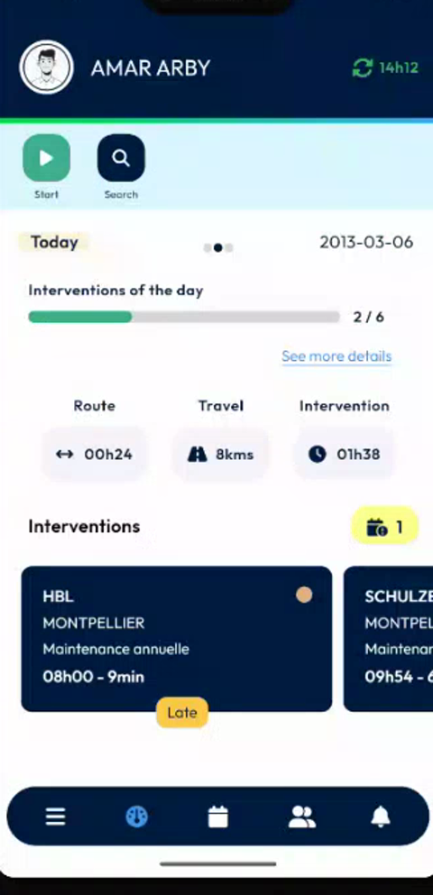
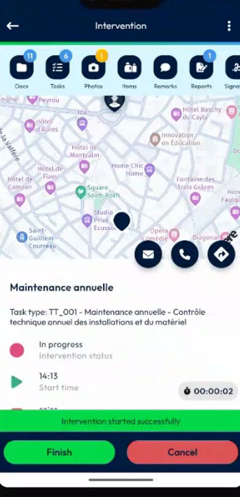
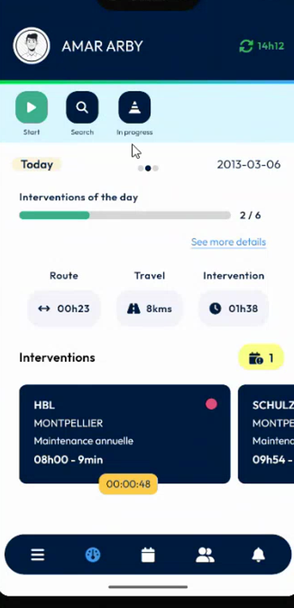
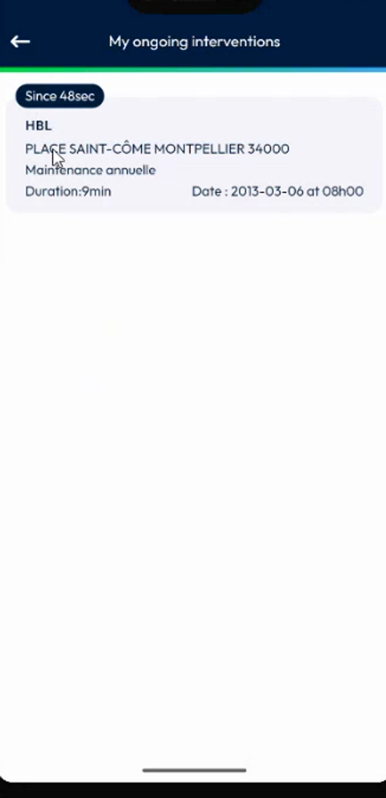
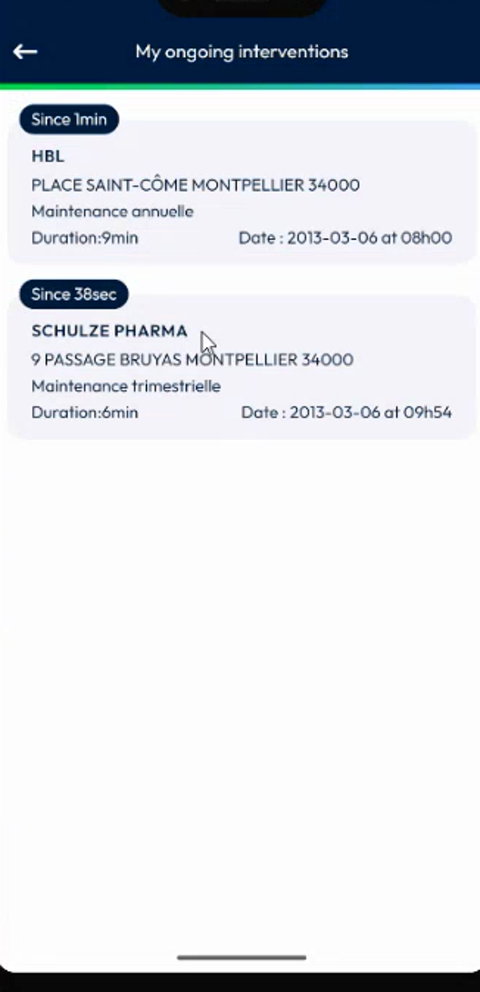
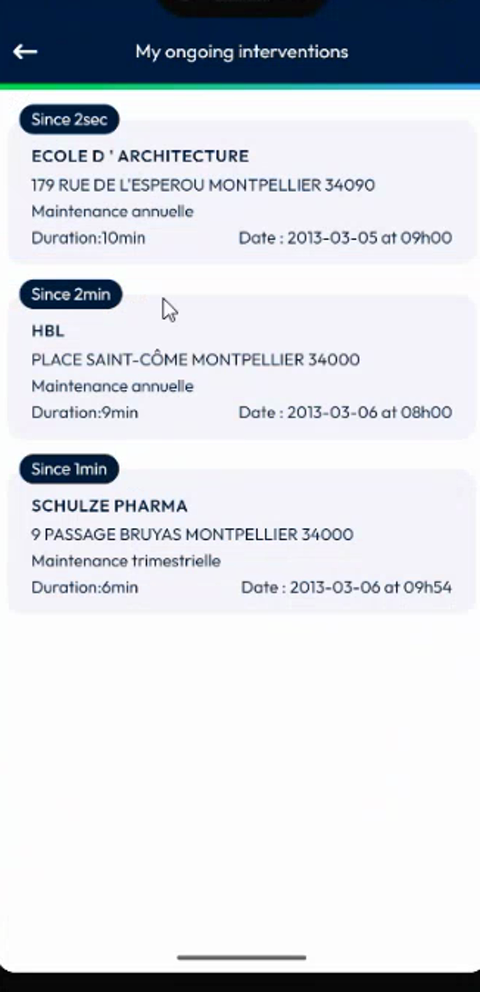
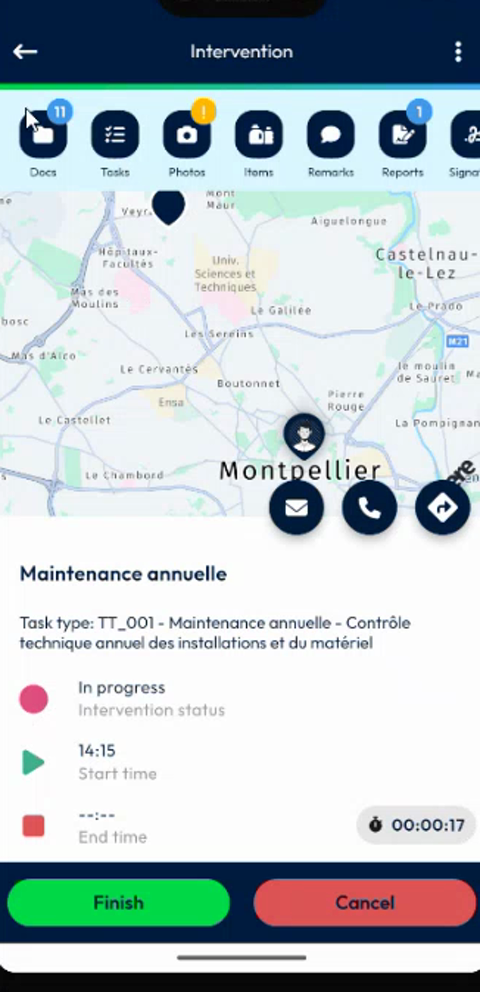

# View Your Ongoing Interventions

## Overview

The dashboard has an **In progress** tab that lists all your ongoing interventions. Before, you had to open the calendar and check each day to find the interventions in progress. Now you see them in one list, and you open any of them in one tap.

The tab is displayed only when at least one intervention is in progress.

## Before you begin

* You are logged in. See [Login](../app-launch/app-launch.md).
* You have started at least one intervention. See [Start an Intervention](../intervention/start-an-intervention.md).

## Check that the tab is displayed

1. On the dashboard, look at the shortcuts under your name.
2. When no intervention is in progress, only **Start** and **Search** are displayed.

<figure><figcaption>
Dashboard when no intervention is in progress
</figcaption></figure>

3. Start an intervention. The message **Intervention started successfully** is displayed.

<figure><figcaption>
Intervention started
</figcaption></figure>

4. Go back to the dashboard. The **In progress** tab is now displayed next to **Search**.

<figure><figcaption>
Dashboard with the In progress tab
</figcaption></figure>

## Open the list of ongoing interventions

1. On the dashboard, tap **In progress**.
2. The **My ongoing interventions** page lists each intervention that you have started.

<figure><figcaption>
My ongoing interventions
</figcaption></figure>

Each intervention is displayed in a card that shows:

* How long ago you started it, for example **Since 48sec**.
* The customer name, for example **HBL**.
* The customer address.
* The task type, for example **Maintenance annuelle**.
* The **Duration** of the intervention.
* The **Date** and time at which it is scheduled.

When you start another intervention, it is added to the list.

<figure><figcaption>
Two interventions in progress
</figcaption></figure>

## Understand the order of the list

The interventions are listed in the order of their scheduled date and time. An intervention that was scheduled on a previous day is displayed at the top of the list. In the example, the intervention of 5 March is displayed above the interventions of 6 March.

<figure><figcaption>
Interventions sorted by date and time
</figcaption></figure>

## Open an intervention

1. On the **My ongoing interventions** page, tap an intervention.
2. The **Intervention** page opens, as it does from the calendar. You can finish it or cancel it.

<figure><figcaption>
Intervention page
</figcaption></figure>

To return to the dashboard, tap the back arrow at the top left.


An intervention leaves the list when you finish it or cancel it. If the list is empty, the **In progress** tab is hidden.


<!-- REVIEW: the video shows the tab appearing after an intervention is started. Confirm that finishing or cancelling an intervention removes it from the list and hides the tab when none is left, and whether the tab appears for interventions started from another device. -->

## Related topics

* [Dashboard](main-actions.md#list-the-interventions-in-progress)
* [Start an Intervention](../intervention/start-an-intervention.md)
* [Finish an Intervention](../intervention/finish-an-intervention.md)
* [Calendar](calendar.md)
