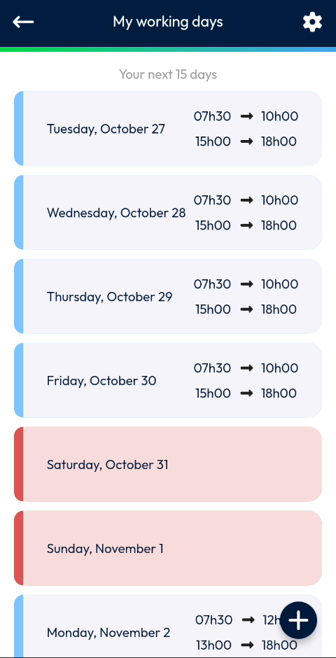

# Menu

Open the menu of NFS Mobile to manage your working hours, read the version note and log out.

## Overview

The menu groups the options that are not part of your daily work screens. It shows your photo, your name and the version of the app, followed by the available options.

<figure><figcaption>
Menu
</figcaption></figure>

| Option | Description |
| ------ | ----------- |
| **Working Hours** | Define the days and hours when you are available. See [Working Hours](working-hours/README.md). |
| **Version note** | Read the notes of the version of the app. |
| **Log out** | Log out of the app. |

<!-- REVIEW: the video does not open Version note or Log out. Confirm what they display and whether Log out asks for a confirmation. -->

## Open the menu

1. In the navigation bar at the bottom of the screen, tap the **Menu** icon (three horizontal lines).
2. The menu opens. The version of the app, for example **Version 1.9.4**, is displayed under your name.
3. Tap an option.

To leave the menu, tap another icon in the navigation bar.

## Related topics

* [Working Hours](working-hours/README.md)
* [Dashboard](../main-actions/main-actions.md)
