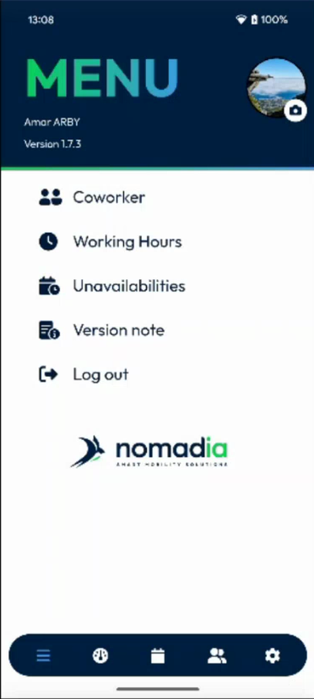
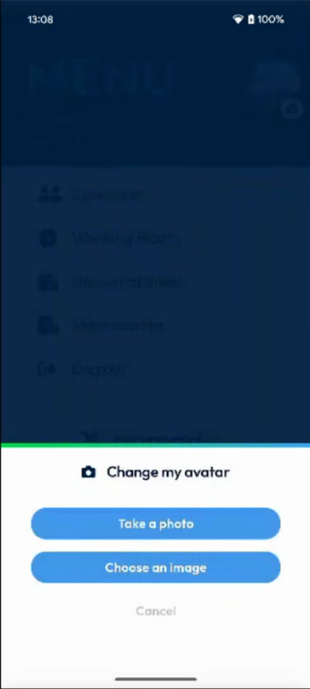
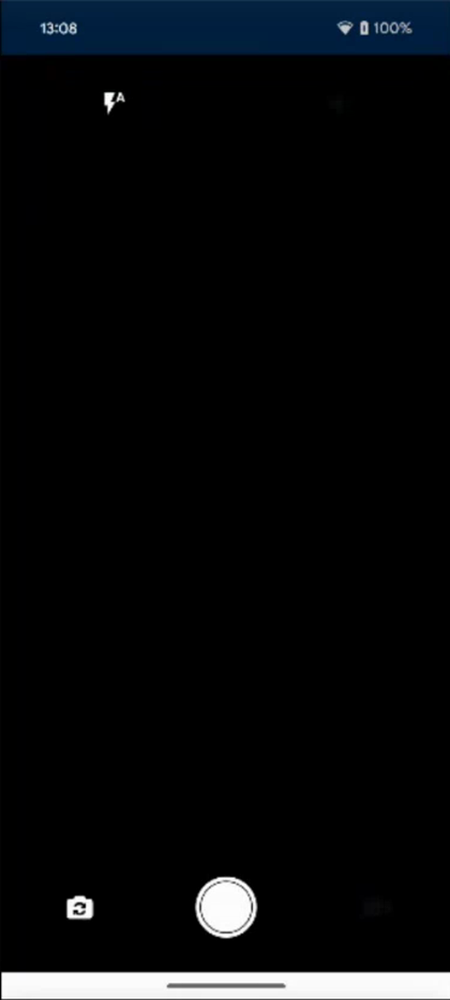
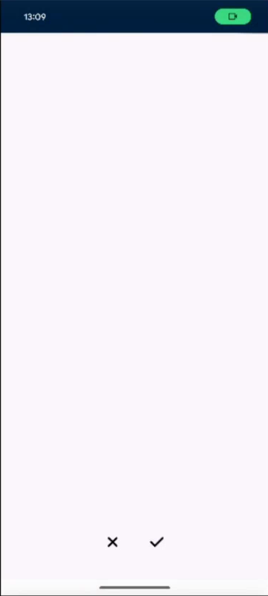
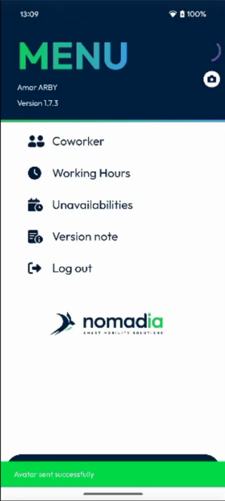
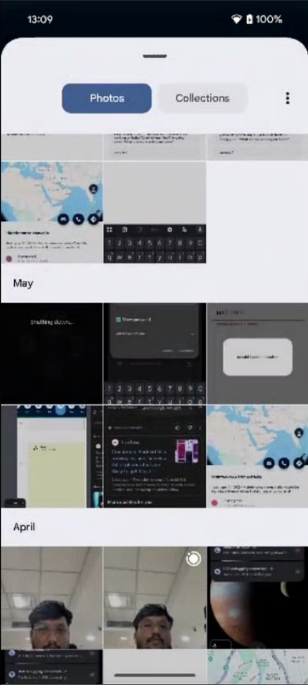
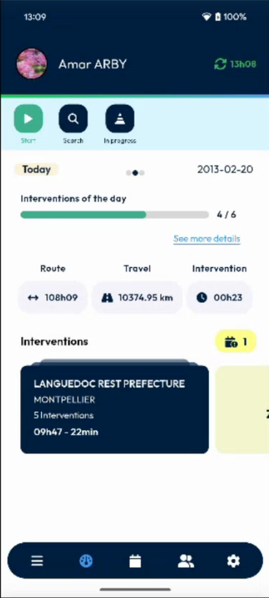
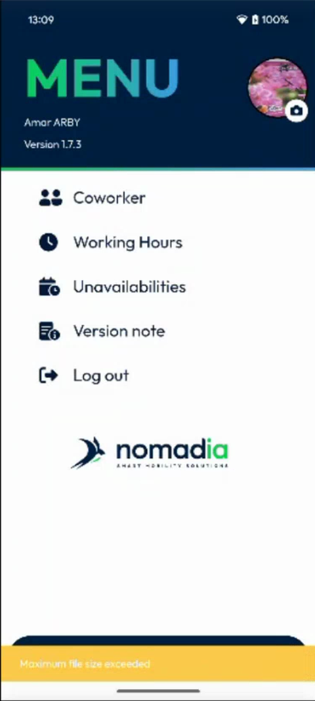
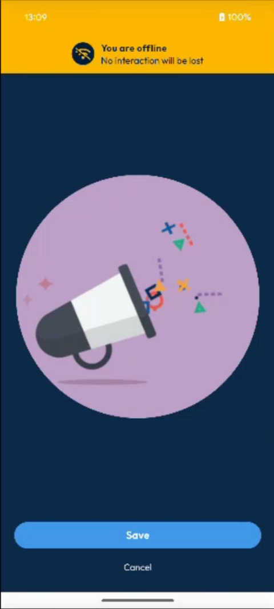
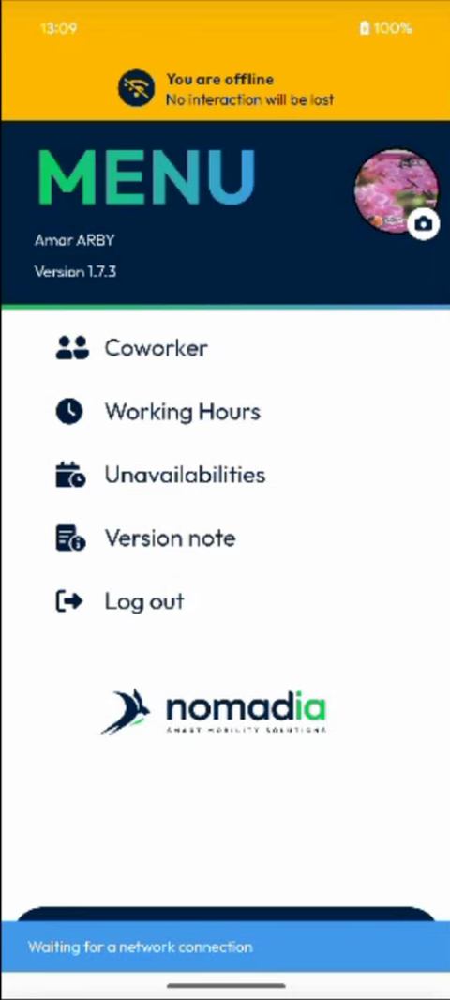

# Change My Avatar

Take a photo or choose an image to use as your picture in the app.

## Overview

Your avatar is the round picture at the top right of the **Menu**. It is also displayed on the dashboard. You can change it by taking a photo or by choosing an image from your device. It also works when your device has no network.

## Before you begin

* You are logged in. See [Login](../app-launch/app-launch.md).
* The app is allowed to use the camera and the photos of your device.

## Open the avatar options

1. In the navigation bar at the bottom of the screen, tap the **Menu** icon (three horizontal lines).
2. Tap your avatar, or the small camera icon on it. The two areas work in the same way.

<figure><figcaption>
Menu with the avatar
</figcaption></figure>

3. The **Change my avatar** message opens, with two buttons: **Take a photo** and **Choose an image**. To close it without a change, tap **Cancel**.

<figure><figcaption>
Change my avatar
</figcaption></figure>

## Take a photo

1. Tap **Take a photo**. The camera of your device opens.

<figure><figcaption>
Camera
</figcaption></figure>

2. Take the photo, then tap the check mark to keep it. Tap the cross to take it again.

<figure><figcaption>
Keep or discard the photo
</figcaption></figure>

3. The photo appears in a circle, as it will look. Tap **Save**. To leave without saving, tap **Cancel**.

<figure><figcaption>
Avatar preview
</figcaption></figure>

4. The message **Avatar sent successfully** is displayed. Your new avatar appears in the **Menu**.

<figure><figcaption>
Avatar sent successfully
</figcaption></figure>


The image is shown in a fixed circle. You cannot move or crop it yet. Choose a photo in which you are in the center.


## Choose an image

1. Tap **Choose an image**.
2. Select an image in your gallery. If the app asks for the access to your photos, allow it.

<figure><figcaption>
Gallery
</figcaption></figure>

3. Check the preview, then tap **Save**.

## See your avatar on the dashboard

Your avatar is also displayed at the top left of the dashboard, next to your name.

<figure><figcaption>
Avatar on the dashboard
</figcaption></figure>

## If the image is too large

The back office sets a maximum size for the image. If your image is larger, a message at the bottom of the screen says that the maximum file size is exceeded. Choose a smaller image.

<figure><figcaption>
Maximum file size exceeded
</figcaption></figure>

## Change your avatar offline

You can change your avatar when your device has no network. The app keeps the image and sends it when the network is back.

1. Choose an image, then tap **Save**. The preview of the new image is displayed.

<figure><figcaption>
Avatar preview when the device is offline
</figcaption></figure>

2. The message **Waiting for a network connection** is displayed.

<figure><figcaption>
Waiting for a network connection
</figcaption></figure>

3. When the network is back, synchronize your data. See [Refresh Your Data](../main-actions/refresh-your-data.md). The avatar is updated.

<!-- REVIEW: the team plans to add a crop of the image, a message that gives the maximum size of the image (for example 5 MB), and a clearer offline message. Update this page when they are done. Confirm the setting of the back office that sets the maximum size, and when the avatar of an offline change is sent to NFS. -->

## Related topics

* [Menu](README.md)
* [Refresh Your Data](../main-actions/refresh-your-data.md)
* [Dashboard](../main-actions/main-actions.md)
