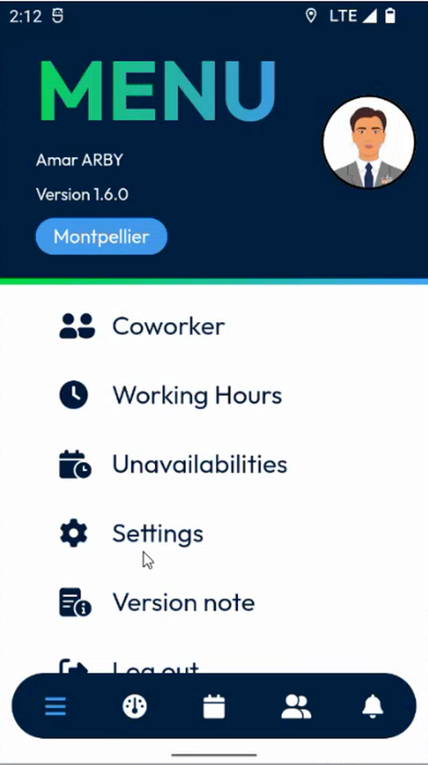

# Coworkers

See where your coworkers are, and control whether your own position is shared.

## Overview

NFS Mobile can show the positions of your coworkers on a map, so that you can organize your work with your team. Your position is shared in the same way, unless you turn on the **Privacy mode**.

This section covers:

| Topic | Description |
| ----- | ----------- |
| [View Your Coworkers](view-your-coworkers.md) | Open the map of your coworkers and read their cards. |
| [Privacy Mode](privacy-mode.md) | Stop sharing your position, and hide the positions of your coworkers. |
| [Send Your Position](send-your-position.md) | Send your current position when the Privacy mode is on. |

## Open the Coworkers page

1. In the navigation bar at the bottom of the screen, tap the **Menu** icon.
2. In the menu, tap **Coworker**.

<figure><figcaption>
Menu with the Coworker option
</figcaption></figure>

The menu shows your photo, your name, the version of the app and your area, for example **Montpellier**. Below them, the options are **Coworker**, **Working Hours**, **Unavailabilities**, **Settings**, **Version note** and **Log out**.

<!-- REVIEW: this screen comes from version 1.6.0 of the app. The other Menu pages were written from version 1.9.4, where only Working Hours, Version note and Log out are shown. Confirm which options are available in the current version, and what Unavailabilities does. -->

## Related topics

* [Menu](../README.md)
* [Settings](../../main-actions/settings.md)
