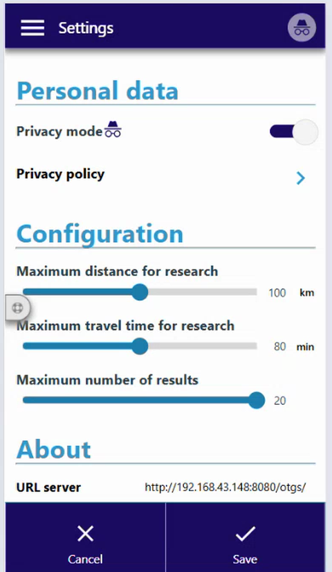
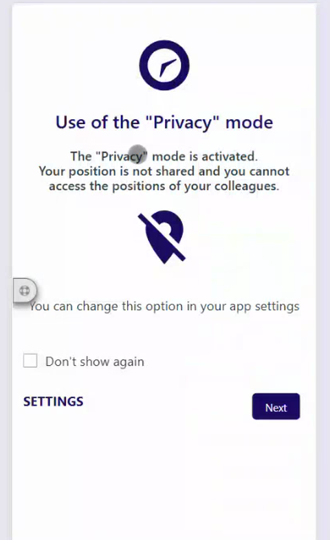
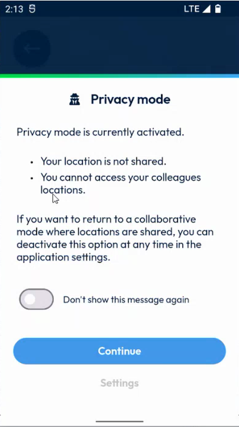
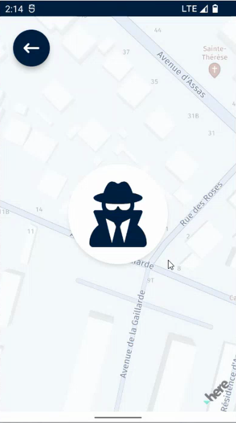

# Privacy Mode

## Overview

The **Privacy mode** protects your privacy. When it is on:

* Your location is not shared.
* You cannot access the locations of your colleagues.

When it is off, the app works in a collaborative mode where locations are shared.

## Turn the Privacy mode on or off

1. In the menu, tap **Settings**. The **Settings** page opens. See [Settings](../../main-actions/settings.md).
2. In **Personal data**, turn on or off the **Privacy mode** switch.

<figure><figcaption>
Privacy mode switch in the settings
</figcaption></figure>

3. Tap **Save** at the bottom right of the screen. To leave without changing the setting, tap **Cancel**.

In the same page, **Privacy policy** gives access to the privacy policy.

## Read the Privacy mode messages

When you turn the Privacy mode on, the app explains what it means.

1. The page **Use of the "Privacy" mode** says that your position is not shared and that you cannot access the positions of your colleagues. To see this page again later, change the option in the settings of the app.

<figure><figcaption>
Use of the Privacy mode page
</figcaption></figure>

2. The page **Privacy mode** says that the Privacy mode is currently activated, with two consequences: your location is not shared and you cannot access your colleagues' locations. It also explains that you can return to the collaborative mode by deactivating the option in the application settings.

<figure><figcaption>
Privacy mode message
</figcaption></figure>

3. To stop seeing this message, turn on **Don't show this message again**.
4. Tap **Continue**. To change the setting, tap **Settings**.

## What you see on the coworkers page

When the Privacy mode is on, the coworkers page does not show the positions of your coworkers. It displays a privacy icon on the map instead.

<figure><figcaption>
Coworkers page with the Privacy mode on
</figcaption></figure>

To send your position once, see [Send Your Position](send-your-position.md).

<!-- REVIEW: the video shows the Privacy mode on and the messages, but not how the switch is turned off again. Confirm whether the Save button is required, and whether other users see you as hidden. -->

## Related topics

* [View Your Coworkers](view-your-coworkers.md)
* [Send Your Position](send-your-position.md)
