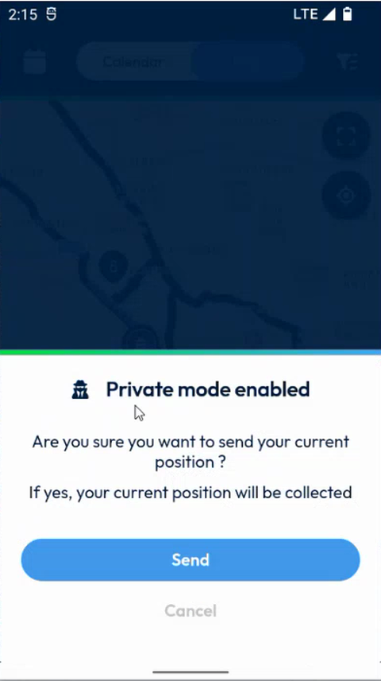
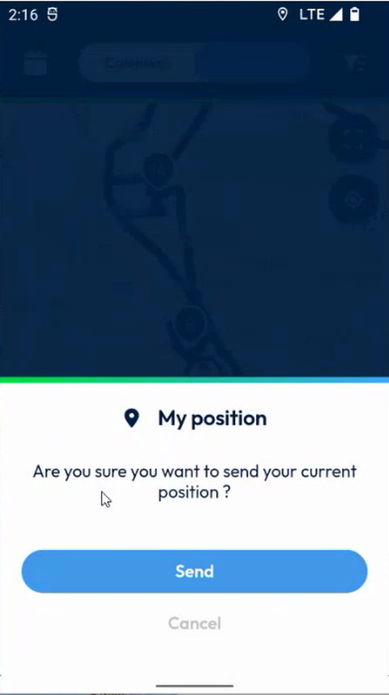

# Send Your Position

Send your current position to your team.

## Overview

When the **Privacy mode** is on, the app does not send your position. You can still send your current position at a given moment, for example when your planner asks where you are. The app asks you to confirm before it sends anything.

## Before you begin

* You are on the map of your interventions or of your coworkers.

## Send your position

1. On the map, tap the button that centers the map on your position.
2. If the Privacy mode is on, the message **Private mode enabled** is displayed. It asks **Are you sure you want to send your current position?** and tells you that your current position will be collected.

<figure><figcaption>
Private mode enabled message
</figcaption></figure>

3. Tap **Send** to send your position. To close the message without sending it, tap **Cancel**.

If the Privacy mode is off, the message is titled **My position** and asks **Are you sure you want to send your current position?**

<figure><figcaption>
My position message
</figcaption></figure>

<!-- REVIEW: the video does not show which button opens these messages, or what happens after Send. Confirm the button, and whether the position is then visible to your coworkers. -->

## Related topics

* [Privacy Mode](privacy-mode.md)
* [View Your Coworkers](view-your-coworkers.md)
