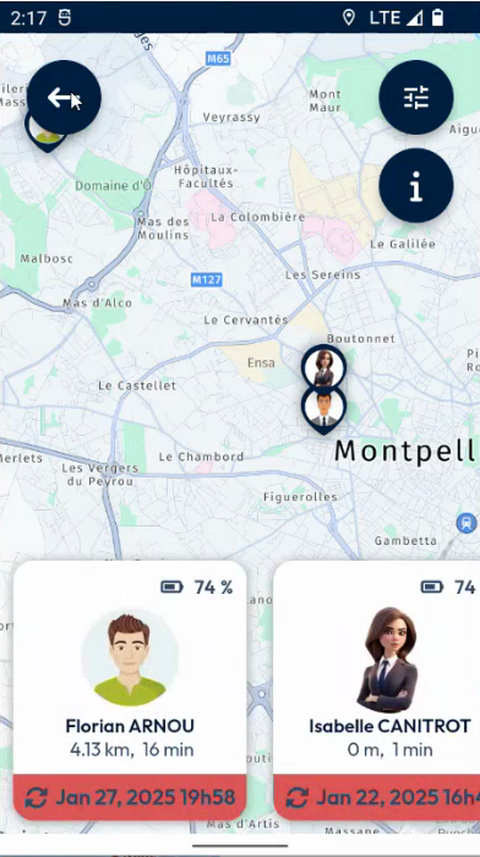

# View Your Coworkers

Open the map of your coworkers and read their cards.

## Overview

The coworkers page shows a map with the position of each coworker, and a card for each of them at the bottom of the screen. You can see at a glance who is nearest to you.

## Before you begin

* The **Privacy mode** is off. When it is on, the page does not display your coworkers. See [Privacy Mode](privacy-mode.md).

## Open the map of your coworkers

1. In the menu, tap **Coworker**. See [Coworkers](README.md#open-the-coworkers-page).
2. Wait while the message **Loading coworkers position – Please wait** is displayed.
3. The map opens, with the position of your coworkers.

<figure><figcaption>
Map of the coworkers
</figcaption></figure>

## Read the coworker cards

At the bottom of the screen, a card is displayed for each coworker. Swipe the cards left or right to see them all. A card shows:

* The photo and the name of the coworker, for example **Florian ARNOU**.
* The battery level of the device of the coworker, for example **74 %**.
* The distance and the travel time between you and the coworker, for example **4.13 km, 16 min**.
* The date and time of the last update of the position of the coworker, for example **Jan 27, 2025 19h58**, in a red label.

The buttons at the top right of the screen are the filter button and the information button. To go back, tap the back arrow at the top left.

<!-- REVIEW: confirm the function of the filter and information buttons, what the red label means (position not up to date?), and what happens when you tap a coworker card. -->

## Related topics

* [Privacy Mode](privacy-mode.md)
* [Coworkers](README.md)
