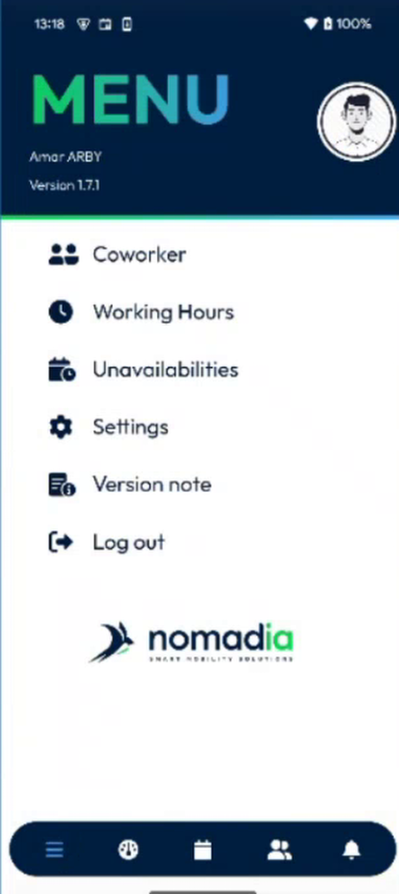
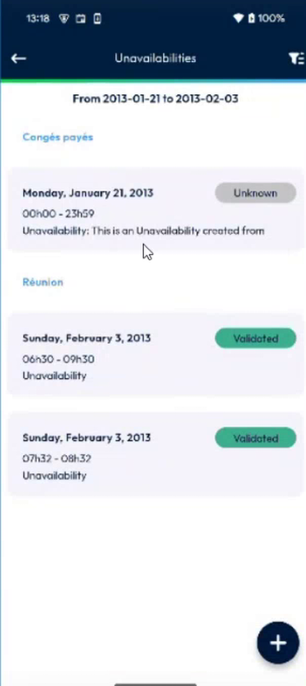

# Unavailabilities

Declare the days and hours when you cannot work, and follow their status.

## Overview

An unavailability is a period when you are not available, for example a leave or a meeting. Your planner sees it, so that no intervention is planned during this period. You manage your unavailabilities from the **Menu**.

This section covers:

| Topic | Description |
| ----- | ----------- |
| [Declare an Unavailability](declare-an-unavailability.md) | Ask for an unavailability, including for a day in the past. |
| [Choose the Unavailability Type by Group](choose-the-unavailability-type-by-group.md) | Pick a group first, then the type. |
| [See Your Unavailabilities in the Agenda](see-unavailabilities-in-the-agenda.md) | Find your unavailabilities in the calendar. |

## Before you begin

* You are logged in. See [Login](../../app-launch/app-launch.md).
* Your administrator allows you to ask for unavailabilities. See [Unavailability Days Setup](../../configuration/unavailability-days-setup.md).

## Open your unavailabilities

1. In the navigation bar at the bottom of the screen, tap the **Menu** icon (three horizontal lines).
2. Tap **Unavailabilities**.

<figure><figcaption>
Menu
</figcaption></figure>

3. The **Unavailabilities** page opens. The top of the page shows the period displayed, for example **From 2013-01-21 to 2013-02-03**.

<figure><figcaption>
List of unavailabilities
</figcaption></figure>

## Read the list

The unavailabilities are grouped by type, for example **Congés payés** and **Réunion**. For each unavailability, the list shows:

* The date, for example **Monday, January 21, 2013**.
* The time range, or **00h00 - 23h59** for a whole day.
* The description.
* The status, at the right.

| Status | Meaning |
| ------ | ------- |
| **Unknown** | The unavailability is not validated yet. |
| **Validated** | Your planner has validated it. |

To go back to the menu, tap the back arrow at the top left.

<!-- REVIEW: confirm the full list of statuses (the Calendar legend lists Requested, Validated and Refused), the meaning of Unknown, and the use of the filter icon at the top right of the page. -->

## Related topics

* [Menu](../README.md)
* [Calendar](../../main-actions/calendar.md)
