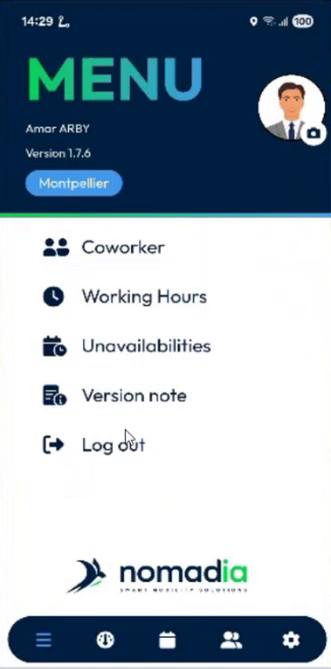
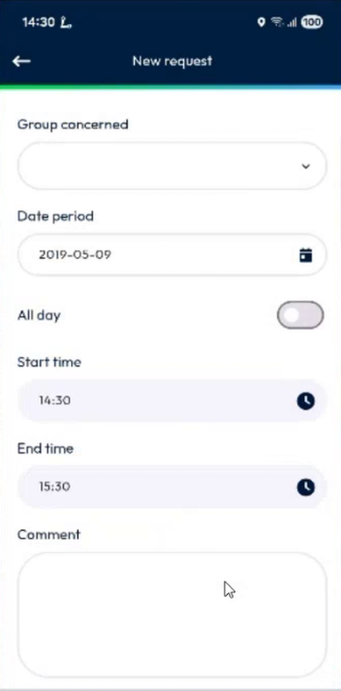
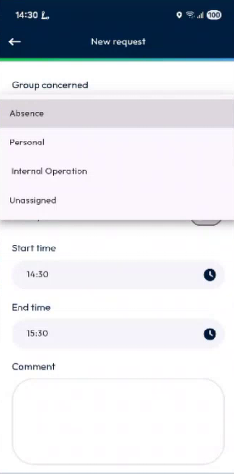
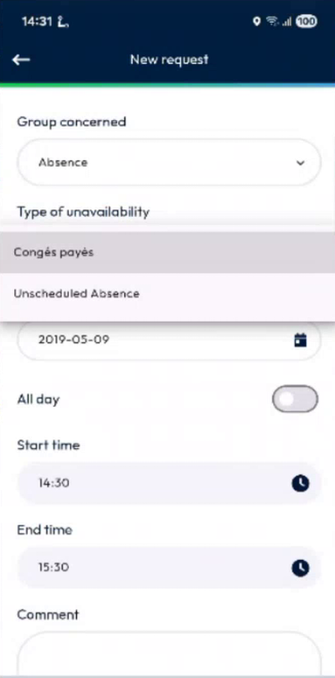
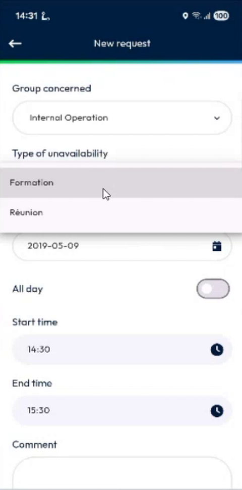
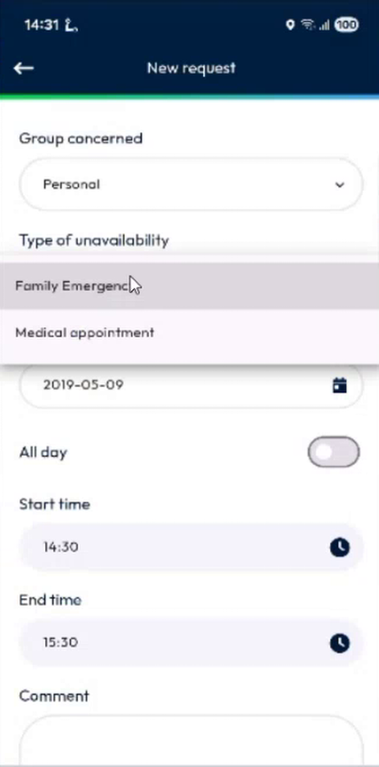
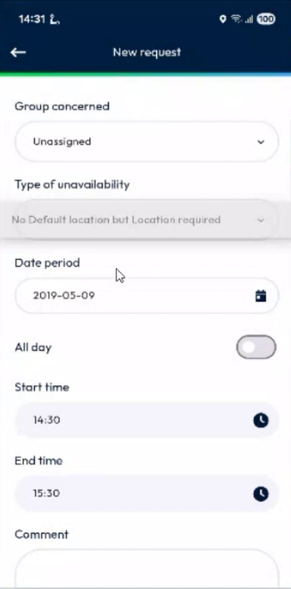
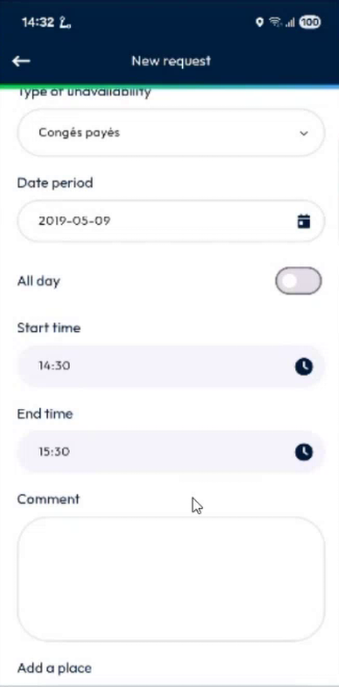
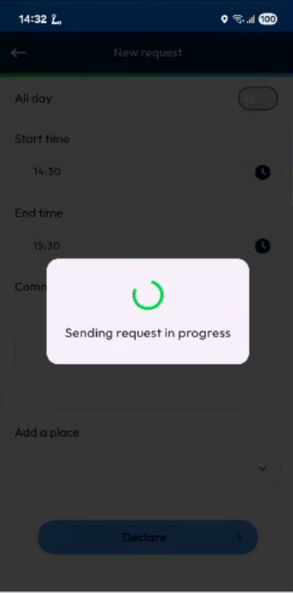
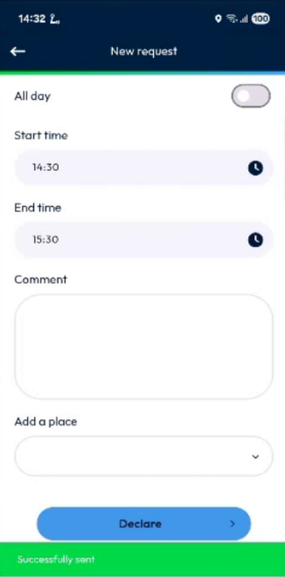

# Choose the Unavailability Type by Group

Find the right type of unavailability faster, by picking its group first.

## Overview

When you declare an unavailability, the list of types can be long. The request form now asks for a **Group concerned** first. The list of types then shows only the types of that group. The groups come from the back office.

## Before you begin

* Your administrator has set the group of each unavailability type. See [Unavailability Groups Setup](../../configuration/unavailability-groups-setup.md).
* You know how to open your unavailabilities. See [Unavailabilities](README.md).

## Declare an unavailability with a group

1. In the navigation bar, tap the **Menu** icon, then tap **Unavailabilities**.

<figure><figcaption>
Menu
</figcaption></figure>

<figure><figcaption>
Unavailabilities page
</figcaption></figure>

2. Tap the plus button at the bottom right. The **New request** page opens.

<figure><figcaption>
New request
</figcaption></figure>

3. Tap **Group concerned**. The list shows the groups, for example **Absence**, **Personal**, **Internal Operation** and **Unassigned**.

<figure><figcaption>
List of groups
</figcaption></figure>

4. Select a group. A **Type of unavailability** field appears under it.
5. Tap **Type of unavailability**. The list shows only the types of the group that you selected.

| Group | Types in the example |
| ----- | -------------------- |
| **Absence** | Congés payés, Unscheduled Absence |
| **Internal Operation** | Formation, Réunion |
| **Personal** | Family Emergency, Medical appointment |
| **Unassigned** | The types that have no group, for example No Default location but Location required, Passage au dépôt and RTT |

<figure><figcaption>
Types of the Absence group
</figcaption></figure>

<figure><figcaption>
Types of the Internal Operation group
</figcaption></figure>

<figure><figcaption>
Types of the Personal group
</figcaption></figure>

<figure><figcaption>
Types of the Unassigned group
</figcaption></figure>

6. Select the type, for example **Congés payés**.
7. Fill in the date, the times and the comment, as described in [Declare an Unavailability](declare-an-unavailability.md).

<figure><figcaption>
Request filled in
</figcaption></figure>

8. Tap **Declare**. Wait for **Sending request in progress**, then **Successfully sent**.

<figure><figcaption>
Sending request in progress
</figcaption></figure>

<figure><figcaption>
Successfully sent
</figcaption></figure>

To change the group, tap **Group concerned** again and select another one. The list of types changes with it, and you must select a type again.


The button is **Declare** for a type that needs no validation. For a type that your planner must validate, the button is **Send request**, and the unavailability is created with the status **Requested**.


<!-- REVIEW: this feature is planned for the next version of the app. Confirm the version, and confirm the label of the button for a type that needs validation. -->

## Related topics

* [Declare an Unavailability](declare-an-unavailability.md)
* [Unavailabilities](README.md)
* [Unavailability Groups Setup](../../configuration/unavailability-groups-setup.md)
