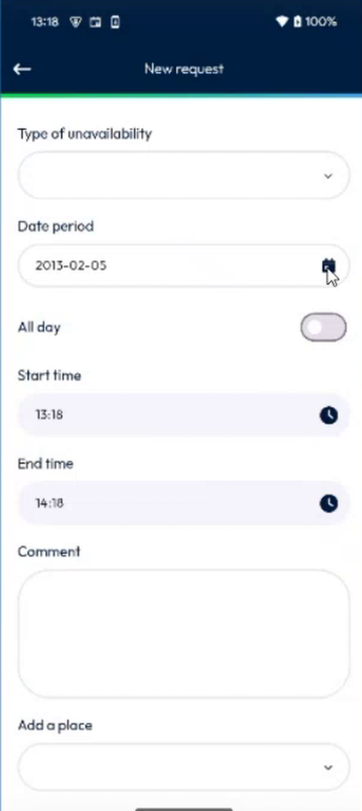
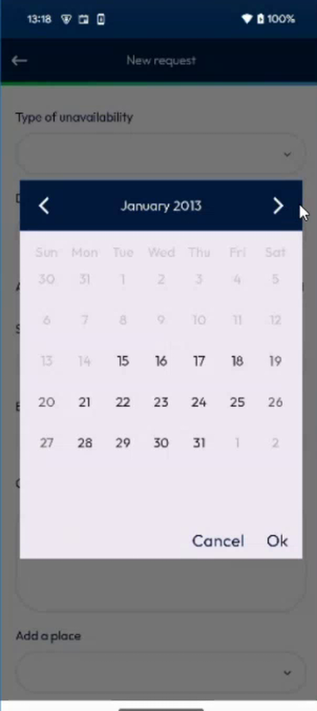
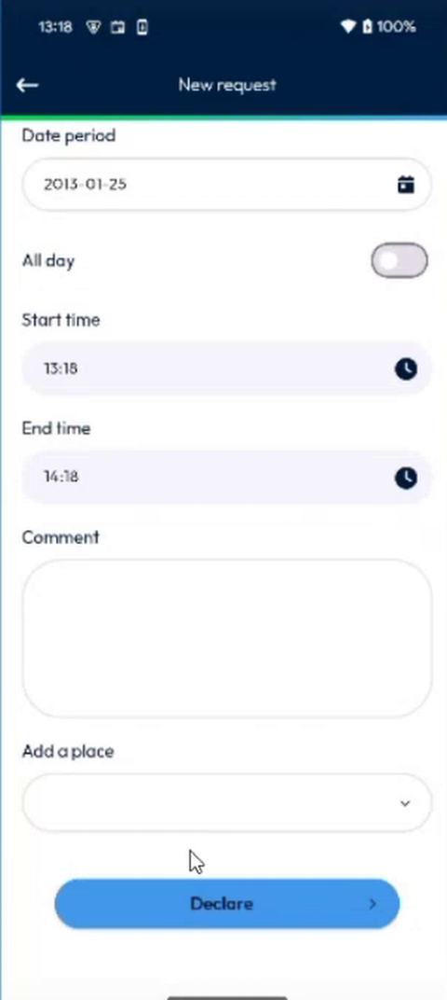
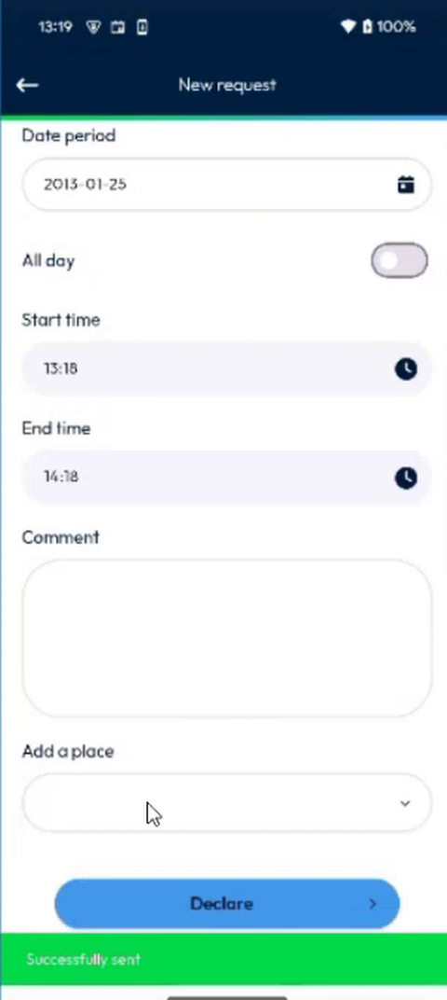
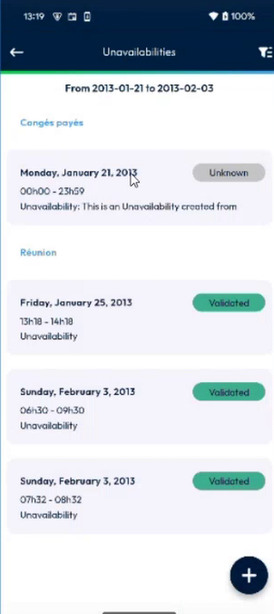
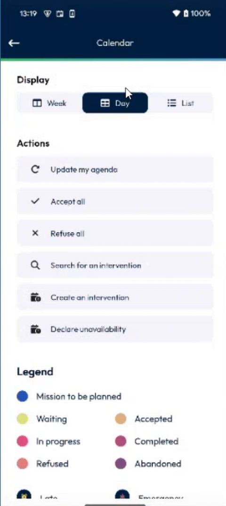

# Declare an Unavailability

Ask for an unavailability, for a day to come or for a day in the past.

## Overview

You can declare an unavailability for today and for the days to come. You can now also declare one for a **past day**. Your administrator decides how many days back you can go. In the example, it is 21 days, so on 5 February you can select a day from 15 January.

## Before you begin

* Your administrator allows you to ask for unavailabilities, and has set the number of past days. See [Unavailability Days Setup](../../configuration/unavailability-days-setup.md).
* Log out and log in again after the administrator changes the setting.

## Declare an unavailability

1. Open your unavailabilities. See [Unavailabilities](README.md#open-your-unavailabilities).
2. Tap the plus button at the bottom right of the page.
3. The **New request** page opens.

<figure><figcaption>
New request page
</figcaption></figure>

4. If your company uses groups, select the **Group concerned** first. See [Choose the Unavailability Type by Group](choose-the-unavailability-type-by-group.md). Then in **Type of unavailability**, select the type, for example the type for a meeting.
5. In **Date period**, tap the calendar icon. The days that you cannot select are grayed out. In the example, the days before 15 January are grayed out.

<figure><figcaption>
Date picker: past days that you can select
</figcaption></figure>

6. Select a day, for example 25 January, then tap **Ok**.
7. To declare the whole day, turn on **All day**. Otherwise, enter the **Start time** and the **End time**.
8. Optional: Enter a **Comment**, and select a place in **Add a place**.

<figure><figcaption>
Request filled in
</figcaption></figure>

9. Tap **Declare**.
10. Wait while **Sending request in progress** is displayed. The message **Successfully sent** is displayed in green.

<figure><figcaption>
Request sent
</figcaption></figure>

## Check the result

1. Go back to the list of unavailabilities. The new unavailability is listed, with its status, for example **Friday, January 25, 2013** with **13h18 - 14h18**.

<figure><figcaption>
New unavailability in the list
</figcaption></figure>

2. In NFS, the unavailability is displayed in the planning on the same day.

## Declare from the calendar

You can also start from the calendar.

1. On the **Calendar** page, tap the options icon at the right of the top bar.
2. In **Actions**, tap **Declare unavailability**.

<figure><figcaption>
Calendar options
</figcaption></figure>


You can declare an unavailability at the same time as an intervention, if your administrator allows it. See [See Your Unavailabilities in the Agenda](see-unavailabilities-in-the-agenda.md).


<!-- REVIEW: the demo selects the type of unavailability but does not show the list of types. Confirm the types, whether the place is mandatory, and the setting that allows an unavailability at the same time as an intervention (the presenter mentions a setting). -->

## Related topics

* [Unavailabilities](README.md)
* [See Your Unavailabilities in the Agenda](see-unavailabilities-in-the-agenda.md)
* [Unavailability Days Setup](../../configuration/unavailability-days-setup.md)
