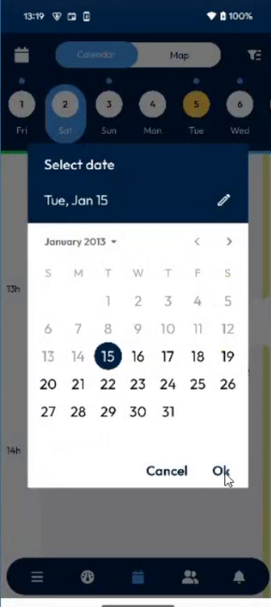
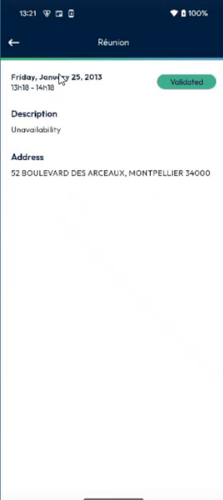
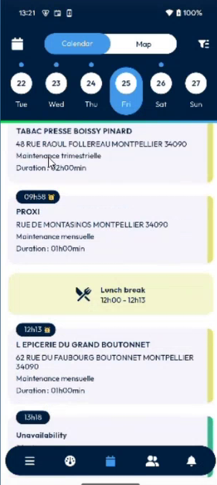

# See Your Unavailabilities in the Agenda

Find your unavailabilities, and your interventions, for the past days that you can display.

## Overview

The calendar now shows the past days up to the limit that your administrator sets. Before, you saw only today, the days to come and yesterday. In the example, the limit is 21 days, so you can display the days from 15 January on 5 February, with their interventions and unavailabilities.

## Before you begin

* Your administrator has set the number of past days. See [Unavailability Days Setup](../../configuration/unavailability-days-setup.md).
* You have logged out and logged in again after the change.

## Go to a past day

1. In the navigation bar, tap the **Calendar** icon.
2. In the top bar, tap the calendar icon at the left.
3. In the **Select date** window, select a day in the past, for example 15 January, then tap **Ok**.

<figure><figcaption>
Select a past date
</figcaption></figure>

The days earlier than the limit are grayed out and cannot be selected.

## Read the agenda of a day

On a day with an unavailability, the agenda shows it in its time slot, between your interventions.

<figure><figcaption>
Day agenda with an unavailability
</figcaption></figure>

* An **Unavailability** card shows the type, for example **Réunion**, the time range and the duration.
* The **Rest** and **Lunch break** cards show the periods when you do not work.

<figure><figcaption>
Unavailability in the agenda
</figcaption></figure>

## Open an unavailability

1. Tap the **Unavailability** card.
2. The details open: the date and time, the status, for example **Validated**, the **Description** and the **Address**.

<figure><figcaption>
Unavailability details
</figcaption></figure>

To go back to the agenda, tap the back arrow.

## Use the list display

In **Calendar options**, you can choose the **List** display. The unavailabilities are shown in the list with the interventions, with a green mark.

<figure><figcaption>
List display with an unavailability
</figcaption></figure>

If an unavailability is at the same time as an intervention, both are displayed.

<!-- REVIEW: confirm how an unavailability and an intervention at the same time are displayed in the Day and Week displays. In the demo, the presenter checked the List display only. -->

## Related topics

* [Calendar](../../main-actions/calendar.md)
* [Declare an Unavailability](declare-an-unavailability.md)
* [Unavailabilities](README.md)
