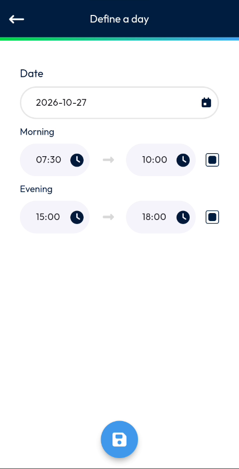
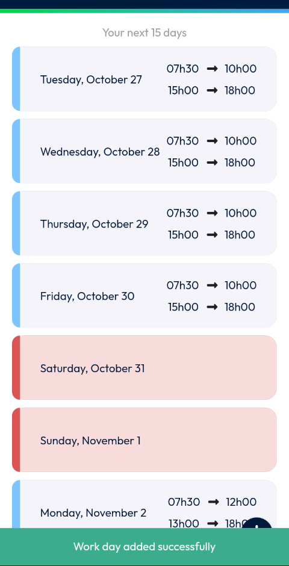
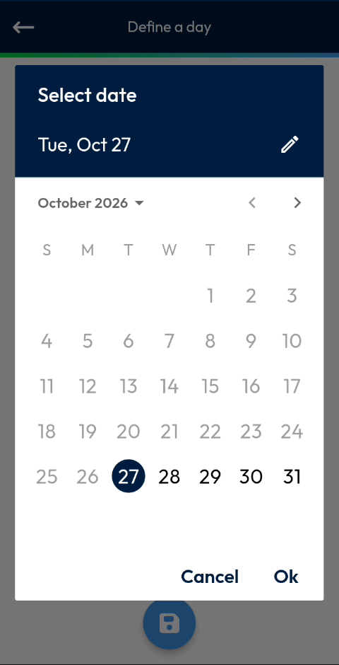
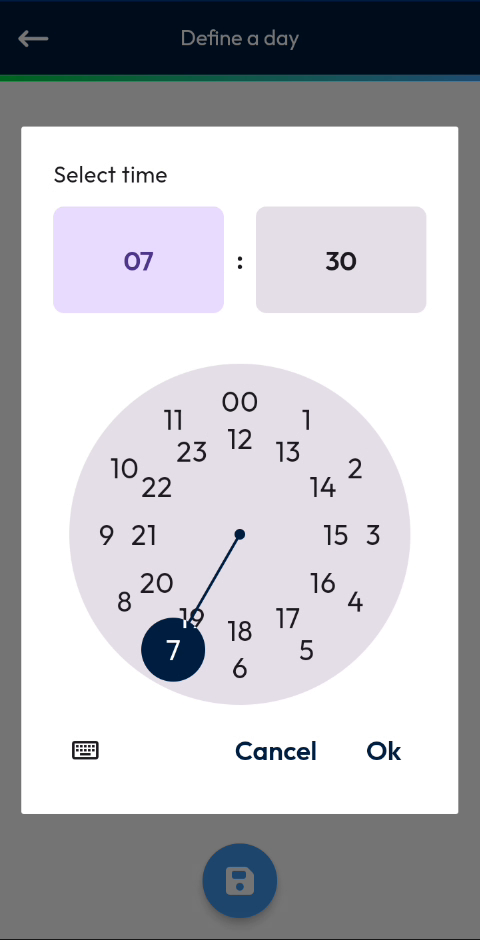

# Add a Working Day

Define the working hours of a day.

## Overview

Add a working day to set the date and the hours of your morning and evening periods. The day then appears in your list of working days.

## Before you begin

* You have opened the **My working days** page. See [Working Hours](README.md#open-the-working-hours-page).

## Add a working day

1. On the **My working days** page, tap the plus button at the bottom right of the screen.
2. The **Define a day** page opens. The date is set to today, and the periods are filled in with default hours.

<figure><figcaption>
Define a day page
</figcaption></figure>

3. In **Date**, tap the field or the calendar icon, then select the date. See [Select the date](#select-the-date).
4. In **Morning**, set the start time and the end time. See [Select a time](#select-a-time).
5. In **Evening**, set the start time and the end time.
6. Tap the blue save button at the bottom of the screen.
7. Wait while the message **Loading Data** is displayed.

The message **Work day added successfully** is displayed, and the day appears in the list.

<figure><figcaption>
Work day added successfully
</figcaption></figure>

## Select the date

1. In **Date**, tap the calendar icon. The **Select date** window opens.
2. Tap a day in the calendar. To change month, tap the arrows next to the month name.
3. Tap **Ok**. To close the window without changing the date, tap **Cancel**.

<figure><figcaption>
Select date window
</figcaption></figure>


To type the date, tap the pencil icon in the **Select date** window, enter the date in **Enter Date**, for example **10/27/2026**, then tap **Ok**.


## Select a time

1. Tap the clock icon next to a time. The **Select time** window opens.
2. Tap the hour on the clock, then the minutes.
3. Tap **Ok**. To close the window without changing the time, tap **Cancel**.

<figure><figcaption>
Select time window
</figcaption></figure>

<!-- REVIEW: confirm the function of the small square icon at the right of each end time, and whether a day that already has working hours is replaced or refused when you add it again. -->

## Related topics

* [View Your Working Days](view-your-working-days.md)
* [Delete a Working Day](delete-a-working-day.md)
