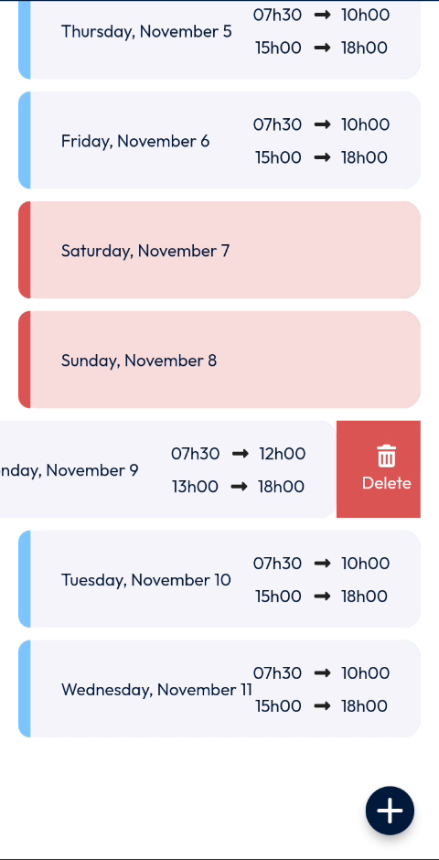
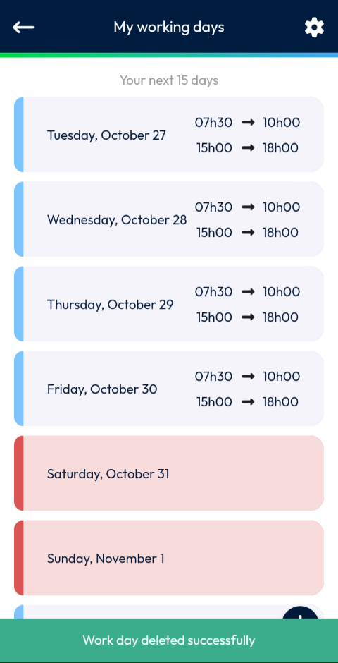

# Delete a Working Day

Remove the working hours of a day.

## Overview

Delete a working day when you no longer work on that date. The day is removed from your list.

## Before you begin

* You have opened the **My working days** page. See [Working Hours](README.md#open-the-working-hours-page).

## Delete a working day

1. On the **My working days** page, find the day to delete.
2. Swipe the day to the left. A red **Delete** button appears at the right of the day.

<figure><figcaption>
Delete button displayed after swiping a day
</figcaption></figure>

3. Tap **Delete**.

The message **Work day deleted successfully** is displayed, and the day is removed from the list.

<figure><figcaption>
Work day deleted successfully
</figcaption></figure>

<!-- REVIEW: the video does not show a confirmation message before the deletion. Confirm whether one is displayed, and what a deleted day looks like in the list (blue day replaced by a red day?). -->

## Related topics

* [View Your Working Days](view-your-working-days.md)
* [Add a Working Day](add-a-working-day.md)
