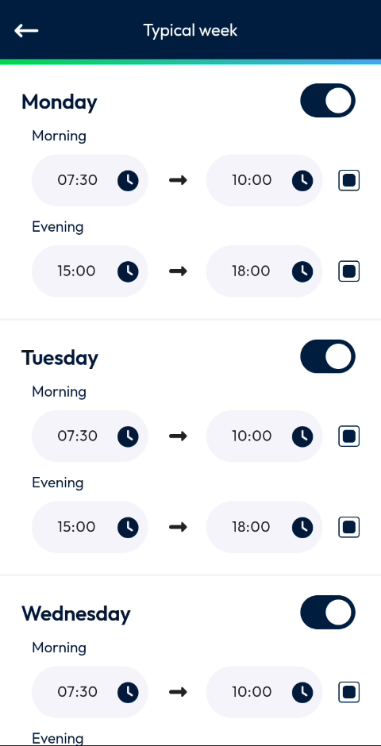

# Set Your Typical Week

Define the hours you usually work on each day of the week.

## Overview

The **Typical week** page sets your usual working hours for each day, from Monday to Sunday. For each day, you turn the day on or off and set a morning period and an evening period.

## Before you begin

* You have opened the **My working days** page. See [Working Hours](README.md#open-the-working-hours-page).

## Open the typical week

1. On the **My working days** page, tap the gear icon at the top right.
2. The **Typical week** page opens.

<figure><figcaption>
Typical week page
</figcaption></figure>

To return to the **My working days** page, tap the back arrow at the top left.

## Read the typical week

For each day of the week, the page shows:

* The name of the day, from **Monday** to **Sunday**.
* A switch at the right of the name. The day is a working day when the switch is turned on.
* The **Morning** period, with a start time and an end time, for example **07:30 → 10:00**.
* The **Evening** period, with a start time and an end time, for example **15:00 → 18:00**.

Scroll down to see all the days.

## Change the typical week

1. Turn the switch of a day on or off.
2. To change a period, tap the clock icon next to a time, then select the time. See [Select a time](add-a-working-day.md#select-a-time).

<!-- REVIEW: the videos only scroll through the Typical week page. Confirm how the changes are saved (save button or automatically), whether the typical week updates the next 15 days automatically, and what the small square icon next to each end time does. Also confirm why Saturday and Sunday are displayed in red in the list of working days although their switch is on here. -->

## Related topics

* [View Your Working Days](view-your-working-days.md)
* [Add a Working Day](add-a-working-day.md)
