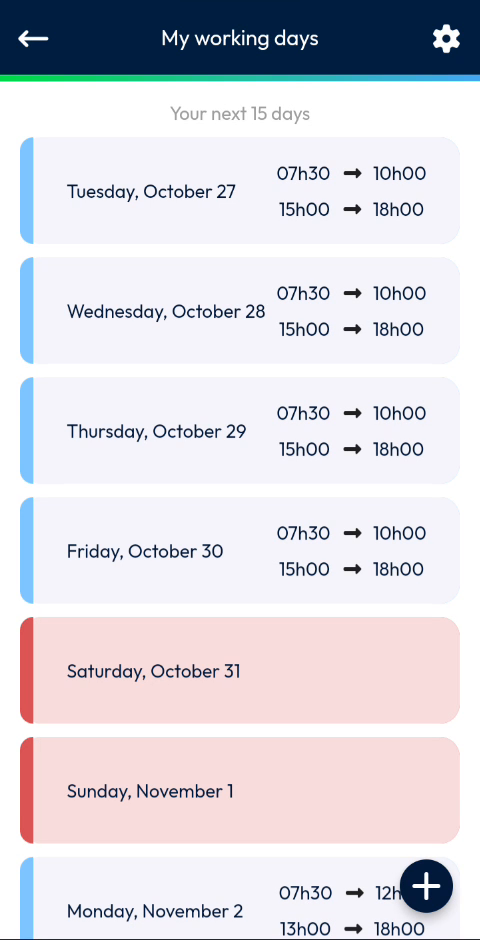

# View Your Working Days

See your working hours for the next 15 days.

## Overview

The **My working days** page lists your working hours day by day. It shows the next 15 days, starting today.

## Before you begin

* You have opened the **My working days** page. See [Working Hours](README.md#open-the-working-hours-page).

## Read the list

1. On the **My working days** page, read the title **Your next 15 days**.
2. Scroll down to see the following days.

<figure><figcaption>
My working days page
</figcaption></figure>

Each day of the list shows:

* The name of the day and its date, for example **Tuesday, October 27**.
* The hours of your morning and evening periods, for example **07h30 → 10h00** and **15h00 → 18h00**.

Days are displayed with two different colors.

| Display | Meaning |
| ------- | ------- |
| A blue bar at the left of the day | A day with working hours. |
| A red day without hours | A day with no working hours, for example **Saturday, October 31** and **Sunday, November 1**. |

<!-- REVIEW: confirm the meaning of the red days (days off, or days without working hours defined) and of the blue bar. -->

## What you can do on this page

* Tap the plus button at the bottom right to [add a working day](add-a-working-day.md).
* Swipe a day to the left to [delete it](delete-a-working-day.md).
* Tap the gear icon at the top right to [set your typical week](typical-week.md).

## Related topics

* [Working Hours](README.md)
